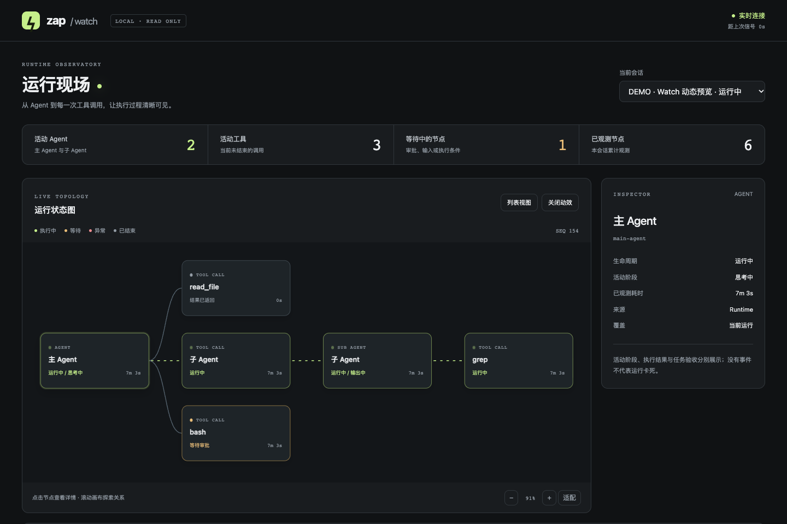
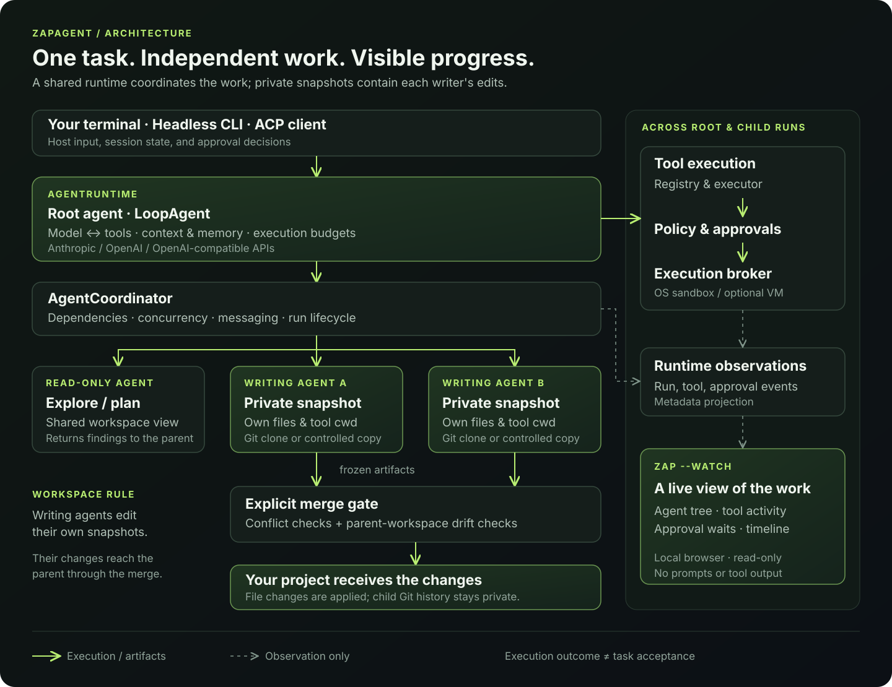

<p align="center">
  
</p>

<h1 align="center">一个任务，一组协作的 agent。</h1>

<p align="center">
  分工并行，隔离修改，实时看见进展。<br />
  开源通用 agent，以及可复用的 TypeScript SDK。
</p>

<p align="center">
  <a href="https://www.npmjs.com/package/zapagent"></a>
  <a href="https://github.com/JackCaow/zapagent/releases"></a>
  <a href="https://github.com/JackCaow/zapagent/actions/workflows/ci.yml"></a>
  <a href="LICENSE"></a>
</p>

<p align="center">
  <a href="#快速开始">快速开始</a> ·
  <a href="#交给-agent-一个任务">协作示例</a> ·
  <a href="#看见任务如何推进">实时可视化</a> ·
  <a href="#它如何工作">架构</a> ·
  <a href="docs/usage.md">文档</a> ·
  <a href="README.md">English</a>
</p>

zapAgent 在终端中理解任务、调用工具并交付结果。用它调研信息、整理文档、分析数据、开发软件，或将多个步骤串成自动化流程。面对复杂任务，协调器可以分派多个子 agent，汇总它们的发现和产物。

- **分工并行。** 将调研、分析、执行、审查拆成独立任务，通过依赖关系和消息组织协作。
- **隔离修改。** 写入型 agent 使用私有工作区快照，非 Git 项目同样适用。先检查产物，再合并；合并时检查冲突和父工作区变化。
- **实时可见。** `zap --watch` 在终端旁打开本地运行视图，展示 agent、工具调用、审批和完成状态。

支持自带模型连接：**Anthropic Messages、OpenAI Chat Completions、OpenAI Responses API** 及兼容服务，接入你现有的文件、工具和工作流。

## 快速开始

安装 [Bun](https://bun.sh) **1.3+** 和 [Git](https://git-scm.com)，然后：

```bash
bun add --global zapagent
cd /path/to/your-workspace
zap --watch
```

进入终端界面后：

1. 用 `/connect` 填入模型服务的 Base URL 和 API Key，选择服务支持的协议。Responses 端点选择 **OpenAI Responses**。
2. 用 `/model` 选择模型；模型支持时，可用 `/effort` 调整推理档位。
3. 描述任务，在终端和本地浏览器中查看进展。

需要使用你自己的模型凭据，调用费用由模型服务商收取。详见[连接配置](docs/usage.md#getting-started)和 [Responses 配置](docs/usage.md#openai-responses-api)。

<details>
<summary>其他安装方式：npm、独立二进制、源码</summary>

**npm 安装**——运行 CLI 仍需安装 Bun 1.3+：

```bash
npm install --global zapagent
zap
```

**独立二进制**可从 [GitHub Releases](https://github.com/JackCaow/zapagent/releases/latest) 下载，附带 SHA-256 校验文件：

| 平台 | 下载 |
| :--- | :--- |
| macOS | [Apple Silicon](https://github.com/JackCaow/zapagent/releases/latest/download/zap-macos-arm64) · [Intel](https://github.com/JackCaow/zapagent/releases/latest/download/zap-macos-x64) |
| Linux | [ARM64](https://github.com/JackCaow/zapagent/releases/latest/download/zap-linux-arm64) · [x64](https://github.com/JackCaow/zapagent/releases/latest/download/zap-linux-x64) |
| Windows | [x64](https://github.com/JackCaow/zapagent/releases/latest/download/zap-windows-x64.exe) |

macOS 二进制使用临时签名，尚未进行 Developer ID 签名或公证。发布内容和校验流程见[发布说明](docs/releasing.md)。

**从源码运行**——仓库固定使用 Bun 1.3.14：

```bash
git clone https://github.com/JackCaow/zapagent.git
cd zapagent
bun install --frozen-lockfile
bun start
```

在源码目录执行 `bun link` 后，可在自己的项目中使用 `zapdev`；也可以执行 `bun run build`，使用 `dist/zap`。

</details>

## 交给 agent 一个任务

从一个需要多方协作的任务开始：

```text
阅读当前目录的资料，整理一份项目评估报告。
把独立部分交给子 agent：梳理项目背景、分析风险、审查结论与依据。
汇总为 report.md，引用资料来源，标明信息缺口。
将报告合并回我的工作区之前，先请求审批。
```

协调器管理子 agent 的依赖、并发、消息和生命周期。实际分工由任务和模型决策驱动；独立步骤可以并行，有依赖的步骤等待前置结果。

写入型 agent 在私有工作区中处理文件、编写报告、运行脚本；开发任务也可以安装依赖、运行测试，以及暂存或提交修改，具体受工具权限和平台沙箱约束。合并交付文件修改，不搬运子 agent 的提交历史。详见[工作区隔离](docs/architecture/48-non-git-workspace-isolation.md)。

## 看见任务如何推进



*截图来自真实 Watch 界面，使用内置模拟事件展示，不代表基准测试或一次真实模型任务。*

运行 `zap --watch`，在本地浏览器中跟随 agent 协作关系和工具生命周期：谁在运行、哪个工具正在执行、哪里需要审批，都有对应状态。

Watch **只读**，展示运行元数据，不展示提示词、工具参数或工具输出。刷新页面不会重放工具。本地回环地址包含私有访问令牌，请勿分享。使用 `--watch-no-open` 可以只输出地址，不自动打开浏览器。[Watch 详细说明 →](docs/architecture/57-watch-runtime-observability.md)

## 接入你的工作流

| 你的需求 | zapAgent 提供的能力 |
| :--- | :--- |
| 使用自己的模型服务 | `/connect`、`/model`、`/effort`；支持 Anthropic、Chat Completions 和 Responses 协议。 |
| 持续推进长任务 | 上下文压缩、项目记忆、保存的会话，以及 `/queue` 后续请求队列。 |
| 掌握工具权限 | `/permissions`、限定范围的审批，默认使用宿主 OS 沙箱。[平台边界](docs/architecture/39-local-sandbox-default.md)。 |
| 回到之前的工作 | `/rewind` 恢复对话、已跟踪的代码修改或两者；外部副作用和部分文件系统变化不在恢复范围内。 |
| 接入现有工具 | 内置文件、搜索、Shell、HTTP 和文档工具，以及 MCP 集成和 skills。 |
| 自动化或构建自己的宿主 | 结构化 Headless 输出、ACP 适配器，以及可复用的 TypeScript SDK。 |

配置模型服务后，可以接入脚本：

```bash
zap -p "整理当前目录的资料，列出主题、结论与待确认的问题" --output-format json
zap --watch -p "分析当前目录的数据并生成报告" --output-format stream-json --watch-linger 30
```

完整命令、配置、审批和自动化选项见 `zap --help-headless` 与 [CLI 手册](docs/usage.md)。

## 它如何工作



宿主通过 `AgentRuntime` 发起任务，`LoopAgent` 管理模型与工具循环、上下文和执行预算。协调器组织子任务；写入型 agent 返回冻结产物，经过冲突和工作区漂移检查后合并。运行事件驱动 Watch。执行成功与任务验收分别记录，验收需要显式评估器或人工审查。

| 模块 | 职责 |
| :--- | :--- |
| [`src/`](src/) | 终端交互、模型配置、会话、Headless/ACP 宿主和 Watch。 |
| [`zapsdk/`](zapsdk/) | TypeScript agent 运行时：模型循环、协作、工具、权限、工作区、合并、上下文、记忆与事件。 |
| [`zapvm/`](zapvm/) | 独立 Go 执行运行时；可选 VM 通过 SDK 协议接入，不负责 agent 提示词、权限或完成判定。 |

Git 项目使用工作树快照的私有克隆，包含符合规则的未提交修改；非 Git 项目使用受控复制快照。只读 agent 可以共享父工作区视图。

实现细节见[架构索引](docs/architecture/README.md)与[多 agent 设计](docs/architecture/26-multi-agent-orchestration.md)。

## 参与贡献

欢迎改进模型兼容性、沙箱行为、多 agent 协作和运行可视化。反馈问题时，请附上预期行为与最小复现，并移除凭据和私有代码。

```bash
bun run typecheck
bun test
bun run build
```

修改独立 VM 模块时使用 `bun run check:vm`；`bun run build:all` 构建两部分宿主组件。详见 [CONTRIBUTING.md](CONTRIBUTING.md)、[Issues](https://github.com/JackCaow/zapagent/issues) 和 [SECURITY.md](SECURITY.md)。

## 许可证

CLI 与 SDK：[MIT](LICENSE)。独立 VM 模块：[Apache-2.0](zapvm/LICENSE)。另见[第三方声明](THIRD_PARTY_NOTICES.md)与[配图说明](docs/images/readme/README.md)。
