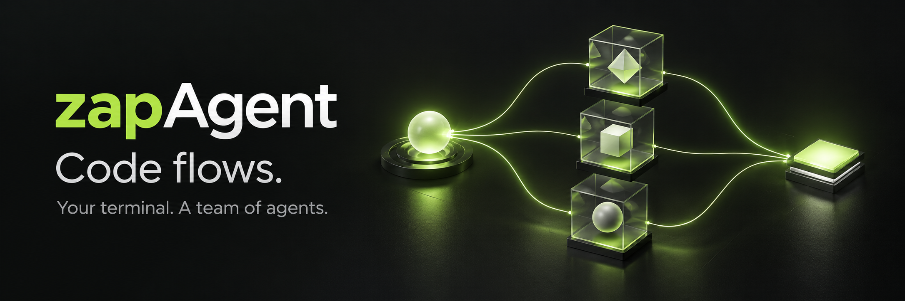

<p align="center">
  
</p>

<h1 align="center">一个任务，一组协作的 agent。</h1>

<p align="center">
  分工协作 · 隔离修改 · 实时可见<br />
  运行在终端中的编程 agent，以及可复用的 TypeScript 运行时。
</p>

<p align="center">
  <a href="#快速开始">快速开始</a> ·
  <a href="#看见任务如何推进">实时可视化</a> ·
  <a href="#agent-如何协作">架构</a> ·
  <a href="docs/usage.md">CLI 手册</a> ·
  <a href="README.md">English</a>
</p>

zapAgent 把 **多 agent 协作、隔离工作区和实时运行图**带进你的终端。让它梳理陌生仓库、拆分独立实现任务，或审查一组改动。写入型 agent 在私有快照里工作，你可以观察过程，再审批将产物合并回项目。

支持 Anthropic Messages、OpenAI Chat Completions、**OpenAI Responses API** 及兼容服务，沿用你现有的编辑器、终端和工具链。

## 让复杂任务有分工，让每份改动有边界

| 多 agent 协作 | 隔离工作区 | 实时可视化 |
| :--- | :--- | :--- |
| 把探索、规划、实现交给子 agent。协调器管理依赖、并发、消息和运行状态。 | 写入型 agent 使用独立工作区，非 Git 项目同样适用。修改收集为产物，经显式合并回到项目。 | `--watch` 打开实时运行图，在终端旁查看模型请求、工具执行、审批和子 agent 状态。 |
| **独立的工作可以一起推进。** | **子 agent 的修改通过合并检查进入项目。** | **看清谁在运行、谁在等待、谁已完成。** |

可以从这样的任务开始：

```text
帮我梳理这个仓库的认证机制。
把独立部分交给子 agent：梳理请求链路、审查会话管理、检查测试覆盖。
汇总它们的发现，再提出修复方案。
将实现产物合并回我的工作区之前，先请求审批。
```

实际分工由任务和模型决策驱动；独立步骤可以并发执行，有依赖的步骤等待前置结果。

## 快速开始

需要 **Git** 和 **[Bun](https://bun.sh) 1.3+**，仓库固定使用 Bun 1.3.14。

```bash
git clone https://github.com/JackCaow/zapagent.git
cd zapagent
bun install --frozen-lockfile
bun start
```

进入终端界面后，使用 `/connect` 配置模型服务，再用 `/model` 选择模型。

在你自己的项目中使用：

```bash
# 在 zapagent 源码目录执行一次。
bun link

# 切换到需要处理的项目。
cd /path/to/your-project
zapdev --watch
```

也可以运行 `bun run build`，使用源码目录下的 `dist/zap` 编译产物。下文以 `zap` 为例，开发命令 `zapdev` 接受相同参数。

> 目前可从源码安装。二进制和 npm 发布流程见[发布说明](docs/releasing.md)，可用版本以 [GitHub Releases](https://github.com/JackCaow/zapagent/releases) 为准。

## 看见任务如何推进

```bash
zap --watch
```

继续在终端里工作，同时在本地浏览器查看 agent、工具和审批如何推进。模型还在生成，工具正在执行，还是子 agent 在等待依赖，都有对应的运行状态。


*截图来自仓库的真实 Watch 界面，使用内置模拟事件进行展示，不代表基准测试或一次真实模型任务。*

- **跟随协作关系：** 主 agent、子 agent 和工具调用保留各自的身份与关联。
- **区分等待原因：** 查看模型活动、工具执行、审批和完成状态。
- **在终端掌握控制权：** Watch 只读；刷新页面不会重放工具或改变任务。
- **只展示运行元数据：** 页面排除提示词、工具参数和工具输出。本地回环地址包含访问令牌，请勿分享。

使用 `--watch-no-open` 可以只输出地址，不自动打开浏览器。事件流与当前边界见 [Watch 架构说明](docs/architecture/57-watch-runtime-observability.md)。

## Agent 如何协作


1. **宿主发起任务。** 终端、Headless CLI 或 ACP 适配器接入 `AgentRuntime`。`LoopAgent` 负责模型与工具循环，同时管理上下文和执行预算。
2. **协调器组织分工。** 子 agent 拥有独立身份、生命周期、依赖和消息通道。独立任务可以在配置的并发额度内同时推进。
3. **写入任务进入隔离工作区。** Git 项目从工作树快照创建私有克隆，包含符合快照规则的未提交修改；非 Git 项目使用受控复制快照。只读 agent 可以共享父工作区视图。
4. **通过产物合并交付修改。** 写入型 agent 生成冻结产物；合并前检查冲突和父工作区是否发生变化。子 agent 的暂存和提交留在私有仓库，合并交付文件修改，不搬运子 agent 的提交历史。
5. **事件流让过程可见。** Watch 观察执行生命周期，不控制任务。运行时区分执行结果与任务验收；任务是否满足要求，需要显式评估器或人工审查。

三个模块各司其职：

| 模块 | 职责 |
| :--- | :--- |
| [`src/`](src/) | 终端交互、模型配置、会话、Headless/ACP 宿主和 Watch。 |
| [`zapsdk/`](zapsdk/) | 可复用的 TypeScript agent 运行时：模型循环、协作、工具、权限、工作区、合并、上下文、记忆与事件。 |
| [`zapvm/`](zapvm/) | 独立 Go 执行运行时。可选 VM 通过 SDK 执行协议接入，不负责 agent 提示词、权限或完成判定。 |

深入阅读：[架构索引](docs/architecture/README.md)、[多 agent 设计](docs/architecture/26-multi-agent-orchestration.md)、[非 Git 工作区隔离](docs/architecture/48-non-git-workspace-isolation.md)。

## 把日常工作串起来

- **自由选择模型。** 连接 Anthropic 或 OpenAI 兼容服务，用 `/model` 切换模型，用 `/effort` 调整受支持的推理设置。
- **持续推进长任务。** 上下文压缩、项目记忆、保存的会话和后续消息队列帮助跨轮次工作。用 `/queue` 追加下一步，或调整当前任务方向。
- **掌握工具权限。** 通过 `/permissions` 查看权限和授权范围。命令默认使用宿主 OS 沙箱，VM 按需启用；平台差异见[执行边界说明](docs/architecture/39-local-sandbox-default.md)。
- **回到之前的工作。** `/rewind` 支持恢复对话、已跟踪的代码修改或两者。恢复点有覆盖范围，外部副作用和所有文件目录结构变化并非都能完整撤销。
- **接入已有工具。** 内置文件、搜索、Shell、HTTP 和文档工具，并支持 MCP 与 skills。
- **构建自己的宿主。** 复用 SDK，通过 Headless 输出结构化事件，或接入兼容 ACP 的客户端。

### 接入脚本

配置模型服务后：

```bash
zap -p "解释这个仓库的架构" --output-format json
zap --watch -p "审查最近的改动" --output-format stream-json --watch-linger 30
```

运行 `zap --help-headless` 查看自动化选项。完整命令、快捷键、环境变量、审批范围和可选 VM 配置见 [CLI 手册](docs/usage.md)。

## 一起改进

欢迎提交可复现的 agent 问题、运行可视化改进、模型服务兼容性修复，以及各平台的沙箱测试。反馈时附上预期行为与最小复现，并移除凭据和私有代码。

```bash
bun run typecheck
bun test
bun run build
```

修改独立 VM 模块时使用 `bun run check:vm`；`bun run build:all` 构建两部分宿主组件。开发流程见 [CONTRIBUTING.md](CONTRIBUTING.md)，漏洞报告方式见 [SECURITY.md](SECURITY.md)。

如果这也是你期待的终端工作方式，欢迎 Star 并参与完善。

## 许可证

CLI 与 SDK：[MIT](LICENSE)。独立 VM 模块：[Apache-2.0](zapvm/LICENSE)。另见[第三方声明](THIRD_PARTY_NOTICES.md)与[配图说明](docs/images/readme/README.md)。
