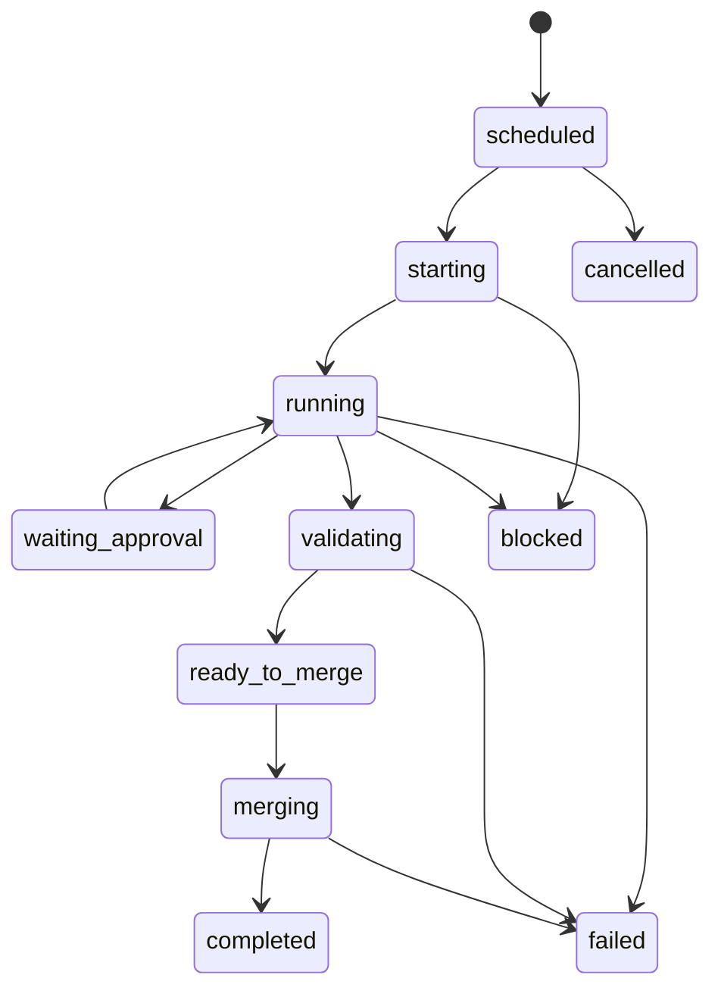
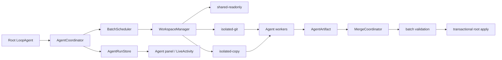

# Multi-agent 编排、隔离与合并设计

本文定义 Zapcode 多 Agent 的目标架构和分阶段落地边界。核心约束是：

> 所有 Agent 可以同时进入生命周期，但只有只读 Agent 可以共享当前工作区；
> 写入型 Agent 必须在隔离工作区执行，根工作区只允许在最终 merge 阶段发生一次事务性变更。

## 实施状态（2026-08-02）

已落地：

- `AgentRunStore` 与 starting/running/waiting_approval/validating/ready_to_merge/merging/blocked 状态；
- streaming/non-streaming 共用 ResourceClaim BatchScheduler；
- general Agent 使用同一批次的 dirty-worktree 私有快照和独立 Git workspace；
- cwd-sensitive Built-in Tool 在隔离 workspace 重建，禁止表面换 cwd、实际写根目录；
- AgentArtifact、批量 3-way 预合并、根目录漂移检测、单次 combined patch apply；
- merge 前根目录不变，冲突时整批不应用，根 checkpoint 在 merge gate 统一建立。

上述为初始实施记录。2026-10-14 补齐非 Git `isolated-copy` 路径：受控文件快照、冻结产物、显式合并、持久化恢复及清理。边界与验收见 [非 Git 工作区隔离](48-non-git-workspace-isolation.md)。

---

## 1. 当前实现与问题

当前 `agent(...)` 是一个长运行 Tool：Tool handler 内部构造子 `LoopAgent`，等待其
完成后再返回 ToolResult。现有实现已经允许 `explore` / `plan` 这类只读调用在
streaming tool executor 中并发，但还不是完整的多 Agent 编排系统。

| 环节 | 当前行为 | 风险 |
|---|---|---|
| 身份关联 | UI 用 `args.task` 匹配 `sub_agent_started` | 同文案并发时可能关联错误 |
| 生命周期 | 只有 started / finished，UI 从日志猜 queued / running | 资源等待、审批等待、合并等待无法区分 |
| 调度 | streaming 分支支持只读并发；非 streaming 分支仍逐个执行 | 同一模型在不同协议下表现不一致 |
| 工作区 | general Agent 继承同一 cwd | 覆盖修改、读取半成品、文件锁竞争 |
| checkpoint | 子 Agent 共享根 executor 的 edit tracking | 并发写入会混入同一 checkpoint |
| 合并 | 没有独立 merge coordinator | 无法统一冲突检测、校验和回滚 |

因此，“把 general 也标成 read-only 以获得并发”不是可接受方案。是否并发是调度
属性，是否可共享工作区是隔离属性，两者必须分开建模。

---

## 2. 目标模型

### 2.1 AgentRun 是一级实体

每次 Agent 调用创建稳定的 `AgentRun`，不再把日志行当作运行状态的事实来源。

```ts
interface AgentRunSnapshot {
  runId: string
  toolCallId?: string
  parentRunId?: string
  agentType: string
  task: string
  status: AgentRunStatus
  sequence: number
  createdAt: number
  updatedAt: number
  startedAt?: number
  finishedAt?: number
  statusDetail?: string
  success?: boolean
}
```

- `runId`：运行生命周期主键；第一阶段沿用已有 `subagentId`。
- `toolCallId`：宿主生成的 Tool execution identity，禁止模型输入伪造。
- `parentRunId`：支持嵌套 Agent 树。
- `sequence`：同一 run 单调递增；Store 丢弃乱序事件。
- Transcript 是历史记录；`AgentRunStore` 才是当前状态的数据源。

### 2.2 状态机



状态语义：

| 状态 | 含义 |
|---|---|
| `scheduled` | 已创建，等待依赖或并发容量；只有这里可显示 queued |
| `starting` | 正在选择运行模式、创建工作区和装配 executor |
| `running` | 模型或 Tool 正在执行 |
| `waiting_approval` | 已发出审批请求；不是资源排队 |
| `validating` | Agent 已结束，正在执行其工作区校验 |
| `ready_to_merge` | 产物已冻结，等待同批兄弟或 merge gate |
| `merging` | MergeCoordinator 正在预检或应用 |
| `blocked` | 缺少外部条件，不能自行推进 |
| `completed / failed / cancelled` | 终态 |

第一阶段只发布能被当前执行链准确观测的 `starting / running /
completed / failed / cancelled / blocked`。其他状态在对应协调器落地前不得伪造。

---

## 3. 组件边界



建议模块：

```text
zapsdk/agent/orchestration/
  coordinator.ts
  scheduler.ts
  run-store.ts
  types.ts
zapsdk/workspace/
  manager.ts
  shadow-git.ts
  worktree.ts
  copy-sandbox.ts
zapsdk/merge/
  coordinator.ts
  merge-tree.ts
  apply-transaction.ts
src/ui/
  agent-panel.tsx
  agent-status.ts
```

第一阶段为降低迁移成本，`run-state.ts` / `run-store.ts` 先放在
`zapsdk/agent/`；协调器出现后再机械迁移到 `orchestration/`。

---

## 4. 调度与工作区选择

所有 AgentRun 在一个 batch 内同时创建为 `scheduled`，随后由 Scheduler 独立推进。

```ts
type WorkspaceMode = "shared-readonly" | "isolated-git" | "isolated-copy"
```

选择规则：

1. 工具能力可证明只读：使用 `shared-readonly`，共享当前工作区快照。
2. Git 仓库且写入型：使用 `isolated-git`，每个 run 独立 worktree、branch、index。
3. 非 Git 项目或 Git 可执行文件缺失：使用 `isolated-copy`，通过受控目录快照运行。Git 权限、损坏或其他运行错误继续报告原始失败，不静默切换。
4. 无法建立隔离：进入 `blocked`，不能退化为共享写入。

只读 Agent 共享的是“启动时可见的根工作区”。写入 Agent 只能读自己的隔离空间，
不会看到兄弟 Agent 的半成品。网络、MCP、系统资源仍需单独 sandbox/permission
策略；Git worktree 本身不是安全沙箱。

### Dirty workspace

直接从 `HEAD` 创建 worktree 会丢失根目录未提交修改，不能作为一致快照。建议创建
私有 shadow Git store：

1. 在私有 object/index 中记录根工作区启动时快照，不修改根 `.git/index`。
2. 从该 snapshot commit 为每个写入 Agent 创建 worktree。
3. 默认排除 ignored 文件和密钥；通过 `.zap/worktreeinclude` 显式白名单补充。
4. batch 结束清理 worktree、临时 refs 和 shadow store；崩溃后可扫描恢复。

---

## 5. 产物与合并协议

写入 Agent 不直接把文件复制回根目录，而是输出可验证产物：

```ts
interface AgentArtifact {
  runId: string
  workspaceId: string
  baseOid: string
  resultOid: string
  changedPaths: string[]
  diffStat: { additions: number; deletions: number; files: number }
  validation: Array<{ command: string; success: boolean; outputRef?: string }>
}
```

同一批写入 Agent 全部到达 `ready_to_merge` 后才进入批量合并：

1. 冻结每个 result commit 和 changed paths。
2. 使用 `git merge-tree --write-tree` 在私有对象库中逐个预合并。
3. 任意冲突则整批不应用，冲突 Agent 标为 `blocked`，UI 显示冲突文件。
4. 对合并 tree 执行 batch validation。
5. 再次检查根工作区是否相对启动快照漂移。
6. 建立一个根 checkpoint，事务性应用最终 tree。
7. 应用或校验失败则恢复 checkpoint；禁止留下半批修改。

不使用 `git apply --3way` 作为核心方案，因为它可能隐式依赖或修改 index，难以保证
根工作区与现有 checkpoint 的边界。

---

## 6. 权限与审批上下文

审批请求必须携带运行归属，不能只显示 Tool name：

```ts
interface AgentApprovalContext {
  agentRunId: string
  toolCallId: string
  workspaceId: string
  workspacePath: string
  impact: "sandbox-local" | "shared-external" | "integration"
}
```

- `sandbox-local`：只影响 Agent 隔离目录，可按现有规则自动或询问。
- `shared-external`：网络写入、MCP mutation、发消息等共享外部副作用，必须独立审批。
- `integration`：把 batch 结果应用到根工作区，单独 merge gate。

某个 Agent 等待审批时，其他无依赖 Agent 必须继续运行。审批队列只负责 UI 一次展示
一个请求，不能把所有 worker 停住。

---

## 7. UI 规则

UI 订阅 `AgentRunStore`，按 `runId` 渲染；Transcript 日志只负责展开行动历史。

- Header 展示总数和真实状态计数，例如 `4 agents · 2 running · 1 approval · 1 merging`。
- 每行显示状态、任务短名、当前 Tool/等待原因、耗时和工作区模式。
- `queued` 只用于 `scheduled`；不得把 starting、approval 或 merge 等待都叫 queued。
- 超过静默阈值时显示最后进度时间，但不把“模型仍在推理”误报为卡死。
- `Esc twice to stop` 作用域要明确：默认停止整个 batch；单 Agent 取消作为后续交互。

兼容期间，老 session 没有 AgentRun 事件时才回退到日志推断。

---

## 8. 分阶段实施

### Phase 1：身份、事件、Store、UI（本次开始）

- Tool handler 接收宿主 `toolCallId`。
- 发布带 sequence 的 `agent_run_state` 事件。
- `AgentRunStore` 忽略乱序更新并提供订阅快照。
- UI 优先按 `toolCallId` 读取真实状态，保留老日志回退。

### Phase 2：统一调度

- 抽出 BatchScheduler。
- streaming / non-streaming provider 共用相同并发规则和容量限制。
- 明确 dependency、capacity、approval 三种等待原因。

### Phase 3：写入隔离

- WorkspaceManager、shadow snapshot、per-run worktree/copy sandbox。
- 子 Agent 的 cwd、checkpoint、todo、Tool output storage 全部绑定 workspaceId。
- 初期可要求用户手动确认应用，不自动合并。

### Phase 4：协调合并

- AgentArtifact、merge-tree 预检、batch validation。
- 根工作区漂移检查、单 checkpoint、事务性 apply/rollback。

### Phase 5：恢复与运维

- 崩溃恢复、孤儿 worktree 清理、状态持久化。
- 性能和磁盘配额、非 Git 项目策略、单 Agent 重跑和冲突重解。

---

## 9. 验收场景

1. 四个 general Agent 同时进入 starting/running，执行期间根工作区不变。
2. 修改互不相交文件的 Agent 在一次 merge 中完整落地。
3. 修改同一文件冲突时不产生任何根目录半成品。
4. 一个 Agent 等待审批时，其余 Agent 继续推进。
5. 根目录已有 dirty 修改时，Agent 能读到启动快照且合并不覆盖用户修改。
6. 进程崩溃后能识别并清理/恢复孤儿 workspace。
7. rewind 一次撤销整批 merge，而不是撤销某个 Agent 的一部分。
8. streaming 与 non-streaming provider 获得一致的并发状态和结果。

---

## 10. 参考

- [Git worktree](https://git-scm.com/docs/git-worktree.html)
- [Git merge-tree](https://git-scm.com/docs/git-merge-tree.html)
- [Git apply](https://git-scm.com/docs/git-apply)
- [Claude Code worktrees](https://code.claude.com/docs/en/worktrees)
- [Claude Code subagents](https://code.claude.com/docs/en/agents)
- [Claude Code agent teams](https://code.claude.com/docs/en/agent-teams)
- [Introducing the Codex app](https://openai.com/index/introducing-the-codex-app/)
