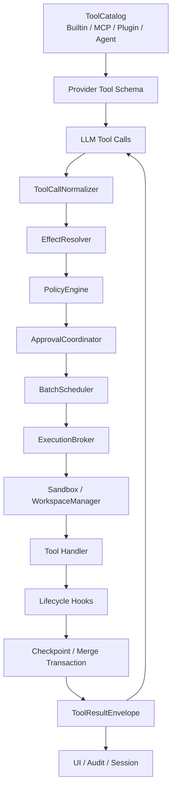

# Tool Runtime 重构设计

状态：**Implemented through Phase 4 foundation (2026-08-02)**
范围：`zapsdk/tools/`、`zapsdk/builtin-tools/`、MCP bridge、Agent Tool、App 权限与审批
实施约束：Legacy Tool 继续通过 compatibility adapter 工作；新能力按 Effect/Policy/Scheduler/Workspace 边界迁移。

当前落地状态：

- Phase 0：HTTP read/mutation 拆分、SSRF/redirect/stream cap、统一路径读取审批、walker/parser Abort/上限、checkpoint coverage UI 已完成。
- Phase 1：`ToolManifest`、结构化 Effect、legacy adapter、MCP annotation 映射已完成；Built-in 继续逐项从 inferred 迁到 declared。
- Phase 2：`DefaultToolPolicyEngine`、每调用 Capability Grant、共享 ApprovalCoordinator 已接入 Executor；App 使用 unknown-effect strict ask。
- Phase 3：streaming/non-streaming 已统一进入 `ToolBatchScheduler`；授权先于资源锁，waiting approval 不占执行容量；unknown 全局独占，路径树冲突与稳定结果顺序已有回归测试。
- Phase 4：写入 Agent 的私有 Git snapshot、隔离 workspace、cwd-sensitive registry 重建和显式 merge gate 已接入 TUI/headless。2026-10-14 增加非 Git `isolated-copy` 后端，权限和 OS sandbox 策略不变，见 [实现边界](48-non-git-workspace-isolation.md)。
- 尚未完成：OS 级 Shell/Network sandbox、崩溃后孤儿 workspace 恢复/清理、完整 ToolResultEnvelope 与批级 rollback。隔离写入 Agent 在 OS sandbox 落地前 fail closed：禁用 Shell/unknown-effect tool，并以 policy + realpath-aware `allowedPaths` 双重限制文件写入。

本文定义 Zapcode 下一代 Tool Runtime。目标不是继续给每个 Tool 增加
`permission`、`readOnly` 等布尔字段，而是把一次调用的真实影响建模为结构化
Effect，再由统一 Policy、Sandbox、Scheduler 和 Transaction 层执行。

---

## 1. 背景与问题

当前 Tool 抽象已经具备统一注册、Zod 参数校验、审批、超时、checkpoint 和流式
并发能力，适合作为迁移基础。但安全与调度信息分散在 ToolDefinition 中：

```ts
interface ToolDefinition {
  permission?: "auto" | "confirm" | "deny"
  timeoutMs?: number
  writesPath?: (args) => string[] | null
  readOnly?: boolean
  isReadOnlyCall?: (args) => boolean
}
```

这套模型存在以下结构性缺口：

1. `readOnly` 只表达调度分类，不能描述文件、网络、进程和外部系统副作用。
2. `permission` 是静态字段，无法正确表达同一 Tool 内 GET 与 DELETE 等不同调用。
3. `writesPath` 只覆盖主动声明路径的文件 Tool，Bash、MCP 和网络 mutation 不在
   同一个事务边界内。
4. 权限判断能拒绝调用，却不能像 OS sandbox 一样强制限制已获准进程。
5. streaming 使用读写屏障，non-streaming 逐个串行，Provider 协议影响执行语义。
6. 子 Agent 的并发分类与工作区隔离尚未完全解耦。
7. timeout 结束 Executor 等待，不代表底层 walker、parser 或子进程已经停止。

典型后果包括：

- `http_fetch` 使用 Auto 权限但支持任意 HTTP method/body；
- `search_files`、`read_pdf` 等读取工具的工作区边界不一致；
- 只读 Bash 字符串白名单无法可靠识别 `env touch`、`sort -o` 等间接写入；
- checkpoint 失败后写入仍可继续，但结果没有暴露“不可 rewind”；
- 多个写入 Agent 不能安全共享根工作区并行。

---

## 2. 设计原则

### 2.1 Tool 描述能力，Runtime 决定是否和如何执行

Tool handler 不负责决定用户是否信任本次调用。它只负责：

- 声明输入 Schema；
- 根据已校验参数解析 Effect；
- 在 Runtime 分配的执行上下文中完成动作；
- 返回结构化结果。

### 2.2 Policy 与 Sandbox 是两个独立层

```text
Policy：这次调用应不应该被允许？
Sandbox：即使允许，这次调用实际上最多能访问什么？
```

审批成功不能自动扩大整个 Agent 或后续 Tool 的权限；扩权必须是本次调用、明确资源、
明确时限的 capability grant。

### 2.3 默认保守，未知 Effect 不并行、不自动执行

- Effect 无法解析：进入 `unknown`，默认需要审批并串行执行。
- 外部 Tool 缺少可信 annotation：默认视为可能产生外部副作用。
- Policy 或 Hook 异常：fail closed。
- Sandbox 不可用且策略要求强隔离：调用失败，不能静默降级。

### 2.4 调度与隔离分开建模

“可以并发”不等于“可以共享工作区”。

- 调度回答何时运行、要等待哪些调用；
- 隔离回答在哪里运行、能访问哪些资源；
- 合并回答结果如何进入根工作区。

### 2.5 一个执行语义，多种 Provider 输入方式

Streaming 和 non-streaming 只负责产生标准化 `ResolvedToolCall[]`，之后必须进入同一个
BatchScheduler。Provider 不应决定工具是并行还是串行。

---

## 3. 目标架构



建议模块边界：

```text
zapsdk/tools/
  manifest.ts
  catalog.ts
  effects.ts
  calls.ts
  results.ts
  hooks.ts
  compatibility.ts
zapsdk/policy/
  engine.ts
  decision.ts
  rules.ts
  capability-grant.ts
zapsdk/scheduler/
  batch-scheduler.ts
  resource-locks.ts
  capacity.ts
zapsdk/execution/
  broker.ts
  limits.ts
  sandbox.ts
zapsdk/workspace/
  manager.ts
  shared-readonly.ts
  worktree.ts
  copy-sandbox.ts
zapsdk/transactions/
  checkpoint.ts
  merge.ts
  audit.ts
```

App 层保留：

```text
src/hooks/usePermissionApproval.ts  # UI 审批交互
src/permissions.ts                  # 用户/项目规则的存储与兼容入口
src/agent-factory.ts                # 组装 Runtime 依赖
src/ui/*                            # 状态、diff、审批、结果展示
```

React/Ink 不进入 `zapsdk`。

---

## 4. Tool Manifest

### 4.1 基础定义

```ts
interface ToolManifest<TInput = unknown> {
  id: ToolId
  source: ToolSource
  description: string
  prompt?: string
  inputSchema: z.ZodType<TInput>
  rawSchema?: Record<string, unknown>
  resolveEffects(input: TInput, context: EffectContext): ToolEffects
  limits?: Partial<ToolResourceLimits>
  execute(input: TInput, context: ToolRuntimeContext): Promise<ToolResult>
}

interface ToolId {
  namespace: "builtin" | "mcp" | "plugin" | "agent"
  name: string
  version?: string
}

interface ToolSource {
  kind: "builtin" | "mcp" | "plugin" | "agent"
  owner?: string
  trust: "first-party" | "configured" | "untrusted"
}
```

Provider-facing名称继续保持兼容：Built-in 使用现有名称，MCP 继续使用
`mcp__<server>__<tool>`。内部审计使用结构化 ToolId，避免安全逻辑依赖字符串拆分。

### 4.2 Effect 模型

```ts
interface ToolEffects {
  filesystem: FileSystemEffect[]
  network: NetworkEffect[]
  process: ProcessEffect[]
  external: ExternalEffect[]
  workspace: WorkspaceEffect
  confidence: "declared" | "inferred" | "unknown"
}

type FileSystemEffect =
  | { operation: "read"; paths: PathScope[] }
  | { operation: "create" | "modify" | "delete"; paths: PathScope[] }

type NetworkEffect =
  | { operation: "connect"; destinations: NetworkScope[] }
  | { operation: "mutate"; destinations: NetworkScope[] }

type ProcessEffect =
  | { operation: "spawn"; commandClass: string; background: boolean }

type ExternalEffect = {
  system: string
  operation: "read" | "mutate" | "destructive"
  resource?: string
}

type WorkspaceEffect =
  | { mode: "none" }
  | { mode: "shared-readonly" }
  | { mode: "isolated-write" }
  | { mode: "root-integration" }
```

Effect 是本次调用级别的数据，不是 Tool 级别的永久标签。

示例：

```ts
// http_request
method === "GET"
  ? network.connect(url)
  : network.mutate(url)

// read_file
filesystem.read(resolvePath(input.path))

// edit_file
filesystem.modify(resolvePath(input.path))

// agent
agent_type === "explore"
  ? workspace.sharedReadonly()
  : workspace.isolatedWrite()
```

### 4.3 资源限制

```ts
interface ToolResourceLimits {
  timeoutMs: number
  maxInputBytes: number
  maxOutputBytes: number
  maxFiles: number
  maxFileBytes: number
  maxDepth: number
  maxNetworkBytes: number
  maxBackgroundOutputBytes: number
}
```

限制分三层合并：

1. Runtime 安全上限；
2. Tool 默认值；
3. 用户或组织策略的更严格覆盖。

任何下层都不能放宽 Runtime 上限。

---

## 5. Policy Engine

### 5.1 输入与输出

```ts
interface PolicyRequest {
  call: ResolvedToolCall
  effects: ToolEffects
  actor: AgentIdentity
  mode: PermissionMode
  workspace: WorkspaceIdentity
  interactive: boolean
}

type PolicyDecision =
  | { decision: "allow"; grant: CapabilityGrant; reason: string }
  | { decision: "ask"; request: ApprovalRequest; reason: string }
  | { decision: "deny"; reason: string }
```

### 5.2 规则匹配维度

规则至少支持：

- ToolId、namespace、source；
- 参数的规范化视图；
- 文件路径与工作区内外；
- HTTP method、目标 host、内网/公网分类；
- external mutation/destructive；
- Agent 类型、runId、workspaceId；
- interactive/headless；
- plan/default/acceptEdits/bypass 模式。

规则采用显式优先级；同优先级时 deny 优先于 ask，ask 优先于 allow。项目配置不能
覆盖管理员 deny。

### 5.3 Capability Grant

审批结果不是简单 boolean，而是一个本次调用的最小授权：

```ts
interface CapabilityGrant {
  callId: string
  expiresAt: number
  filesystem?: {
    read: string[]
    write: string[]
  }
  network?: {
    destinations: string[]
    methods: string[]
  }
  external?: Array<{
    system: string
    operations: string[]
  }>
}
```

Sandbox/Broker 必须消费 Grant；Grant 不得被后续调用复用。用户选择“本会话总是允许”
时，保存的是规则，下一次调用仍需重新计算 Effect 和 Grant。

### 5.4 Tool 可见性

- 永久 deny 且无条件不可用：不发送给模型。
- 根据参数才可能 deny：保留 Schema，在调用时决策。
- 临时不可用：可以从 Schema 中隐藏，或返回带恢复条件的 capability error。

这样可以减少 prompt 体积，并避免模型反复调用当前不可能成功的 Tool。

---

## 6. ExecutionBroker 与隔离

ExecutionBroker 根据 Effect 和 Grant 选择执行环境：

| Effect | 执行环境 |
|---|---|
| 纯内存/时间计算 | 进程内 handler |
| 工作区文件只读 | 受控文件 API 或 read-only sandbox |
| 工作区文件写入 | 当前根工作区事务，或 Agent 隔离 workspace |
| Shell | OS sandbox，子进程继承文件和网络边界 |
| 外部网络读取 | Network policy + SSRF 防护 + 流式字节上限 |
| 外部 mutation | 独立审批 + 目标限制 + 审计 |
| 写入 Agent | worktree/copy sandbox，完成后 merge gate |

### 6.1 文件系统边界

- 解析 canonical path 和最近存在祖先，防止 symlink escape；
- 区分 read roots 与 write roots；
- `.git`、`.zapcode`、凭据目录可作为 protected roots；
- working directory 不能替代访问控制；
- 所有文件 Tool 与 Shell 共享同一 Scope 语义。

### 6.2 网络边界

- 只允许 `http:` / `https:`；
- 解析 DNS 后拒绝 loopback、link-local、private、metadata 地址；
- 每次 redirect 重新验证目标；
- method/body/headers 参与 Policy；
- signed URL、Authorization、Cookie 不得未经允许发送给第三方 Reader；
- 流式读取并在字节上限处取消连接，不能 `response.text()` 后再截断。

### 6.3 Shell

字符串 allowlist 只能作为提示性 Policy，不作为只读安全边界。Shell 的最终边界必须由
OS sandbox/container 强制：

- workspace 只读或限定写根；
- 网络默认关闭或按 host allowlist；
- 清理敏感环境变量；
- 限制 background、PTY、login shell；
- Abort 时终止完整进程树；
- 记录命令、cwd、grant、退出原因和资源用量。

---

## 7. 统一 BatchScheduler

### 7.1 标准输入

Streaming 和 non-streaming 都转换为：

```ts
interface ResolvedToolCall {
  id: string
  name: string
  arguments: Record<string, unknown>
  order: number
  sourceStep: number
}
```

Streaming 可以在参数完整后提前提交某个 call，但执行仍由同一 BatchScheduler 决定。

### 7.2 资源锁

用 ResourceClaim 替换 `readOnly` 布尔值：

```ts
interface ResourceClaim {
  key: string
  mode: "shared" | "exclusive"
}
```

示例：

```text
read_file(src/a.ts)  → shared:fs:/repo/src/a.ts
edit_file(src/a.ts)  → exclusive:fs:/repo/src/a.ts
web_search           → shared:network:search
http POST api/x      → exclusive:external:https://api/x
root merge           → exclusive:workspace:root
```

调度规则：

1. 无冲突的 shared claims 并行；
2. exclusive claim 等待之前冲突的 shared/exclusive；
3. 不相关路径的文件写入可以并行，但根工作区默认仍由事务层决定是否开放；
4. unknown Effect 获取全局 exclusive lock；
5. 审批等待不占执行容量，也不阻塞其他无依赖调用；
6. 保持同一模型 batch 的结果顺序稳定。

### 7.3 状态

```ts
type ToolRunStatus =
  | "resolving"
  | "waiting_policy"
  | "waiting_approval"
  | "waiting_dependency"
  | "waiting_capacity"
  | "starting"
  | "running"
  | "validating"
  | "completed"
  | "failed"
  | "cancelled"
```

UI 不再把所有等待都显示为 queued。

---

## 8. Lifecycle Hooks

```ts
interface ToolLifecycleHooks {
  beforePolicy?(ctx: HookContext): Promise<void>
  afterPolicy?(ctx: HookContext, decision: PolicyDecision): Promise<void>
  beforeExecute?(ctx: GrantedToolContext): Promise<HookDecision>
  onProgress?(event: ToolProgressEvent): void
  afterExecute?(ctx: GrantedToolContext, result: ToolResult): Promise<ToolResult>
  onFailure?(ctx: HookContext, error: ToolFailure): Promise<void>
}
```

`beforeExecute` 可以 deny、ask 或收窄参数，但不能扩大 Capability Grant。
`afterExecute` 可以脱敏和压缩模型可见输出，但必须保留原始审计摘要；它不能撤销已经发生
的副作用。

Hook 超时和异常策略：

- Policy/安全 Hook：fail closed；
- UI/telemetry Hook：fail open，但记录失败；
- checkpoint/transaction Hook：由当前事务策略决定，不能静默吞掉。

---

## 9. Transaction、Checkpoint 与 Merge

### 9.1 Transaction coverage

```ts
type TransactionCoverage =
  | "none"
  | "filesystem-checkpoint"
  | "isolated-workspace"
  | "external-nonreversible"
```

每个结果必须携带 coverage，UI 和 session 都能知道本次操作是否可恢复。

```ts
interface ToolResultEnvelope {
  callId: string
  result: ToolResult
  effects: ToolEffects
  policy: PolicyDecisionSummary
  runtime: RuntimeSummary
  transaction: {
    coverage: TransactionCoverage
    checkpointId?: string
    workspaceId?: string
    mergeId?: string
  }
}
```

### 9.2 根工作区写入

- 文件 Tool：写前 checkpoint 必须成功，或明确进入 non-rewindable 审批；
- 同一模型 batch 可以聚合为一个 checkpoint；
- 部分失败时按 batch policy 决定保留成功结果或整体回滚；默认文件编辑 batch 整体回滚；
- Bash 的任意写入无法准确通过路径预测覆盖，应依赖 sandbox/worktree 或标记 coverage
  不完整。

### 9.3 写入 Agent

沿用 `26-multi-agent-orchestration.md`：

```text
isolated workspace
  → result commit/artifact
  → conflict preflight
  → validation
  → root drift check
  → single root checkpoint
  → transactional apply
```

外部副作用不能通过 worktree 回滚，必须在 Effect、审批和结果里独立展示。

---

## 10. MCP、Plugin 与 Agent Tool

### 10.1 MCP

MCP annotation 只作为 Effect 推断输入，不是无条件信任：

- `readOnlyHint=true`：可推断 external read，但 source trust 仍参与 Policy；
- destructive annotation：强制 destructive Effect；
- annotation 缺失或冲突：confidence=unknown；
- `rawSchema` 原样发给 Provider，但 Server 端校验不能替代 Host Policy；
- 每个 MCP Server 可以设置默认策略和单 Tool 覆盖。

### 10.2 Plugin

Plugin Tool 必须声明 source、版本和 Effect resolver。安装授权与运行授权分离：安装插件
不等于永久允许其所有 Tool 自动执行。

### 10.3 Agent

Agent 继续作为 Tool 暴露，但 handler 只负责创建 AgentRun；WorkspaceManager 和
Scheduler 决定执行位置与并发：

- Explore/Plan：`shared-readonly`；
- General：`isolated-write`；
- 外部 mutation Tool：仍逐次 Policy；
- Agent 完成后返回 Artifact，不直接修改根工作区；
- merge 是独立 `root-integration` Effect。

---

## 11. 兼容层与迁移

现有 Tool 不一次性重写。`compatibility.ts` 将旧 Tool 映射为新 Manifest：

```ts
function adaptLegacyTool(tool: Tool): ToolManifest {
  return {
    // identity/schema/handler 直接复用
    resolveEffects(args) {
      if (tool.definition.writesPath) return inferredFileWrite(...)
      if (tool.definition.readOnly || tool.definition.isReadOnlyCall?.(args)) {
        return inferredReadOnly()
      }
      return unknownEffects()
    },
  }
}
```

兼容推断只能收紧权限，不能因为旧字段缺失而自动放宽。

### Phase 0：立即安全修复

- 拆分只读 HTTP 与 mutation HTTP，补 SSRF/流式限流；
- 修复 Explore Bash 的已知写入绕过；
- 统一 workspace 外读取审批；
- 为 walker/parser/后台进程补 Abort 与资源上限；
- checkpoint 失败向结果和 UI 暴露。

这些修复不等待新 Runtime。

### Phase 1：Manifest + Effect

- 新增类型与 legacy adapter；
- Built-in Tool 逐个补 Effect resolver；
- MCP annotation 映射；
- 保持原 Executor 和 Scheduler 行为。

### Phase 2：PolicyEngine

- 把 `usePermissionApproval` 中的决策逻辑下沉到 SDK PolicyEngine；
- App 只保留 ApprovalCoordinator/UI；
- 兼容现有 session/project/global rules；
- 引入 CapabilityGrant 和结构化审计。

### Phase 3：统一 Scheduler

- streaming/non-streaming 都提交 ResolvedToolCall；
- ResourceClaim 调度替换 writeChain；
- 增加等待原因和容量限制；
- 保持结果顺序和 Turn 原子提交。

### Phase 4：Sandbox + Workspace

- Shell OS sandbox；
- Network policy；
- 写入 Agent worktree/copy isolation；
- Tool output、todo、checkpoint 绑定 workspaceId。

### Phase 5：Transaction + Merge

- ToolResultEnvelope；
- batch checkpoint/rollback；
- MergeCoordinator；
- 崩溃恢复、孤儿 workspace 清理与配额。

---

## 12. 测试与验收

### 12.1 Contract tests

每个 Built-in Tool 必须验证：

- Schema 拒绝非法输入；
- Effect 与参数一致；
- Policy decision 符合路径/网络/模式；
- Abort 后不继续执行；
- 输入、输出、文件数和网络字节上限；
- ToolResultEnvelope 包含完整 provenance。

### 12.2 安全回归

至少覆盖：

1. `env touch`、`sort -o`、可写 Git 子命令不能进入 read-only sandbox；
2. HTTP 拒绝 localhost、private IP、metadata、redirect rebinding；
3. 非 GET 网络调用不能在无 mutation grant 时执行；
4. symlink 不能逃逸 read/write roots；
5. workspace 外 PDF/DOCX/search/glob 按统一 Policy 处理；
6. 大响应、压缩炸弹、灾难性 regex 和无匹配的根目录 glob 可被取消；
7. MCP 错误 annotation 不得覆盖 destructive 事实；
8. Policy/安全 Hook 超时 fail closed。

### 12.3 调度回归

1. 同一路径 read/read 并行；
2. 同一路径 read/write、write/write 串行；
3. 不同隔离 workspace 的写 Agent 并行；
4. waiting approval 不阻塞无关调用；
5. streaming/non-streaming 得到相同开始顺序约束和最终结果顺序；
6. unknown Effect 保守串行；
7. 取消一个 Agent 不误取消兄弟 Agent。

### 12.4 Transaction 回归

1. checkpoint 失败时不静默产生“可 rewind”结果；
2. multi-edit 任一失败不产生部分写入；
3. 多 Agent merge 冲突不修改根目录；
4. 根目录漂移阻止旧 Artifact 应用；
5. 一次 rewind 能撤销整个 merge batch；
6. external mutation 明确标记不可逆。

---

## 13. 决策记录

本文确定以下方向：

1. 使用结构化 Effect，而不是继续扩展 `readOnly` 布尔值。
2. Policy 和 Sandbox 分层，审批不能替代技术隔离。
3. streaming/non-streaming 共用 BatchScheduler。
4. 写入 Agent 必须隔离，不能退化为共享根工作区写入。
5. MCP annotation 是提示，不是完全可信的安全事实。
6. checkpoint coverage 必须进入结果协议和 UI。
7. 永久 deny 的 Tool 应从模型可见工具集中删除。

仍需在实施前确定：

- 首个 OS sandbox 支持 macOS Seatbelt 还是优先复用外部 sandbox runtime；
- ResourceClaim 是否首期只做到文件级，还是直接支持路径树重叠；
- 根工作区普通文件 Tool 是否默认每调用 checkpoint，还是按模型 batch 聚合；
- headless 模式遇到 `ask` 时统一 deny，还是允许注入外部 approval provider。

---

## 14. 参考

- [Claude Code sandbox](https://code.claude.com/docs/en/sandboxing)
- [Claude Code subagents](https://code.claude.com/docs/en/sub-agents)
- [Claude Code hooks](https://code.claude.com/docs/en/hooks)
- [Codex approvals and security](https://learn.chatgpt.com/docs/agent-approvals-security)
- [Codex sandboxing](https://learn.chatgpt.com/docs/sandboxing)
- [Gemini CLI tools](https://github.com/google-gemini/gemini-cli/blob/main/docs/reference/tools.md)
- [Gemini CLI policy engine](https://github.com/google-gemini/gemini-cli/blob/main/docs/reference/policy-engine.md)
- [Gemini CLI sandbox](https://github.com/google-gemini/gemini-cli/blob/main/docs/cli/sandbox.md)
- [OpenCode agents](https://opencode.ai/docs/agents)
- [Cline](https://github.com/cline/cline)
- [Multi-agent orchestration](26-multi-agent-orchestration.md)
