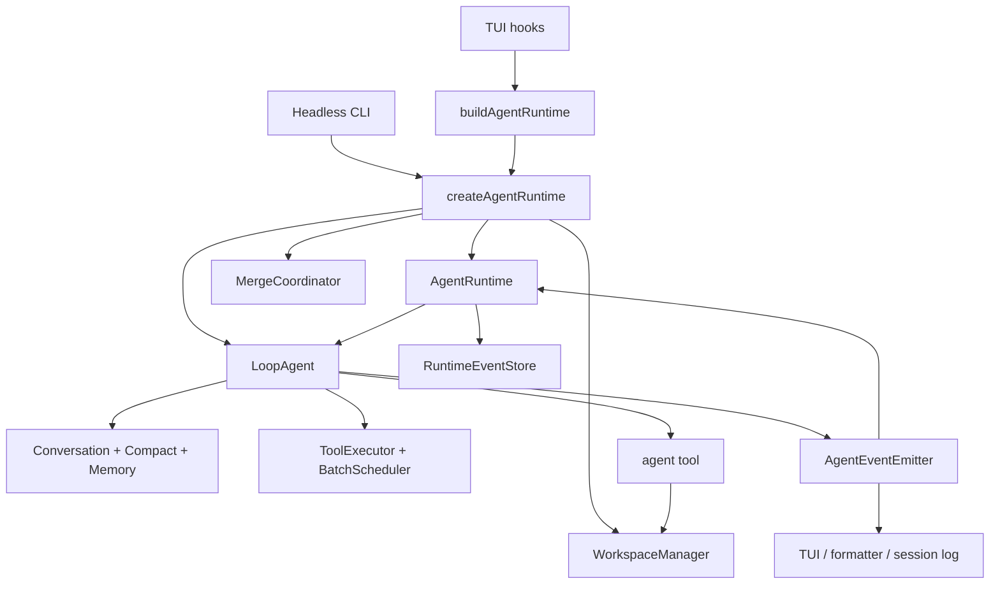
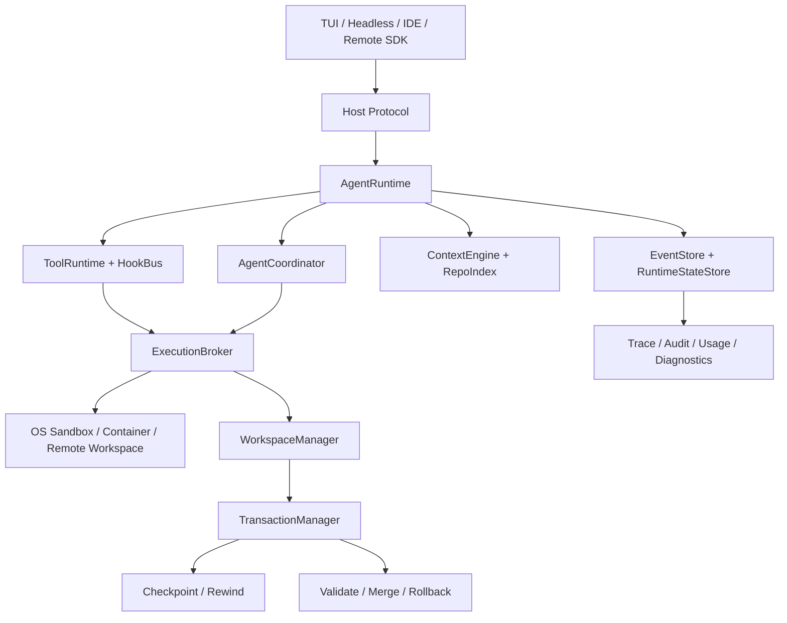

# 生产 Agent Harness：主流实现对标与 Zap 演进设计

状态：**Phase 0–3 + Phase 4A implemented（2026-08-04）**

范围：`zapsdk/agent`、`zapsdk/tools`、`zapsdk/workspace`、`zapsdk/merge`、
`zapsdk/checkpoint`、`src/agent`、`src/headless`、宿主协议

相关文档：[Agent Harness 测试设施](28-agent-harness.md)、
[多 Agent 编排](26-multi-agent-orchestration.md)、
[Tool Runtime 重构](27-tool-runtime-redesign.md)

## 1. 结论

Zap 已经拥有较多生产 Harness 组件，但它们仍围绕 `LoopAgent` 和 TUI/Headless
宿主分别装配。当前形态可以概括为：

> 组件能力较强，统一 Runtime 控制面较弱。

Zap 的相对优势是结构化 Tool Effect、统一资源调度、写 Agent 的 Git 隔离以及带根目录
漂移检测的事务性合并。主要差距不是“再增加几个 Tool”，而是缺少以下系统边界：

1. 一级 `AgentRuntime` 与稳定的 Thread/Turn/Item/Run 协议；
2. Policy 之外的 OS 级执行沙箱；
3. 可持久化、可 steer/resume/cancel 的 Agent 线程；
4. preserved workspace/artifact 的可操作 resume、清理和 UI 恢复中心；
5. 统一生命周期 HookBus；
6. 面向大型仓库的 AST/依赖图 Repo Intelligence；
7. 供 TUI、Headless、IDE 和远程客户端复用的 Host Protocol。

`zapsdk/testing` 解决的是场景回归和故障复现问题，是生产 Harness 的验证设施，不是
生产 Harness 本身。

---

## 2. Harness 的定义与边界

在 coding agent 中，Harness 是包裹模型、把一次模型调用变成可靠软件工程任务的运行时
控制系统：

```text
Agent capability = Model capability + Harness capability
```

生产 Harness 至少负责：

- **Execution loop**：step/turn、停止条件、重试、超时、降级和取消；
- **Context**：system prompt、conversation、memory、compact、cache、repo context；
- **Tool runtime**：发现、schema、effect、policy、approval、调度和结果回填；
- **Isolation**：sandbox、workspace、资源限制和外部副作用边界；
- **Orchestration**：多 Agent 生命周期、任务依赖、消息、并发和汇总；
- **State**：session、checkpoint、rewind、fork、resume 和 crash recovery；
- **Transactions**：validation、merge、rollback 和根工作区集成；
- **Observability**：事件、trace、usage、cache、错误归因和审计；
- **Host protocol**：TUI、Headless、IDE、SDK、远程客户端；
- **Verification**：场景回放、fault injection、trajectory regression 和 eval。

以下内容不混入生产 Harness 核心：

- 具体 TUI 布局与颜色；
- 某个 provider 的私有字段适配；
- 单一业务 Skill 的 prompt 内容；
- 只针对某个测试文件的 mock 工具。

---

## 3. 调研方法

本对标只比较 Harness 架构，不比较模型质量、生成代码风格或商业定价。资料优先级为：

1. 官方公开文档和官方开源仓库；
2. Zap 当前代码；
3. 论文只用于解释公开架构，不用社区测评推断闭源实现。

对标对象：

- **OpenAI Codex**：本地 CLI、桌面 worktree、多 Agent 和 App Server；
- **Claude Code**：permissions、hooks、subagents、agent teams、checkpoint；
- **OpenHands SDK**：Agent/Conversation、Workspace、事件、持久化和 Agent Server；
- **Aider**：Repo Map、Architect/Editor、Git 和自动 lint/test。

强/中/弱仅代表公开架构覆盖程度，不代表最终任务成功率。

---

## 4. Zap 当前生产 Harness

### 4.1 当前装配路径

TUI 每个用户 turn 通过
[`buildAgentRuntime`](../../src/agent/buildAgentRuntime.ts) 注入宿主配置；Headless 也
调用 SDK 的统一 `createAgentRuntime`。`LoopAgent`、`WorkspaceManager` 和
`MergeCoordinator` 只在 RuntimeFactory 内完成生产装配。



这条链路已经消除 TUI/Headless 双装配；UI 仍直接消费兼容 AgentEvent，尚未迁移为纯
RuntimeEvent projector。

### 4.2 已落地能力

| 领域 | 当前实现 | 判断 |
|---|---|---|
| Agent loop | `LoopAgent`，stream/call、重试、budget、force finish | 已具备 |
| Context | auto/micro/reactive compact、memory、cache diagnostics | 较强 |
| Tool policy | ToolEffects、PolicyEngine、Capability Grant | 较强 |
| Tool scheduling | streaming/non-streaming 共用 `ToolBatchScheduler` | 已具备 |
| Multi-agent | Agent tool、共享 budget、AgentRun 状态 | 部分具备 |
| Write isolation | dirty-worktree snapshot、per-run Git workspace | Git 仓库可用 |
| Merge | artifact、冲突预检、根漂移检测、combined patch | 较强 |
| Session | append-only JSONL、恢复、fork | 已具备 |
| Rewind | checkpoint journal、blob、磁盘/对话回退 | 已具备 |
| Observability | AgentEvent、AgentLogger、devtools、usage/cache | 部分具备 |
| Host | TUI、Headless stream JSON | 统一 RuntimeFactory，projection 待统一 |
| Verification | bun tests、memory eval、`zapsdk/testing` | 正在形成 |

### 4.3 结构性缺口

1. `LoopAgent` 同时持有 provider、conversation、compact、budget、tool、subagent 和
   callback，承担了过多 Runtime 责任。
2. AgentRun/ToolRun 已有控制状态快照，但还没有一级 resume/steer/cancel 协议。
3. Workspace lease/artifact 已持久化并分类，仍缺 marker 校验、hydrate、配额和安全清理。
4. 原写 Agent 依赖 Git 的缺口已于 2026-10-14 补齐 `isolated-copy` 后端；真实 Bench 收益仍须单独验证，见 [实现边界](48-non-git-workspace-isolation.md)。
5. Policy 能拒绝操作，但没有 OS sandbox 强制实际访问边界。
6. Hook 仍是 `onApproval`、`postProcess`、`onTrackEdit`、`onRunEnd` 等分散 callback。
7. 没有稳定的外部 Thread/Turn/Item 协议和 app-server。
8. 没有 AST symbol/reference graph 或按任务选择的 Repo Map。

---

## 5. 主流 Agent 对标

### 5.1 总览矩阵

| Harness 维度 | Zap | Codex | Claude Code | OpenHands | Aider |
|---|---|---|---|---|---|
| 统一 Runtime 控制面 | 中偏弱 | 强 | 强 | 很强 | 弱 |
| Tool/Policy 建模 | 强 | 强 | 强 | 强 | 基础 |
| OS 级执行隔离 | 弱 | 强 | 中 | 强 | 弱 |
| 多 Agent 编排 | 中 | 强 | 很强 | 中强 | 弱 |
| 写入隔离与合并 | 强 | 强 | 强 | 中强 | 单 Agent Git |
| Session/恢复 | 中强 | 强 | 强 | 很强 | 中 |
| 生命周期 Hooks | 弱 | 强 | 很强 | 强 | 较弱 |
| 代码库语义索引 | 弱 | 中强 | 中强 | 中 | 很强 |
| 外部宿主/API | 弱 | 很强 | 强 | 很强 | CLI 脚本 |
| 场景回归/Eval | 起步 | 未完整公开 | 未完整公开 | 强 | 强 |

### 5.2 与 Codex 的差距

Codex App Server 使用 `Thread → Turn → Item` 作为稳定协议，支持 thread start/resume/
fork、turn start/steer/interrupt、增量 item 事件和 approval。CLI、IDE 和其他 rich client
可以共享同一后端协议。

Zap 当前没有等价的 Runtime server，因此：

- TUI 和 Headless 直接持有 SDK 对象；
- 无法由另一个客户端 attach 到正在运行的 turn；
- 无法稳定 steer、订阅或恢复单个 Agent thread；
- event schema 没有版本化、连接握手和 backpressure 语义。

Codex 还明确区分 Approval 与 OS Sandbox：approval 决定能否越界，sandbox 强制文件、
网络和进程边界。Zap 目前只有 Policy/Workspace 层，缺少第二道系统强制边界。

多 Agent 方面，Codex 将 subagent 表示为独立 thread，支持 inspect、steer、stop 和汇总。
Zap 的 Agent 仍主要表现为一个长运行 Tool。另一方面，Zap 的 artifact 批量预合并、根
漂移检测和一次 combined patch 应用，是当前应保留的优势。

参考：

- [Codex App Server](https://learn.chatgpt.com/docs/app-server.md)
- [Codex Sandbox](https://learn.chatgpt.com/docs/sandboxing.md)
- [Codex Subagents](https://learn.chatgpt.com/docs/agent-configuration/subagents.md)
- [Codex Worktrees](https://learn.chatgpt.com/docs/environments/git-worktrees.md)

### 5.3 与 Claude Code 的差距

Claude Code 的公开 Harness 优势主要在生命周期扩展和 Agent 组织：

- Hooks 覆盖 Pre/Post Tool、Permission、Stop、Subagent、Task、Config、File change；
- Hook handler 可以是 command、HTTP、MCP、prompt 或 agent；
- Agent Teams 提供 lead、teammate、共享任务列表、依赖自动解锁和 mailbox；
- subagent/agent team 可以使用 worktree 隔离；
- session 支持 resume、branch、compact 和 checkpoint rewind；
- plugin 可组合 skills、agents、hooks、MCP、LSP 和 monitors。

Zap 已有 AgentRun 状态和写隔离，但没有共享 task graph、Agent mailbox、一级 Agent
控制协议和统一 HookBus。Zap rewind 与 Claude checkpoint 范围接近，都需要特别处理
Shell/Bash 引起但未被文件工具声明的变化。

参考：

- [Claude Code Hooks](https://code.claude.com/docs/en/hooks)
- [Parallel agents](https://code.claude.com/docs/en/agents)
- [Agent Teams](https://code.claude.com/docs/en/agent-teams)
- [Subagents](https://code.claude.com/docs/en/sub-agents)
- [Checkpointing](https://code.claude.com/docs/en/checkpointing)
- [Sessions](https://code.claude.com/docs/en/sessions)
- [Plugins](https://code.claude.com/docs/en/plugins)

### 5.4 与 OpenHands 的差距

OpenHands 把 `Conversation` 定义为生命周期和状态协调器，把 `Agent` 设计为基于事件
历史的无状态单步执行器。每个 step 原子化，天然支持 pause/resume。EventLog 还是
persistence、monitoring、stuck detection 和 visualization 的公共集成点。

Workspace 同时抽象 local process、container 和 remote agent-server；更换 Workspace
类型不改变 Conversation API。持久化范围包括事件、执行状态、Agent 配置、工具输出、
统计、activated skills 和 workspace context。

Zap 与其最大的差别是：

- `LoopAgent` 仍持有跨 step 可变状态；
- session log 不是整个 Runtime 的唯一事实来源；
- workspace 没有 local/container/remote 统一接口；
- execution status 与 pending approval 已可崩溃分类，但 loop 还不是可 pause/resume 的原子 step；
- 没有 app/agent-server 级多用户或远程部署边界。

参考：

- [OpenHands Agent](https://docs.openhands.dev/sdk/arch/agent)
- [OpenHands Conversation](https://docs.openhands.dev/sdk/arch/conversation)
- [OpenHands Workspace](https://docs.openhands.dev/sdk/arch/workspace)
- [Conversation persistence](https://docs.openhands.dev/sdk/guides/convo-persistence)
- [Runtime Architecture](https://docs.openhands.dev/openhands/usage/architecture/runtime)
- [Security](https://docs.openhands.dev/sdk/arch/security)

### 5.5 与 Aider 的差距

Aider 的 Runtime、权限和多 Agent 能力弱于 Zap，但它有两个重要的 Harness 设计值得
借鉴：

1. 使用 tree-sitter 构建 symbol/reference graph，再通过图排序在 token budget 内选择
   与当前任务最相关的 repo map；
2. 将 reasoning 和 editing 拆为 Architect/Editor 阶段，并在编辑后自动 lint/test，
   每次修改通过 Git commit 提供简单可靠的 undo。

Zap 当前主要依靠模型主动使用 glob/search/read 发现代码。对于大型仓库，这会增加模型
轮次、重复读取和 context 污染。RepoIndex 应作为 ContextEngine 的确定性输入，而不是
新增一个必须由模型主动调用的普通 Tool。

参考：

- [Aider Repository Map](https://aider.chat/docs/repomap.html)
- [Chat modes / Architect](https://aider.chat/docs/usage/modes.html)
- [Git integration](https://aider.chat/docs/git.html)
- [Linting and testing](https://aider.chat/docs/usage/lint-test.html)

---

## 6. 目标架构



### 6.1 `AgentRuntime`

`AgentRuntime` 是唯一装配入口。TUI、Headless 和未来 app-server 不再直接构造
`LoopAgent`、WorkspaceManager 或 MergeCoordinator。

```ts
interface AgentRuntime {
  startThread(input: StartThreadInput): Promise<ThreadSnapshot>
  resumeThread(threadId: string): Promise<ThreadSnapshot>
  forkThread(threadId: string, throughTurnId?: string): Promise<ThreadSnapshot>
  startTurn(threadId: string, input: TurnInput): Promise<TurnSnapshot>
  steerTurn(threadId: string, turnId: string, input: TurnInput): Promise<void>
  interruptTurn(threadId: string, turnId: string): Promise<void>
  subscribe(filter: EventFilter, listener: RuntimeEventListener): () => void
  close(): Promise<void>
}
```

第一阶段可由 Runtime 内部继续调用 `LoopAgent`，避免一次性重写 reasoning loop。

### 6.2 稳定实体

```text
Thread
└── Turn
    ├── Item (message / tool call / tool result / file change / approval)
    └── AgentRun
        ├── ToolRun
        ├── WorkspaceLease
        └── AgentArtifact
```

- **Thread**：可恢复、可 fork 的长期会话；
- **Turn**：一次用户请求和它触发的完整工作；
- **Item**：宿主可显示和持久化的协议单元；
- **AgentRun**：可独立调度、取消、恢复和观察的 agent 执行；
- **ToolRun**：一次授权、调度和执行记录；
- **WorkspaceLease**：执行位置和强制边界；
- **AgentArtifact**：冻结、可验证、可合并的结果。

### 6.3 事件信封

现有 `AgentEvent` 可作为 payload 迁移，但必须增加稳定身份、排序和版本：

```ts
interface RuntimeEvent<T = RuntimeEventPayload> {
  schemaVersion: 1
  eventId: string
  sequence: number
  timestamp: number
  threadId: string
  turnId?: string
  runId?: string
  parentRunId?: string
  toolRunId?: string
  workspaceId?: string
  payload: T
}
```

不允许 UI 再通过 task 文案或日志顺序推断当前状态。

### 6.4 EventStore 与 RuntimeStateStore

两类数据需要分开：

- **EventStore**：append-only 事实流，用于回放、审计和 UI；
- **RuntimeStateStore**：可原子更新的当前状态，用于 crash recovery 和快速查询。

初期可以保留现有 session JSONL 作为 EventStore adapter；不要为了引入 Runtime 立即
迁移全部历史文件。AgentRun、pending approval、workspace lease、artifact、merge gate
等控制状态应写入独立、原子持久化的 store。

### 6.5 ExecutionBroker

ExecutionBroker 统一承接已通过 Policy 的调用：

```text
Policy: 是否允许执行？
Broker/Sandbox: 实际最多能访问什么？
```

职责包括：

- 为 Tool/Agent 选择 local sandbox、isolated Git/copy 或 remote/container；
- 强制 filesystem、network、process 和 resource limit；
- 管理 signal、timeout、子进程树和后台任务；
- 生成标准 ToolResultEnvelope；
- 记录实际 effect 与声明 effect 的偏差。

### 6.6 AgentCoordinator

Agent 不再只是 Tool handler 内的内部对象。Coordinator 至少提供：

- spawn / steer / wait / cancel / resume；
- parent-child identity；
- shared task graph 与 dependency unblock；
- mailbox 和定向消息；
- 并发容量、预算和优先级；
- foreground/background；
- approval ownership；
- artifact fan-in 和 merge gate。

### 6.7 HookBus

HookBus 使用同一事件定义，建议首批支持：

```text
RuntimeStart / RuntimeStop
ThreadStart / ThreadResume / ThreadFork
TurnStart / TurnStop / TurnFailure
BeforeModel / AfterModel
BeforeTool / PermissionRequest / AfterTool / ToolFailure
AgentStart / AgentStop / AgentBlocked
WorkspaceAcquire / WorkspaceRelease
BeforeValidate / AfterValidate
BeforeMerge / AfterMerge / MergeFailure
BeforeCompact / AfterCompact
```

Hook 需要声明能否阻断、超时、失败策略和可见数据；异步通知 Hook 不得反向修改已经完成
的动作。

### 6.8 RepoIndex

RepoIndex 是 ContextEngine 的确定性数据源：

- tree-sitter/LSP symbol；
- definition/reference；
- import/dependency graph；
- test-to-source 关联；
- git change/ownership 信号；
- 按 query 和 token budget 生成 Repo Map；
- 文件变更后的增量更新。

模型仍可通过 search/read 深挖，但不再从完全空白状态开始理解仓库。

一级 Coordinator、RepoIndex/RepoMap、HostProtocol/App Server 和真实仓库 trajectory
benchmark 的已落地控制面、协议与验收命令见
[Agent Platform Control Plane](33-agent-platform-control-plane.md)。

### 6.9 商业级 trajectory 与缓存验收

单次 Bench 只能证明一条路径可运行，不能证明缓存稳定性。正式候选版本使用至少 100 条
真实 trajectory，并同时覆盖多个仓库、短/长 session、100+ messages、session resume 和
compact 后继续运行。推荐最小分布为 10 条 cold、70 条 warm、20 条 post-compact；任何单一
仓库或单一任务不应主导样本。

报告必须分开呈现三个阶段：

| 阶段 | 含义 | 主要观察项 |
|---|---|---|
| `cold` | 无可复用运行前缀的首次执行 | 首次写入成本、正确性、建立缓存所需 token |
| `warm` | 稳定 system/repo/memory 前缀已存在 | cache hit P50/P10、write churn、任务效率 |
| `post_compact` | compact 后恢复并继续 session | 新摘要是否破坏稳定前缀、resume 正确性 |

正式通过标准：

- trajectory 数量 `>= 100`，仓库数由 corpus 显式设下限；
- warm cache hit 中位数 `>= 90%`，P10 `>= 80%`；
- aggregate token-weighted cache write churn `<= 5%`；
- provider cache accounting coverage `>= 99%`；
- 短/长 session、100+ messages、resume、post-compact 都达到配置的最少样本数；
- 原有 correctness、steps、tool calls、fresh input tokens 门禁继续同时成立。

定义：

```text
cache hit       = cacheRead / (freshInput + cacheRead + cacheWrite)
cache write churn = cacheWrite / (freshInput + cacheRead + cacheWrite)
accounting coverage = 同时回报 fresh/read/write 的 attempts / 全部 attempts
```

`RealRepoCorpusTask.cachePhase` 和 `session` 会传给 subprocess executor；长会话、resume 和
compact 不是纯标签，executor 必须回报 `sessionMessages`、`sessionResumed`、
`compactOccurred` 作为证据。缺失指标按失败或未覆盖处理，不允许从统计分母中静默删除。
provider 未回报的 cache 字段必须保持缺失，不能在 executor 中通过 `?? 0` 伪装成已覆盖。

一个商业候选 corpus 的 thresholds 至少应包含：

```json
{
  "minAttempts": 100,
  "minRepositories": 3,
  "requiredCachePhases": ["cold", "warm", "post_compact"],
  "minWarmCacheHitRateMedian": 0.9,
  "minWarmCacheHitRateP10": 0.8,
  "maxCacheWriteChurnRate": 0.05,
  "minProviderCacheAccountingCoverage": 0.99,
  "minShortSessionAttempts": 1,
  "minLongSessionAttempts": 1,
  "minHundredMessageAttempts": 1,
  "minResumedAttempts": 1,
  "minPostCompactAttempts": 1
}
```

仓库自带的单 task smoke corpus 只验证协议、worktree、grader 和报告链路，不可以作为上述
商业验收报告。完整 100+ provider trajectory 属于有成本的发布验收，应使用冻结的 corpus、
固定模型/provider 配置和独立输出目录执行并归档。

---

## 7. 分阶段实施

### Phase 0：协议与装配统一

目标：不改变 Agent 行为，先消除双装配。

- 新增 `AgentRuntime` facade 和 RuntimeFactory；
- TUI/Headless 改为 Host adapter；
- 定义 Thread/Turn/Item/Run ID；
- `AgentEvent` 包装成版本化 RuntimeEvent；
- 保留 `LoopAgent` 作为内部执行器；
- PR #4 的测试 Harness 覆盖 call/stream 和两个宿主 adapter。

Phase 0A 已落地：`zapsdk/runtime`、统一 `createAgentRuntime`、TUI/Headless 迁移、
版本化 RuntimeEvent 以及项目级 JSONL EventStore。实现细节见
[AgentRuntime 与事件存储](30-agent-runtime.md)。

验收：

- TUI/Headless 使用同一 RuntimeFactory；
- 相同场景产生相同语义事件序列；
- 现有 session 可读；
- 现有 2,000+ 测试和 build 全绿。

### Phase 1：控制状态持久化与恢复

- RuntimeStateStore；
- 持久化 AgentRun、ToolRun、approval、workspace lease、artifact 和 merge state；
- 启动时扫描 interrupted run 和孤儿 workspace；
- 定义 resumable / failed / needs-user / cleanup-only 恢复分类；
- workspace 磁盘配额、保留和安全清理。

验收：在模型执行、工具执行、等待审批、Agent 结束待合并四个位置强杀进程，重启后都能
明确恢复或终止，不丢失根工作区状态。

Phase 1A/1B 已完成原子 RuntimeStateStore、跨进程 writer lease/CAS、owner 存活保护、approval/Tool/workspace/artifact/
merge 生命周期屏障、启动前恢复分类、workspace marker/hydrate、显式 resume/cleanup 和故障点
测试；详见 [RuntimeStateStore 与崩溃恢复](31-runtime-state-recovery.md)。preserved artifact
不会自动执行，必须由宿主显式确认。Phase 2A 已补齐容量配额、TTL、TUI 恢复中心和
ExecutionBroker；详见 [ExecutionBroker、OS Sandbox 与恢复中心](32-execution-sandbox-recovery-center.md)。

### Phase 2：ExecutionBroker 与强制沙箱

Phase 2A 已完成 broker、macOS Seatbelt、Linux bubblewrap adapter、内置 Windows AppContainer
launcher 与 fail-closed 生产装配。细粒度通用进程 egress proxy 留在 2B。

- macOS Seatbelt；
- Linux bubblewrap 或 container；
- Windows restricted token/ACL；
- 非 Git `isolated-copy`（2026-10-14 已实现；文件级冲突检查，不替代 OS sandbox）；
- filesystem/network/process/resource policy 编译；
- 子进程树取消和后台任务归属。

验收：恶意或错误 Tool handler 即使绕过声明，也不能写出 workspace、访问禁止网络或
遗留失控子进程。

### Phase 3：一级多 Agent Coordinator

Phase 3 已完成：一级 AgentRun、容量调度、dependency graph、mailbox、
steer/cancel/resume、审批等待释放容量、写 workspace 隔离和 merge 生命周期已经进入统一
Runtime 生产装配。

- AgentThread persistence；
- spawn/steer/wait/cancel/resume；
- mailbox、task graph、dependency；
- per-agent approval；
- validation command；
- batch merge rollback。

验收：多个写 Agent 在独立 workspace 并行，任一冲突或 validation 失败时根目录不产生
半批修改；其他 Agent 不因一个 Agent 等待审批而停住。

### Phase 4：Hooks、Repo Intelligence 与 Host Protocol

Phase 4A 已完成 RepoIndex/RepoMap、HostProtocol/App Server、RuntimeEvent v2 游标索引和真实仓库
trajectory regression。统一 HookBus、remote/container runtime 和多租户服务治理仍属于 4B。

- HookBus 与插件集成；
- RepoIndex/RepoMap；
- app-server/SDK 协议；
- remote/container runtime；
- trace exporter、trajectory regression 和性能预算。

验收：TUI、Headless 和远程客户端可以连接同一 Runtime；大型仓库场景中首次定位轮次、
重复文件读取和输入 token 相比基线可量化下降。

---

## 8. 迁移原则

1. **先统一协议，不先重写 LoopAgent**：Facade + adapter 后再拆内部状态。
2. **Policy 与 Sandbox 分离**：审批成功不能等于无限执行权限。
3. **Event 是事实，UI 是投影**：状态不能由日志文案反推。
4. **AgentRun 是一级实体**：不能继续只用 ToolResult 表示整个 Agent 生命周期。
5. **根工作区只在事务边界变化**：保留现有 snapshot/drift/combined patch 优势。
6. **兼容现有 session**：通过 adapter 渐进迁移，不批量重写用户历史。
7. **Fail closed**：隔离或状态恢复不可证明时进入 blocked，不退化为共享写入。
8. **每阶段都有 Harness 场景**：实现与故障注入、回放、恢复测试一起提交。

---

## 9. 明确非目标

- 不在 Runtime 重构中顺便替换 Ink/TUI；
- 不把所有 Tool 一次性改写为新 Manifest；
- 不在没有度量前更换 compact/memory 算法；
- 不以“更多并发”为目标牺牲隔离或事务正确性；
- 不把 worktree 当成 OS 安全沙箱；
- 不把测试 Harness 的 API 直接当作生产 Host Protocol。

---

## 10. 建议的下一步

当前控制面闭环后，后续按可独立验收的边界推进：

1. 统一 HookBus，替换分散的 lifecycle callback；
2. RuntimeEvent → session transcript 的单向 projector，并增加 retention/compaction；
3. tree-sitter/LSP reference graph，建立大型仓库 RepoIndex 质量基线；
4. remote/container benchmark runner，隔离未受信任仓库 setup；
5. App Server 的连接握手、背压、多租户认证、TLS termination 和配额。
