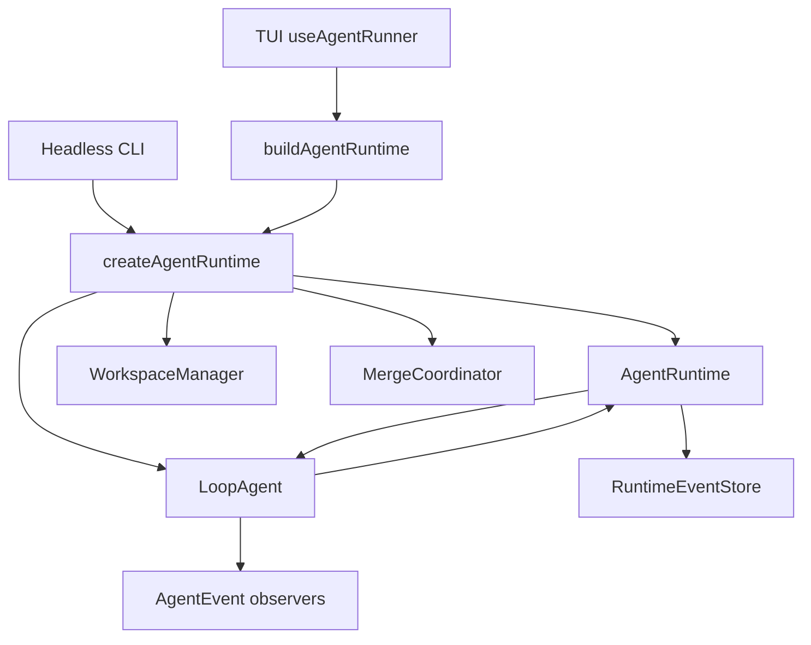

# AgentRuntime 与事件存储

状态：**Phase 0A 已实现（2026-08-02）**

范围：`zapsdk/runtime`、`src/agent/buildAgentRuntime.ts`、
`src/agent/runtimeEventStore.ts`、`src/headless/runHeadless.ts`

上位设计：[生产 Agent Harness 对标与演进设计](29-production-agent-harness-benchmark.md)

## 1. 本阶段结果

Phase 0A 在不重写 `LoopAgent` 的前提下建立了统一 Runtime 边界：

1. `AgentRuntime` 是 TUI、Headless 共同使用的运行入口；
2. `createAgentRuntime` 是生产代码装配 `LoopAgent`、`WorkspaceManager` 和
   `MergeCoordinator` 的唯一工厂；
3. Thread、Turn、Item、Run 使用稳定 ID，不再依赖 task 文案或 UI 日志顺序关联；
4. 原始 `AgentEvent` 被包装为带版本、全局顺序和执行身份的 `RuntimeEvent`；
5. Runtime 事实写入独立的 append-only JSONL EventStore；
6. 原有 AgentEvent API、session JSONL 和 checkpoint 行为保持兼容。

本篇只描述 Phase 0 的事件事实层。后续 Phase 1A 已实现独立 RuntimeStateStore、控制
状态屏障和崩溃分类，详见
[RuntimeStateStore 与崩溃恢复](31-runtime-state-recovery.md)。

## 2. 统一装配



宿主只负责提供配置差异：provider、registry、conversation、checkpoint callback、
formatter 和 UI handler。以下生命周期规则由 RuntimeFactory 统一保证：

- 写 Agent 使用同一 `WorkspaceManager` 和 `MergeCoordinator`；
- subagent event 同时送达宿主和 Runtime 事实流；
- `onRunEnd` 先执行宿主 checkpoint，再在 `finally` 清理 workspace；
- TUI 与 Headless 使用相同的隔离和清理语义。

`LoopAgent` 仍是内部 reasoning executor。SDK 中直接测试 `LoopAgent`、SkillRunner 或
subagent 实现不受“生产装配唯一入口”约束。

## 3. 稳定协议

```text
Thread
└── Turn
    ├── Item: user message
    ├── Item: AgentEvent payload
    ├── Item: assistant message / error
    └── RuntimeRunSnapshot: root or child AgentRun
```

核心信封：

```ts
interface RuntimeEvent<T = RuntimeEventPayload> {
  schemaVersion: 1
  eventId: string
  sequence: number
  timestamp: number
  threadId: string
  turnId?: string
  runId?: string
  parentRunId?: string
  toolRunId?: string
  workspaceId?: string
  payload: T
}
```

当前 payload 有四类：

- `turn_started`
- `agent_event`
- `turn_completed`
- `turn_failed`

每个 turn 创建独立 `turnId` 和 root `runId`。子 Agent 的 `runId/parentRunId` 优先取
权威 `agent_run_state`，其他迁移期事件使用 `path` 映射。tool call/result 使用模型的
tool-use id 作为 `toolRunId`。

### 顺序不变量

- `sequence` 在一个 Thread 内严格递增；
- 新 Runtime 实例从 EventStore 的最新 sequence 继续；
- Thread `createdAt` 从首条已存事件恢复；
- 一个 Runtime 实例禁止并发执行两个 root turn；
- 完成或失败事件写入后，`run()` 才向宿主 settle。

## 4. EventStore

`RuntimeEventStore` 与 Phase 1A 的 `RuntimeStateStore` 是两个不同边界：

```ts
interface RuntimeEventStore {
  append(event: RuntimeEvent): Promise<void>
  list(threadId: string, query?: RuntimeEventQuery): Promise<RuntimeEvent[]>
  latestSequence(threadId: string): Promise<number>
}
```

已提供两种实现：

- `InMemoryRuntimeEventStore`：单元测试、嵌入式调用；
- `JsonlRuntimeEventStore`：TUI/Headless 的持久事实流。

生产路径：

```text
$ZAPCODE_DATA_DIR/projects/<project-id>/runtime-events/<sha256(threadId)>.jsonl
```

目录权限为 `0700`，文件权限为 `0600`（Windows 除外）。文件名使用 threadId 哈希，
避免路径穿越；原始 threadId 保留在每条信封内验证。

Store 只容忍进程强杀导致的最后一条不完整 JSON。下一次 append 会先截断该尾记录，再
续写；中间或已换行的损坏会抛 `RuntimeEventStoreCorruptionError`，不会静默跳过事实。

Phase 0 的 EventStore 仍是观测数据，默认写失败会记录
`runtime_event_store_failed`，但不把已经成功的 agent turn 改判为失败。嵌入方可选择
`eventStoreFailureMode: "required"`。承载 approval/workspace/merge 恢复的
RuntimeStateStore 使用 fail-closed 策略，不复用这里的 best-effort 语义。

## 5. 与现有 session 的关系

两个日志职责不同，暂不合并：

| Store | 作用 | 兼容策略 |
|---|---|---|
| `src/session.ts` JSONL | 用户可恢复 transcript、todo、usage、snapshot、rewind | 格式不变，旧 session 继续读取 |
| Runtime EventStore | Runtime 审计、未来 host replay 的事实源 | 新目录独立写入 |

当前 TUI 仍从 `AgentEvent` 直接投影 UI。这是迁移兼容层，不是最终状态。HostProtocol
落地时，TUI/Headless 应只订阅 RuntimeEvent，并由同一 projector 生成 transcript。

## 6. 已验证范围

- 成功、失败和取消 turn 的 Runtime 事件序列；
- AgentEvent 兼容订阅；
- 多 Runtime 实例 sequence/Thread identity 续接；
- JSONL 顺序校验、路径哈希和强杀半条尾记录修复；
- Headless 与 TUI handler 类型改为最小 `AgentEventSource`；
- 生产 `src/` 不再直接构造 `LoopAgent/WorkspaceManager/MergeCoordinator`。

## 7. 后续阶段

RuntimeStateStore、启动前恢复分类、writer lease 和 workspace hydrate/resume 已在 Phase 1A/1B
落地。尚待：

1. HostProtocol 的远程恢复协议（本地 TUI 恢复中心、workspace 配额和 TTL 已完成）；
2. session projector：RuntimeEvent 与现有 transcript 的单向兼容 adapter；
3. EventStore retention/compaction，避免长期保存 streaming delta 无限增长；
4. ExecutionBroker 与 OS sandbox 已作为独立层落地；后续补 Windows helper 与 egress proxy。
