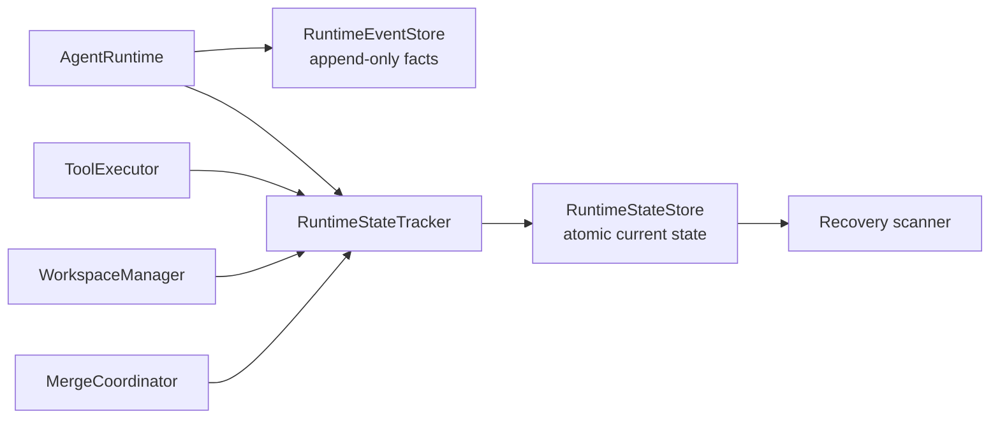

# RuntimeStateStore 与崩溃恢复

状态：**Phase 1A + 1B 已实现；Phase 2A 宿主操作已接入（2026-08-02）**

范围：`zapsdk/runtime/state-*`、`zapsdk/tools/executor.ts`、
`zapsdk/workspace`、`zapsdk/merge`、TUI/Headless Runtime 装配

上位设计：[生产 Agent Harness 对标与演进设计](29-production-agent-harness-benchmark.md)

## 1. 本阶段结果

Phase 1A 增加独立于 append-only EventStore 的可变控制状态；Phase 1B 把保存下来的
workspace/artifact 变成可验证、可操作的恢复资源：

1. 原子持久化 Thread、Turn、AgentRun、ToolRun；
2. approval 在打开 UI Promise 前先保存为 `pending`，只保存参数哈希；
3. Tool handler 在 `running` 状态落盘后才允许产生副作用；
4. 写 Agent workspace 先保存 `acquiring`，再创建 snapshot/clone；
5. artifact 冻结、merge start/completed/failed 都有持久状态；
6. 新 Runtime 第一次执行前扫描失效 owner，分类中断实体；
7. live Runtime 通过 instance ID + PID owner 避免被另一个进程误恢复；
8. 恢复过程幂等，不会重复改写已经分类的状态。
9. 每个 thread 使用跨进程 writer lease，所有状态更新支持 revision CAS；
10. workspace batch 写入 owner marker，恢复时校验 thread、仓库、真实路径和 Git OID；
11. `RuntimeRecoveryController` 提供 inspect、resume merge 和显式确认 cleanup；
12. cleanup 先持久化 `releasing`，再删除 batch，重启后按磁盘证据收敛状态；
13. Runtime 通过 `onRecovery` 和 `lastRecoveryReports()` 把恢复结果暴露给宿主。

本阶段没有重放模型请求、重新执行 Tool、自动同意 approval 或自动重试 merge。无法证明
安全的动作进入 `failed / blocked / needs_user / cleanup_only`，不猜测执行结果。

## 2. 两种存储的职责



| Store | 写入模型 | 用途 | 失败策略 |
|---|---|---|---|
| RuntimeEventStore | append-only JSONL | UI、审计、回放事实 | 默认 best-effort |
| RuntimeStateStore | 每个 Thread 一份原子快照 | 控制边界、崩溃分类 | fail closed |

生产路径：

```text
$ZAPCODE_DATA_DIR/projects/<project-id>/runtime-state/<sha256(threadId)>.json
```

目录权限为 `0700`、文件权限为 `0600`（Windows 除外）。每次更新在同目录写临时文件，
完成后 rename 替换；损坏快照抛 `RuntimeStateStoreCorruptionError`，不会静默重置。

`RuntimeStateStore.update()` 对同一个 store 实例、同一个 Thread 串行执行，并递增
`revision`。调用方可传 `expectedRevision` 做 CAS；过期 revision 抛
`RuntimeStateRevisionConflictError`。

`JsonRuntimeStateStore.acquireThreadLease()` 使用同目录 `*.json.lease` 文件和排他创建保证
一个 thread 同时只有一个 writer。lease 记录 instance ID、PID 和 startedAt；活 PID 拒绝
抢占，失效 PID 的 lease 可被新 Runtime 隔离并接管。状态更新会拒绝未持有的外部 lease，
恢复扫描也先取得同一 lease，因此“运行”和“恢复”不会并发改同一 thread。

## 3. 状态模型

```text
RuntimeStateSnapshot
├── owner (instanceId / pid / startedAt)
├── Thread
├── Turn[]
├── AgentRun[]
├── ToolRun[]
├── Approval[]
├── WorkspaceLease[]
├── Artifact[]
├── Merge[]
└── latest RecoveryReport
```

Tool call ID 由模型生成，可能在不同 turn 重复。持久状态使用
`turnId + toolCallId` 作为 ToolRun/approval 的复合身份，避免第二轮的 `tool_1` 覆盖第一轮。

approval 不保存原始参数，只保存 canonical JSON 的 SHA-256；这样可以关联审计记录，又不
把命令、文件内容或 token 复制进控制状态。AgentRun 只保存最多 1,000 code points 的
task preview。

## 4. 持久化屏障

状态不是 UI 事件的事后副本。可能产生副作用的关键点使用可等待 lifecycle hook：

| 动作 | 必须先落盘 | 才允许继续 |
|---|---|---|
| root turn | Thread/Turn/root Run = running + owner | 第一次 provider 调用 |
| approval | Approval = pending | 打开/等待宿主 approval Promise |
| Tool | ToolRun = running | checkpoint、handler、post-process |
| 写 workspace | Workspace = acquiring | snapshot、clone、checkout |
| merge | Merge = running，Artifact = merging | drift check、combined patch apply |

终态写失败时不伪造另一个结果。例如根 patch 已应用、但 `merge_completed` 落盘失败，
Merge 保持 `running`；下次恢复会判为 `interrupted + blocked`，要求检查根目录，而不是错误
地记录为普通 `failed`。

RuntimeEvent 的 UI projection 仍保留，但它不是上述屏障。`RuntimeStateTracker.flush()` 在
provider 首次执行和 turn settle 前必须成功，否则 `run()` 不向宿主报告成功。

## 5. 恢复扫描

`AgentRuntime.run()` 第一次执行前调用 recovery scanner。扫描先检查 snapshot owner：

- PID 仍存活：跳过，不触碰另一个活 Runtime；
- owner 不存在或 PID 已失效：分类所有非终态实体；
- 分类后清除 owner、关闭 active turn，并写入 `RuntimeRecoveryReport`；
- 第二次扫描没有新动作，不增加 revision。

恢复矩阵：

| 崩溃点 | 恢复结果 | 原因 |
|---|---|---|
| model / root AgentRun 执行中 | Run/Turn = failed | provider Promise 无法跨进程恢复 |
| Tool scheduled/running | ToolRun = failed | handler 是否完成不可证明，禁止重放 |
| waiting approval | Approval = interrupted；ToolRun = cancelled；显式 waiting AgentRun = blocked | 旧 UI Promise 已失效；普通 root Run 仍按中断失败 |
| Agent ready_to_merge | Run = blocked；workspace preserved | 不自动合并；宿主可显式调用 `resumeMerge` |
| merge running | Merge = interrupted；artifact/run = blocked | 根 patch 可能处在不确定边界 |
| active isolated workspace，无 artifact | workspace = orphaned | 只标 `cleanup_only`，不自动删除 |
| artifact 指向缺失 workspace | artifact = blocked；workspace = orphaned | 没有可验证的证据可继续 merge |
| shared-readonly lease | workspace = released | 只关闭 bookkeeping，绝不清理根目录 |

启动扫描不会修改根工作区，也不会执行模型/Tool/merge。对 isolated workspace，只有目录
仍存在才标记 `preserved`。后续操作必须由宿主显式调用 `RuntimeRecoveryController`：

- `resumeMerge({ artifactIds })`：重新校验 marker、batch 边界、repo/workspace 真实路径、base
  和 result commit，再走原有 drift check + transactional merge；
- `cleanupBatch({ batchPath, confirm: true })`：要求显式确认并重新验证整个 batch，不能把状态
  文件中的任意路径直接当作递归删除授权；
- `inspect()`：只读返回当前控制快照，供 TUI/headless/未来 HostProtocol 展示。

恢复 merge 成功后仍保留 batch，直到宿主或用户明确 cleanup，便于审计和处理同批次的其他
artifact。

## 6. 生命周期状态

### Approval

```text
pending -> approved | denied | cancelled | failed
pending --process restart--> interrupted
```

### Workspace / Artifact / Merge

```text
Workspace: acquiring -> active -> releasing -> released
                      -> failed
           acquiring|active --restart--> preserved | orphaned
           releasing --restart--> preserved | released

Artifact: ready -> merging -> merged | blocked
          ready --normal cleanup without merge--> discarded

Merge: running -> completed | blocked | failed
       running --restart--> interrupted
```

`blocked` 与 `failed` 不等价：`failed` 表示已知执行失败；`blocked` 表示可能存在可恢复
证据或根目录不确定性，需要用户/Coordinator 判断。

## 7. 验证范围

- JSON state 并发串行更新、revision、原子 reload、权限和损坏拒绝；
- 跨 store writer lease 冲突、失效 PID 接管和 stale revision CAS 拒绝；
- root turn 状态写失败时 provider 调用次数为 0；
- Tool `started` 写失败时 handler 调用次数为 0；
- approval requested/approved/denied 顺序与参数脱敏；
- 不同 turn 重复 tool-call ID 不覆盖；
- workspace → artifact → merge → release 全生命周期落盘；
- model、Tool、approval、ready artifact、merging 五类故障点恢复；
- live owner 跳过、shared root 不误清理、缺失 artifact workspace 阻断；
- merge 完成状态写失败时不反向伪造 `merge_failed`；
- recovery scanner 幂等且保留 artifact 目录证据。
- marker 权限/身份/路径边界验证，跨 Runtime hydrate + resume merge；
- cleanup 显式确认、删除前状态屏障和中断 cleanup 的证据归并；
- `onRecovery`/`lastRecoveryReports()` 宿主可见性。

## 8. Phase 2A 后续状态

Phase 1B 已完成 writer 仲裁和受管证据恢复。后续 Phase 2A 已补齐：

1. `/recovery` 项目级恢复中心、merge/cleanup/prune 二次确认；
2. owner marker 扫描、TTL、bytes/batch quota 和删除前二次边界校验；
3. ExecutionBroker 与 macOS/Linux/Windows fail-closed sandbox provider。

仍未完成：artifact patch preview、通用进程细粒度 egress proxy、EventStore retention/session
projector、统一 HookBus。详见
[ExecutionBroker、OS Sandbox 与恢复中心](32-execution-sandbox-recovery-center.md)。
