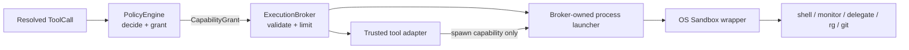

# ExecutionBroker、OS Sandbox 与恢复中心

状态：**Phase 2B 安全闭环已实现（2026-08-02）**

范围：`zapsdk/execution`、`zapsdk/tools/executor.ts`、进程型 built-in tools、
`zapsdk/workspace/retention.ts`、`zapsdk/runtime/recovery-center.ts`、TUI `/recovery`

上游：[Tool Runtime redesign](27-tool-runtime-redesign.md)、
[RuntimeStateStore 与崩溃恢复](31-runtime-state-recovery.md)

## 1. 已落地边界

本阶段把“允许执行”和“系统能做什么”拆成两层：



- `PolicyEngine` 只依据 Tool Effect、actor、workspace 和交互模式决定 allow/ask/deny；
- `ExecutionBroker` 再校验 grant 是否覆盖 filesystem、network、process、external 和 workspace；
- 声明 process effect 的 Tool 必须设置 `sandboxAware`，否则 broker 拒绝调用 handler；即使设置了，
  handler 成功返回却没有消费 broker-owned launcher 也会失败，不能靠 metadata 冒充已隔离；
- production `buildAgentObjects` 使用 `sandboxMode: "required"`，sandbox 不可用时进程 Tool
  fail closed，普通非进程 Tool 不受影响；
- SDK 默认保持 `disabled`，避免没有显式启用系统边界的 embedder 被误认为已隔离；
- Tool handler 不再拿到可自行绕过的 command wrapper，只拿 `ExecutionProcessBroker`；`bash`、
  后台 bash、`monitor`、`delegate_agent`、delegate 前后 git status、`search_files` 的 ripgrep
  全部由它启动，前后台进程结束后释放每次调用的私有临时目录；
- broker 强制硬 timeout、输入/输出、声明路径数量/深度/现有文件大小，并把统一 resource
  meter 下发给 adapter。HTTP 响应字节、后台输出及 glob/search/list traversal 使用同一组
  effective limits；Tool 只能收紧、不能放大 runtime hard cap。ToolExecutor 仍负责外层
  abort、checkpoint 和 lifecycle。

Tool handler 仍是可信 adapter。直接调用 `tool.handler()` 是 SDK 单元测试/embedding API，
不是模型执行路径；生产模型调用必须经过 ToolExecutor → Policy → Broker。

文件型 Tool 不经过子进程，因此由 adapter 执行同一套 capability 边界：effect/grant 使用
canonical path，实际 delete/move 保留 lexical path；existing symlink 和“缺失文件位于 symlink
目录下”都通过 nearest-existing-ancestor 解析。这样既阻止 workspace symlink 指向外部 secret，
也不会把“删除 symlink”错误实现为“删除 symlink 目标”。

### 1.1 安全修复 1–8

| # | 风险 | 已落地闭环 |
|---|---|---|
| 1 | symlink/缺失路径绕过 workspace root | lexical 与 canonical path 分离，nearest-existing-ancestor 校验 |
| 2 | read-only Tool 没有真实 filesystem effect | read/list/tree/search/glob/pdf/docx 全部声明 canonical read scope |
| 3 | `sandboxAware` 只是一枚可伪造布尔值 | handler 只能拿 process capability；成功但零 broker spawn 会失败 |
| 4 | rg、git、后台任务等从 host 直接 spawn | 所有 model-triggered child process 迁移到 `ExecutionProcessBroker` |
| 5 | broad workspace write 可修改控制面 | adapter + macOS/Linux/Windows 双层保护 `.git/.zapcode` |
| 6 | 环境变量 denylist 漏出未知凭据 | 默认 allowlist；delegate 逐项显式保留认证变量 |
| 7 | shell 默认全网访问 | bash/monitor 默认 offline；delegate 与 HTTP Tool 分别显式声明 egress |
| 8 | 声明与真实平台行为脱节 | macOS 实跑 + Linux/Windows 独立 CI acceptance + policy construction 回归 |

process effect 仍按实际用途参与调度：只有显式 `readOnly: true` 的观察型进程（当前为 sandboxed
ripgrep）可以共享并发；shell、delegate、monitor 和所有未标注进程继续独占调度。

## 2. OS provider

| 平台 | Provider | 强制边界 | 不可用行为 |
|---|---|---|---|
| macOS | Seatbelt `/usr/bin/sandbox-exec` | deny-default；工作区读写 grant；系统运行时只读；可选 network | process Tool 拒绝执行 |
| Linux | bubblewrap `bwrap` | 空文件视图、系统 runtime 白名单、grant bind、network namespace | 未安装 bwrap 时拒绝执行 |
| Windows | 内置 AppContainer launcher | 独立 Package SID、grant ACL、network capability、kill-on-close Job Object | Windows PowerShell bootstrap 不可用时拒绝执行 |

macOS 子进程使用 `/bin/sh`，不加载用户 shell profile。默认 HOME 指向私有临时目录。
子进程环境使用 allowlist（PATH、locale、terminal、必要 Windows runtime 字段等），而不是
容易漏掉新凭据命名的 denylist。`delegate_agent` 是唯一需要宿主认证的 adapter：它显式
声明 Claude/Codex credential 路径为只读 grant，并只保留对应 provider 的认证环境变量；
其他 HOME 文件仍被 Seatbelt/namespace 拒绝。

root workspace 的普通写 grant 不覆盖控制面：`.git` 和 `.zapcode` 在 macOS 使用显式 deny，
Linux 在 broad writable bind 之后覆盖只读 mount，Windows 对 AppContainer SID 添加显式 deny
ACL。Linux/Windows 遇到尚不存在的 `.git/.zapcode` 时临时创建受保护空目录，执行结束后仅在
仍为空时删除。
generic write/edit/delete/move Tool 同样拒绝这些 protected paths。

Windows launcher 以源码嵌入 Bun bundle，运行时写入私有临时目录并由系统 PowerShell 编译，
不依赖 sidecar 或环境变量。目标进程以 suspended 状态创建，加入 Job 后才恢复；结束时恢复
grant path ACL 并删除 AppContainer profile。helper 异常退出时 Job handle 关闭会终止进程树。

当前 network grant 编译为 OS 级 all-or-none：`bash` 和 `monitor` 默认不声明 network，只有
embedder 显式设置 `sandboxNetwork: true` 才开放；`delegate_agent` 因 provider API 需要显式
声明网络。普通 HTTP/Web Search Tool 是默认的 brokered egress 路径。按域名/IP/字节数执行
细粒度 egress 限制仍需要代理层，不在 Seatbelt/bubblewrap 本地 provider 内伪造支持。

## 3. Agent 行为

- root bash：用户审批后，可读写当前 root workspace（`.git/.zapcode` 除外）；不能读写
  workspace 外用户文件，默认不能联网；
- general Agent：生命周期并行启动，在独立 Git workspace 中运行；bash 只能读写该 lease；
- explore/plan Agent：共享 root 的只读视图；只有 runtime sandbox 可用时才暴露经过词法验证
  和 OS read-only grant 的 bash；SDK/Windows/Linux 无 provider 时继续隐藏 bash；
- unknown-effect Tool 在 isolated workspace 仍被 Policy 拒绝；OS sandbox 不是声明缺失的替代品。

## 4. Workspace TTL 与配额

`WorkspaceRetentionManager` 默认策略：

```text
TTL         7 days
max bytes   5 GiB per repository managed root
max batches 64
```

SDK 调用方可通过 `RuntimeWorkspaceOptions.retention` 覆盖。每次创建新的 isolated Agent batch
前执行 sweep；TUI `/recovery` 也可显式执行。

清理算法只处理 Git common dir 下 `zap-agent-workspaces/batch-*` 的直属真实目录，并要求：

1. owner marker 是普通文件且 schema/shape 有效；
2. realpath 仍是 managed root 的直属 child；
3. marker batch ID 和真实目录名一致，workspace root 和当前项目一致；
4. RuntimeStateStore 中 active/acquiring/releasing/preserved workspace，以及 ready/merging/
   blocked artifact 对应 batch 全部受保护；
5. marker PID 仍存活时受保护；
6. 只对失主、未保护 batch 应用 TTL；超过 bytes/batch quota 时按最老优先回收；
7. `rm` 前再次读取 marker 和验证路径，防止扫描后 path swap；symlink/损坏 marker 只报告，
   永不递归删除。

若受保护资源本身超过配额，报告 `overQuota`，不会为了达标丢弃恢复证据。

## 5. TUI Runtime Recovery Center

`/recovery` 打开项目级恢复中心。它读取项目所有历史 thread，而不是只读取当前 session：

- `loading / ready / merging / cleaning / pruning / error` 是独立 UI 状态；
- artifact row 使用 `m` 或 Enter 进入 merge 二次确认；
- workspace row 使用 `d` 或 Enter 进入永久丢弃二次确认；
- `p` 对 ownerless batch 执行 TTL/配额 sweep，也要求确认；
- `r` 重新扫描 state 和 marker，Esc 关闭；
- merge 仍走 marker/OID/root drift/conflict 校验和 transactional apply；成功后创建 checkpoint，
  `/rewind` 可以撤回这次根目录修改；
- cleanup 仍先持久化 `releasing`，再 hydrate/验证 batch 后删除；
- live writer lease 不会被恢复扫描或 UI 操作抢占。

新 task 可以恢复旧 task 的 artifact，因为 `ProjectRecoveryCenter` 在项目 store 上聚合 thread，
再为选中项构造 thread-scoped `RuntimeRecoveryController` 获取 writer lease。

## 6. 故障与兼容语义

- required sandbox 不可用、grant 不覆盖、Tool 未声明 sandbox aware：handler 调用次数为 0；
- broker/handler 失败返回普通 `ToolResult { success:false }`，Tool lifecycle 记录 failed；
- SDK disabled 模式不向旧 ToolResult 强行添加 runtime metadata；production required 模式只在
  实际子进程全部由 sandboxed launcher 启动后记录 `sandboxEnforced: true`，声明或包装器存在
  本身不算强制证据；
- background task 持有 sandbox 临时资源直到 output flush + exited event，取消按进程组终止；
- retention 扫描失败不阻塞普通 TUI；非 Git 项目使用独立临时根目录扫描与恢复 `isolated-copy` 工作区。存在未完成 copy merge journal 的 batch 不参与配额清理，须先恢复合并。

## 7. 已验证范围

- required provider unavailable / Tool 不感知 sandbox / grant 缺失时 fail closed；
- macOS Seatbelt：允许 workspace 内普通写，拒绝 workspace 外读写，拒绝修改 `.git/.zapcode`；
- Linux/Windows 在安装 bwrap 的 Ubuntu runner 和 Windows runner 执行同一套真实隔离
  acceptance：允许 workspace 写、拒绝 workspace 外读写；
- foreground、background TaskStore、monitor 和 delegate 原有行为回归；
- `read_file` symlink 外泄、`sandboxAware` 假声明、ripgrep leading-dash pattern、环境变量泄漏、
  protected control path 和默认无网络均有专门回归；
- TTL 回收、数量 quota、protected/live owner 超额保留、symlink/非法 marker 跳过；
- 恢复中心跨 thread 发现 artifact，显式 merge、拒绝未确认 cleanup、确认后安全删除；
- TypeScript strict check、全量 Bun tests、production build；
- tmux 真实终端 `/recovery` 打开、刷新、确认/取消和关闭路径。

## 8. 后续边界

1. 通用 shell 若由 embedder 显式开放网络，按域名/IP 与网络字节强制仍需要 egress proxy；
   当前 HTTP adapter 已执行 `maxNetworkBytes`，OS provider 对通用进程执行 network all-or-none；
2. Windows AppContainer 每次启动需要 PowerShell `Add-Type`，后续可用签名 NativeAOT helper
   降低冷启动耗时，但不影响当前隔离边界；
3. workspace usage 可进一步写入 HostProtocol telemetry，并增加配置 UI；
4. artifact diff 目前由 merge coordinator 做冲突/路径校验，恢复中心尚未展示逐文件 patch preview。
