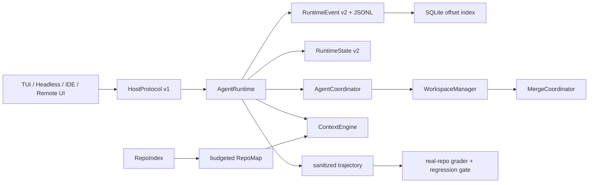

# Agent Platform Control Plane

本文描述 Zap 一级 `AgentCoordinator`、`RepoIndex/RepoMap`、`HostProtocol/App Server`
和真实仓库 trajectory benchmark 的生产实现与验收边界。

## 1. 总体边界



`LoopAgent` 仍是单个 Agent 的推理循环，但不再拥有多 Agent 调度、workspace 合并或宿主协议。
这些职责分别属于 Coordinator、Workspace/Merge 和 HostProtocol。

## 2. AgentCoordinator

实现位于 `zapsdk/coordinator/`，生产装配位于 `zapsdk/runtime/factory.ts`。

### 2.1 生命周期

状态明确区分：

- `scheduled`
- `waiting_dependency`
- `waiting_capacity`
- `starting`
- `running`
- `waiting_approval`
- `waiting_input`
- `cancelling`
- `validating`
- `ready_to_merge`
- `merging`
- `completed / blocked / failed / cancelled`

等待审批或输入时释放执行容量；依赖失败会阻断下游；取消是幂等的。`steer` 进入持久化
mailbox，只在 Agent 明确的安全边界消费。

### 2.2 写入隔离与合并

`explore/plan` 使用共享只读 workspace。`general` 继续通过 `WorkspaceManager` 获取独立 Git
worktree/copy workspace。执行成功只进入 `ready_to_merge`；根 Agent 调用
`merge_agent_artifacts` 后才进入 `merging`，事务合并成功后才是 `completed`。
依赖该写入 Agent 的下游任务会一直停留在 `waiting_dependency`，直到 merge 真正成功，
避免从根工作区读到合并前的旧内容。

### 2.3 崩溃恢复

Coordinator 的 runs、dependency graph、mailbox、结果和 artifact 引用写入同一份
`RuntimeStateSnapshot`。RuntimeState schema 从 v1 升级到 v2；旧快照加载时内存迁移，下一次
写入以 v2 原子替换。崩溃时处于执行中的 Agent 标为 `blocked`，必须显式 `resume`，且 resume
创建新的 continuation run，避免假装从不可恢复的模型流中点继续。

`agent` Tool 现在只是提交/等待适配器。生产子 Agent 由 Runtime 持有的 Coordinator 执行，
不再由 Tool 私自构造生命周期。

## 3. Runtime Protocol 与事件索引

RuntimeEvent v2 增加 `correlationId` 和 `causationId`。JSONL 是事实源；SQLite sidecar 只保存
thread、sequence、byte offset、时间和 payload type，不保存 prompt、reasoning、tool 参数或
输出。索引丢失或损坏时从 JSONL 重建。

分页同时支持：

- `afterSequence`
- `beforeSequence`
- `direction: forward | backward`
- `limit`
- `hasMoreBefore / hasMoreAfter`

这为 session 的“最近窗口 + 加载更早消息”提供稳定游标，不再依赖无限 terminal scrollback。

## 4. RepoIndex / RepoMap

实现位于 `zapsdk/repo-index/`，TUI 和 headless 通过 `src/agent/repoMap.ts` 自动注入每轮上下文。

### 4.1 索引内容

- Git tracked/untracked 文件枚举，非 Git 目录降级为安全遍历；
- TypeScript/JavaScript 使用 TypeScript AST 提取顶层 symbol 和 import；
- Python、Go 等语言使用保守的声明提取器；
- test path、import graph、inbound reference、Git changed 信号；
- size/mtime 增量指纹，32 worker 有界刷新；
- cache 存在 Git metadata 目录，权限为 `0700/0600`，不会污染工作树。

### 4.2 Map 选择

Map 根据当前用户 query、path、symbol 精确命中、import 中心度、test 和 changed 信号排序，
在模型 context window 派生的硬 token budget 内输出。内容只包含路径、声明签名和 import，
不复制函数体。构建失败 fail-open，不阻断 Agent 主任务。

## 5. HostProtocol / App Server

实现位于 `zapsdk/host-protocol/`。

HostProtocol v1 提供：

- `thread.snapshot`
- `thread.run / thread.cancel`
- `thread.events` 游标分页
- `agent.list / agent.cancel / agent.steer / agent.resume`

`HostRuntimeRegistry` 注册 session 生命周期的 `SessionHostRuntime`。TUI 每轮仍只通过统一
`createAgentRuntime` 装配具体 Runtime，但会把它 attach 到稳定 session binding；轮次结束只
detach，不再让 thread 从 HostProtocol 消失。`/new` 或 `/sessions` 切换会原子注销旧 binding
并注册新 session。因此空闲时仍可 snapshot、分页/订阅事件和发起下一轮，活动轮次则可 cancel。

App Server 提供：

- `POST /v1/rpc`
- `GET /v1/threads/:threadId/events?after=<sequence>`（SSE）
- replay 与 live 切换期间按 sequence 去重，避免竞态丢事件；
- 服务关闭时主动结束 SSE、heartbeat 和订阅，不遗留长连接；
- 默认仅绑定 `127.0.0.1`；所有请求必须 Bearer token；
- 非 loopback 绑定必须由调用方显式提供 token；
- 1 MiB 请求上限、`no-store`、`nosniff`。

App Server 是 SDK 组件，宿主决定何时启动和如何交付 token。CLI 默认不暴露端口；显式设置
`ZAPCODE_HOST_PROTOCOL_PORT`（`0` 表示随机空闲端口）后，TUI/headless 启动 loopback
App Server、输出一次性 Bearer token，并把当前生产 Runtime 注册到同一个
`HostRuntimeRegistry`。因此 `thread.cancel` 既能取消协议发起的 turn，也能取消 TUI/headless
直接发起的活动 turn；进程退出时关闭 server 和 SSE。

## 6. 真实仓库 trajectory benchmark

实现位于 `zapsdk/evals/`，CLI 为：

```bash
bun run benchmark:real-repo -- \
  --corpus evals/real-repo/corpus.json \
  --executor /absolute/path/to/executor \
  --executor-arg optional-arg \
  --output .eval-output \
  --baseline /optional/previous-report.json
```

executor 必须是独立进程，实现 stdin/JSONL 协议：从 stdin 读取一个 task request，在 stdout
依次输出 `runtime_event`，最后输出唯一的 `result`。`RuntimeBenchmarkExecutor` 是唯一被 runner
接受的生产 adapter；CLI 不再 import 任意 executor module 到 benchmark 主进程。

grader 除文件与命令正确性外，还可设置 `maxSteps`、`maxToolCalls`、
`maxFreshInputTokens` 和 `minCacheHitRate`。任一已配置指标缺失时 fail closed；缓存命中率按
`cacheRead / (freshInput + cacheRead + cacheWrite)` 计算，避免只凭最终文件正确掩盖低效轨迹。

每个 task：

1. 固定 40 位 commit；
2. 创建 detached worktree；
3. 执行受信任 setup；
4. 运行 Agent；
5. 执行确定性 grader；
6. 检查 required/forbidden path 和变更文件数；
7. 写入脱敏 JSONL trajectory；
8. 删除 worktree。

task deadline 会先终止 executor 进程组（Windows 使用 `taskkill /T /F`），确认子进程退出后才
执行 grader 和 worktree 清理。因此超时不是单纯停止 await，executor 不能在结果返回后继续
写入半成品。

task/attempt ID 必须是 filesystem-safe identifier；同一 task 的多次 attempt 使用全局唯一
workspace/trajectory 路径，禁止通过 manifest ID 逃逸输出目录或互相覆盖。

trajectory 只保留 ID、状态、用量、哈希和命令字节数，不保存 prompt、reasoning、tool 参数或
tool output。Corpus 报告包含每任务 pass rate、median duration/tokens 和 aggregate p95，并可
针对 baseline 设置 pass-rate、时延、token 回归阈值。门禁失败时 CLI 返回非零退出码。

商业级缓存验收不能用单次 task 代替。Corpus entry 现在可声明 `cachePhase`（`cold`、`warm`、
`post_compact`）和 `session`（短/长会话、最少消息数、resume、compact-before-run）；这些场景
会进入 executor request。executor 必须回报 `sessionMessages`、`sessionResumed` 和
`compactOccurred`，否则对应场景 fail closed。报告始终分开输出三个 phase，包含：

- cache hit P50/P10；
- provider cache accounting coverage；
- token-weighted cache write churn；
- 多仓库、短/长 session、100+ messages、resume、post-compact 的实际覆盖数。

正式门禁由 corpus thresholds 配置：`minAttempts`、`minRepositories`、
`requiredCachePhases`、`minWarmCacheHitRateMedian`、`minWarmCacheHitRateP10`、
`maxCacheWriteChurnRate`、`minProviderCacheAccountingCoverage` 和各类 session 覆盖下限。
provider 未同时回报 fresh/cache-read/cache-write 的 attempt 计为 accounting 未覆盖，而不是从
分母中静默剔除。executor 也不得把 provider 缺失字段用 `0` 代替，否则会制造虚假的 100%
accounting coverage。

仓库内置 `evals/real-repo/corpus.json` 作为真实 Zapcode pinned-commit smoke corpus。
它只验证执行链路，不代表商业级样本量验收。

## 7. 验收命令

```bash
bun run typecheck
bun test
bun run build
```

关键定向套件：

```bash
bun test zapsdk/tests/coordinator
bun test zapsdk/tests/repo-index
bun test zapsdk/tests/host-protocol
bun test zapsdk/tests/evals
```

## 8. 明确的后续增强

本阶段不声称以下能力已经完成：

- 对所有语言都使用 tree-sitter/LSP 的精确 reference graph；
- 非受信任仓库的容器/远程 benchmark runner；
- App Server 的多租户认证、TLS termination 和配额服务；
- 在崩溃后恢复模型流中间 token（当前选择安全的 continuation run）。

这些增强不影响本阶段四项能力的协议稳定性和现有验收路径。
