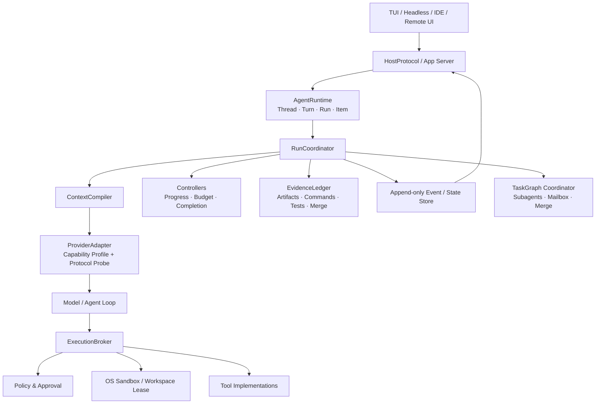

# 35. Agent Harness 市场调研与 Zap 演进方案

**状态：分阶段实施中；P0.1、P0.2 已落地，其余内容仍为提案。**
**审计日期：2026-08-15**
**范围：Agent Harness，而非模型能力、TUI 视觉或某一个 Benchmark 的通关策略。**

## 实施看板

| 工作包 | 状态 | 已验证范围 |
| --- | --- | --- |
| P0.1：`CompletionContractV2`、`EvidenceLedgerV2`、Runtime completion projection | 已完成 | artifact/write fingerprint 自动取证；命令/approval/merge 的 host evidence 接口；`modelClaimedSuccess`、`evidenceState`、`infrastructureOutcome` 分离；旧 `requireSuccessfulToolCall` 兼容。 |
| P0.2：`HarnessPolicyV2` 与自适应预算决策 | 已完成 | V1 `taskDecomposition`/`reserveSteps` 经 adapter 保持兼容；V2 默认以 model turn、wall time、tool call、fresh input 的通用资源观察形成 transient `BudgetDecision`，并以稳定 reason code 记录。固定步数提示仅为 V1 direct caller 保留。 |
| P0.3：Broker/StateStore 自动取证与事件回放 | 待实施 | command、approval、workspace、merge 的运行时自动汇集。 |
| P0.4：Provider capability probe | 待实施 | tool/reasoning/schema/cancel/cache 的可执行兼容性 fixture。 |
| P1–P3：Controller、任务图、App Server | 待实施 | 依赖 P0 稳定的事件与完成语义。 |

P0.1 不改模型提示、任务分解格式、权限、沙箱或 Benchmark adapter；它只让共享 Runtime 更准确地区分“模型结束”“交付被验证”与“证据桥基础设施失败”。P0.2 只替换共享的收敛提示与策略表达，不以 task name、模型或评测环境分支，也不把尚未实现的 Broker 强制能力伪装成已生效限制。命令、approval、workspace、merge 的自动汇集仍属于 P0.3，当前只能经 host evidence 接口提供。

## 1. 结论先行

Harness 可以理解为 Agent 的“躯体和神经系统”：模型负责理解、推理和生成；Harness 负责把任务变成可执行的运行、在真实环境中安全地调用工具、保存状态、判断进度、收集证据、处理失败并把同一个运行暴露给 TUI、Headless、IDE 和评测器。

Zap 不应复制某个产品的 prompt 或某套固定步数规则。目标应是一个 **模型无关、渠道无关、评测无关** 的运行时：

1. **Runtime 的成功语义以证据为准。** 模型输出“已完成”只是一项声明，不等于产物、验证或用户批准已经完成。
2. **策略与强制边界分离。** `HarnessPolicy` 决定何时提示、暂停或要求验证；`ExecutionBroker + OS Sandbox` 才负责真正限制文件、进程和网络。
3. **默认运行与 Benchmark 完全同构。** Terminal-Bench 适配器只能负责启动、隔离、超时、采集和调用官方 verifier；不得读取题名、隐藏断言或注入专用收敛策略。
4. **多 Agent 是任务图调度，不是“多开几个 Tool”。** 只有独立可验证的子任务才并行；写入工作必须在独立 workspace 中完成，并通过事务性 merge 进入主工作区。
5. **先补完成闭环，再扩张能力面。** P0 是版本化事件、`CompletionContract`、`EvidenceLedger`、预算/进度控制与 provider 兼容性探针；不是先上更多 prompt、更多工具或更多 Agent。

这套方向既吸收了 Pi 的轻量可嵌入性、Hermes 的长运行 Gateway/后端抽象、Codex 的 Runtime + Sandbox + App Server 分层，也避免把任何一个公开项目的产品取舍当成 Zap 的默认实现。

---

## 2. 调研边界与证据等级

### 2.1 调研方法

本页优先使用项目官方仓库、官方文档和公开 API 文档；无法确认的行为不写成产品事实。对于 DeepSeek，公开资料主要描述模型/API 的 Tool Calling 协议，而非一套公开、可审计的“DeepSeek Harness”，因此必须把 **Provider 集成** 与 **Host Harness** 分开讨论。

| 证据等级 | 本文如何使用 |
| --- | --- |
| 官方实现/文档 | 描述已公开的架构或接口能力。 |
| 当前 Zap 代码审计 | 描述仓库中已经存在的接口和缺口，以代码为准。 |
| 社区集成经验 | 只作为兼容性风险线索；需转化为自动化 probe 后才能成为产品承诺。 |
| 本文提案 | 明确标注为目标设计，尚未表示已实现。 |

### 2.2 公开产品对照

| 产品/项目 | 公开做法 | 对 Zap 的可迁移启发 | 不能照搬的部分 |
| --- | --- | --- | --- |
| [Pi](https://github.com/badlogic/pi-mono/tree/main/packages/coding-agent) | 极薄的 terminal coding harness；同一 Agent 可经 TUI、print/JSON、RPC 和 SDK 使用；JSONL session tree 支持 fork/clone；扩展和自定义工具可插拔。 | Host 不应拥有第二套 Agent 装配；事件/会话要可分叉、可回放、可被自动化客户端消费。 | Pi 的扩展包拥有系统权限是有意的开发者取舍；Zap 不能把它当作默认安全模型。 |
| [Hermes Agent](https://github.com/NousResearch/hermes-agent) | 长运行 gateway 统一 TUI/消息渠道；持久记忆与检索；支持隔离 subagent、并行工作流和多种 terminal backend。 | 将渠道接入置于稳定 gateway/protocol 之上；将 terminal backend 与 Agent Loop 解耦；并行要携带 workspace/结果边界。 | “学习/自改进”不能直接接入生产路径；技能、插件和记忆仍需可审计权限模型。 |
| [Codex App Server](https://openai.com/index/unlocking-the-codex-harness/) | 把 thread 生命周期、配置/认证、工具执行与扩展从前端剥离；TUI、IDE 等通过 App Server 共享运行时。 | `HostProtocol/App Server` 是 Zap 消除 TUI/headless 双装配的正确终局。 | App Server 不是先决条件；不能以重写宿主为由延后完成语义和证据闭环。 |
| [Codex Sandbox](https://openai.com/index/building-codex-windows-sandbox/) | 通过 OS 级边界和子进程继承建立实际执行隔离，并默认限制 workspace 写入/网络。 | Policy 不能替代系统强制；Broker 应把 capability 映射成真实 sandbox 配置并记录生效结果。 | 各 OS 能力不同；没有实现过的后端必须 fail closed，而不是把“声明隔离”当作隔离。 |
| [Claude Code 文档](https://code.claude.com/docs/en/hooks) | 用 hooks、subagents/teams、sessions/checkpoints 等生命周期能力暴露宿主扩展点。 | `HookBus` 应成为验证、安全、审计、通知的稳定订阅点，而非继续耦合进 `LoopAgent`。 | Hook 不能绕过 approval、sandbox 或状态机；第三方 hook 必须有明确可信边界。 |
| [DeepSeek Tool Calls](https://api-docs.deepseek.com/guides/tool_calls) | API 层定义 tool-call 消息与 JSON Schema；部分模型/模式支持 strict schema。 | 每个 provider 需要显式 capability profile、协议测试和降级路径，而非按模型名写特判。 | Tool Calling API 不等于完整 Agent Harness；模型的 reasoning/tool-message 兼容性需在实际 provider probe 中持续验证。 |

### 2.3 从调研得到的共同模式

1. **长运行状态必须独立于 UI。** Pi 的 RPC/JSONL、Hermes 的 gateway、Codex 的 App Server 都指向一个事实：前端是 runtime 的消费者，不应是唯一所有者。
2. **工具执行必须是独立平面。** 运行时决定“要做什么”，执行平面决定“是否能做、在哪做、留下什么证据”。
3. **会话不是线性文本。** 可恢复运行需要 thread/turn/item/run、branch、checkpoint、artifact 和 approval，而非只依赖终端 scrollback。
4. **多 Agent 的成本在协调和合并。** 真正价值来自任务图、隔离 workspace、冲突处理和可验证汇总，而不是并发数量。
5. **模型厂商契约会漂移。** Provider adapter 必须有可测试的兼容性表，禁止用“某模型通常会这样返回”的隐式假设驱动运行时。

---

## 3. Zap 当前基线：已确认能力与缺口

以下是对当前代码结构的审计，不把未合并分支、历史 Benchmark 结果或设计文档当作实现事实。

| 已有基础 | 当前位置 | 已有价值 | 主要缺口 |
| --- | --- | --- | --- |
| `HarnessPolicy` | `zapsdk/harness/policy.ts` | V2 已表达 autonomy、task/plan threshold、completion、预算、execution 与 observability；V1 输入经 adapter 兼容。 | process/network/files/cost 的强制及自动证据仍未落入 Broker/StateStore。 |
| `ProgressController` | `zapsdk/harness/progress.ts` | 已按 wall time、model turn、tool call、fresh input、停滞和 workspace mutation 形成 `continue/converge/finalize` 决策及 reason code。 | 当前是 transient loop guidance；对 approval、merge、verifier 与持久 Decision event 的自动闭环属于 P0.3/P1。 |
| `CompletionContractV2` 与 `EvidenceLedgerV2` | `zapsdk/harness/completion.ts` | 已表达 final/tool/artifact/command/approval/merge requirements；工具 write fingerprint 可自动形成 artifact/path/hash 证据；保留 source。 | command、approval、merge 仍需 host/Broker/StateStore 注入；尚未形成 workspace lease 或 verifier 的自动证据链。 |
| `AgentRuntime` 完成判定 | `zapsdk/runtime/agent-runtime.ts` | 已把 `modelClaimedSuccess`、`evidenceState`、`infrastructureOutcome` 及完整 evidence 投影到 root run 事件；证据桥失败不会吞掉终态事件。 | 尚未写入独立 `verifierOutcome`，也未把 StateStore 生命周期自动汇入 ledger。 |
| Runtime factory/types | `zapsdk/runtime/factory.ts`、`zapsdk/runtime/types.ts` | 已开始让 Host 接收统一策略。 | TUI/headless/未来 IDE 的 protocol、恢复状态和版本兼容仍需统一。 |

### 3.1 已暴露的问题类型

历史真实任务与评测暴露的不是“模型少一个 prompt”这么简单：

- Agent 可以报告 `ok:true`，但缺少目标 artifact、测试或真实 verifier 成功。
- 固定步数/固定 reserve 可能压缩长诊断任务，或让普通任务无谓地提前收尾。
- 破坏性操作（例如会改变被读取的数据库/WAL）没有形成“先保全、后写入、再验证”的通用事务链。
- verifier 超时、基础设施失败、工具失败、模型未收敛和完成语义错误被混为同一种“失败”，使优化方向失真。
- 缓存命中率可高，但不代表任务闭环；缓存、成功率、证据完整性和安全性必须共同报告。

这些都必须在共享 Harness 解决，不能只为某条 Terminal-Bench trajectory 增加专用 prompt、checkpoint 或隐藏规则。

---

## 4. 目标架构



### 4.1 一条运行的最小、稳定协议

运行时所有对外状态都应来自 schema-versioned、append-only 事件；展示层可以做窗口化、折叠或分页，但不拥有事实。

| 实体 | 用途 | 最小字段 |
| --- | --- | --- |
| `Thread` | 可恢复的用户任务集合 | `id`, `parentId?`, `cwd`, `createdAt`, `schemaVersion` |
| `Turn` | 一次用户指令或 steer/cancel/resume | `id`, `threadId`, `kind`, `inputRef`, `status` |
| `AgentRun` | 可中断、可恢复、可审计的执行单元 | `id`, `turnId`, `phase`, `budget`, `provider`, `workspaceLease` |
| `Item` | 文本、thinking 摘要、tool call、tool result、approval、artifact 等不可变记录 | `id`, `runId`, `kind`, `payloadRef`, `sequence` |
| `Decision` | Policy/Controller 的可解释判断 | `reasonCode`, `inputs`, `decision`, `at` |
| `Artifact` | 交付物或中间结果 | `uri`, `contentHash`, `producer`, `verification` |
| `Approval` | 用户或策略门控 | `scope`, `requestedCapability`, `status`, `expiresAt?` |

原则：大 payload 可以在 blob/artifact store，事件内保留引用、hash 和摘要；事件结构不可被 TUI 重新解释为另一套状态机。

### 4.2 HarnessPolicy：从静态开关改为可解释约束

`HarnessPolicy` 是产品共享配置，而非 Benchmark profile。它应描述期望和上限，Controller 根据实时观测做决定。

```ts
interface HarnessPolicyV2 {
  version: 2;
  autonomy: "interactive" | "bounded" | "supervised";
  task: {
    classHint?: "question" | "investigation" | "change" | "migration";
    requirePlanAbove?: "risk" | "complexity";
    completion: CompletionContract;
  };
  budgets: {
    wallTimeMs?: number;
    modelTurns?: number;
    toolCalls?: number;
    freshInputTokens?: number;
    cost?: number;
  };
  execution: {
    allowedCapabilities: Capability[];
    workspaceMode: "shared-read" | "isolated-write";
    checkpoint: "never" | "before-destructive" | "before-write";
  };
  observability: { level: "minimal" | "standard" | "debug" };
}
```

不再把“第 40 步停止”“预留 2 步收尾”视为普遍正确的策略。预算控制器应基于剩余资源、最近进展、风险、待验证的声明和工具阻塞状态计算下一步，而不是按题目名称、模型名称或评测环境套固定剧本。

### 4.3 CompletionContract 与 EvidenceLedger：完成语义的核心

`CompletionContract` 描述本次任务的**可观察完成条件**；`EvidenceLedger` 保存“模型声明”和“系统观察”之间的对应关系。

| 层 | 回答的问题 | 例子 |
| --- | --- | --- |
| Intent | 用户希望什么？ | “修复 bug 并通过测试”“生成某路径文件”“给出调研结论”。 |
| Claim | Agent 说已经做了什么？ | “已修改 X”“已生成 Y”“测试已通过”。 |
| Observation | 系统实际看到了什么？ | tool exit code、文件 stat/hash、diff、测试输出、approval、merge 结果。 |
| Validation | 观察是否满足契约？ | required artifact 存在且 hash 已记录；要求的测试 exit code 为 0。 |
| Outcome | 能安全地对 Host 报告什么？ | `verified`、`partial`、`missing`、`blocked`、`cancelled`。 |

建议的最小类型：

```ts
type EvidenceState = "verified" | "partial" | "missing" | "blocked" | "cancelled";

interface CompletionContract {
  id: string;
  requirements: Array<
    | { kind: "final_response"; required: true }
    | { kind: "artifact"; path?: string; required: true }
    | { kind: "command"; commandRef: string; exitCode: 0 }
    | { kind: "workspace_merge"; required: true }
    | { kind: "approval"; capability: Capability; required: true }
  >;
}

interface EvidenceRecord {
  requirementId?: string;
  source: "tool" | "runtime" | "user" | "verifier";
  kind: "claim" | "command" | "artifact" | "diff" | "test" | "approval" | "merge";
  observedAt: string;
  payloadRef?: string;
  hash?: string;
  verdict: "supports" | "contradicts" | "inconclusive";
}
```

这不是把隐藏 verifier 塞进产品。契约只可来自用户显式请求、已授权的项目规则、运行时已观察到的副作用，或 Host 明确提供的验收命令；对缺失证据的默认动作是透明地再验证、请求澄清或报告 `partial`，而不是虚构成功。

### 4.4 Controller 组：从 LoopAgent 中拆出决策责任

| Controller | 输入 | 产出 | 禁止承担的责任 |
| --- | --- | --- | --- |
| `ProgressController` | 近期 action/observation、重复率、未验证声明、阻塞原因 | `explore` / `implement` / `verify` / `report` 建议和理由 | 直接执行工具、篡改模型回答。 |
| `BudgetController` | wall time、turn/tool/token/cost、队列/后台进程状态 | 降级、取消、继续、请求用户决策 | 以固定 step 数替代真实预算。 |
| `CompletionController` | Contract + Ledger | `verified/partial/missing/blocked` 与 continuation 请求 | 将自然文本结束误判为任务完成。 |
| `SafetyController` | tool intent、风险分类、workspace 状态、approval | allow / ask / deny / checkpoint 决策 | 作为唯一隔离手段。 |
| `RecoveryController` | 持久化 run、lease、approval、artifact、merge 事件 | crash 后 resume/rollback/cleanup 计划 | 丢失原始输入后“猜测恢复”。 |

Controller 决策都必须作为 `Decision` 事件保存。这样用户能知道为什么处于 `waiting approval`、`merging` 或 `blocked`，评测也能区分“模型没有收敛”和“基础设施不给执行”。

### 4.5 ExecutionBroker、Sandbox 与 Workspace

1. **Broker 是唯一受控执行入口。** 输入/输出/超时只是第一层；还需主动观测并限制进程树、后台输出、文件数量/大小/深度、网络字节、挂载点与工作目录逃逸。
2. **Policy 不等于 Sandbox。** Policy 表达 allow/ask/deny；sandbox adapter 要返回实际生效的 capability、OS backend、拒绝原因和降级状态。没有可用的强制后端时，高风险 capability 必须 fail closed。
3. **写前保全是通用事务。** 对首次写入、覆盖、删除、数据库修复、迁移等风险操作，保存 checkpoint/原始 hash；写后记录 diff、命令结果和验证。它保护所有用户仓库，而非某个 WAL 题目。
4. **多 Agent 使用 lease。** 只读任务可共享只读 workspace；写入任务获得独立 worktree/sandbox lease；完成后由 `MergeCoordinator` 检测冲突并写入一次事务性 merge 事件。
5. **后台任务是资源，不是沉默的子进程。** Broker 必须追踪 owner run、PID/process group、日志上限、deadline、取消路径和最终收集状态；Host 要能显示它仍在工作。

### 4.6 ProviderCapabilityProfile：把模型差异显式化

每个 provider/model 路由都应在启动或发布时跑低成本 probe，并持久化版本化 capability profile：

| 能力 | 示例 probe | 运行时用途 |
| --- | --- | --- |
| tool-call framing | 多轮 tool call、空文本、并行 call | 正确解码/重试或降级串行。 |
| reasoning 与 tool 消息 | reasoning 后紧接 tool call、tool result 回填 | 防止 provider 格式差异导致丢上下文。 |
| strict schema | 枚举、嵌套对象、拒绝非法参数 | 决定能否依赖 schema 或需要 broker validation。 |
| cache accounting | input/cache-read/cache-write 字段完整性 | 区分 provider 缺字段与真实低命中。 |
| cancellation/stream resume | abort、重连、部分输出 | 保证预算取消和 crash recovery 的语义一致。 |

DeepSeek 等模型只需实现这个标准 adapter，不需要为某个模型在 `LoopAgent` 内埋分支。profile 失败应在 Host 明确展示为 provider capability 降级，而非误报为 Agent“卡死”。

---

## 5. 分阶段落地路线

### P0：统一成功语义与运行证据（最高优先级）

**目标：同一条任务在 TUI、Headless、恢复后和评测中都能给出同样可解释的完成结论。**

| 交付 | 最小变更 | 验收 |
| --- | --- | --- |
| `HarnessPolicyV2` | **已完成**：保留 V1 兼容 adapter；V2 新增任务/预算/执行/观测约束，固定 `reserveSteps` 只保留给直接 V1 caller。 | V1/V2 resolver、V2 runtime assembly、reason-coded `BudgetDecision` 和 focused regression tests 通过；没有 Benchmark 条件分支。 |
| `CompletionContractV2` | 支持 final、artifact、command/test、approval、merge 等通用 requirement。 | 自然文本完成但缺 required artifact 时为 `missing`；正常问答不被工具契约阻塞。 |
| `EvidenceLedgerV2` | 自动从 Broker/Runtimes 收集 exit code、diff、hash、artifact、approval、merge。 | `modelClaimedSuccess`、`evidenceState`、`verifierState`、`infrastructureState` 可独立报告。 |
| 事件兼容层 | 为 Thread/Turn/Item/Run/Decision/Artifact 加 schema version、双写/回放 fixture。 | 老 session 可读；新事件可回放；崩溃中间态可恢复。 |
| Provider probe | 为当前 provider 写 tool/reasoning/schema/cancel/cache fixture。 | 不兼容路由会在运行前/首调用被明确降级，不再以神秘 tool failure 呈现。 |

### P1：解耦运行控制与执行面

**目标：让 LoopAgent 专注模型对话，把“何时继续、何时验证、是否允许执行”变成可测试组件。**

| 交付 | 最小变更 | 验收 |
| --- | --- | --- |
| Controller extraction | 将 Progress/Budget/Completion 从 loop 提取为纯输入输出模块，并保留桥接层。 | 单元测试可重放 event fixture；不因 todo 格式错误阻断工具调用。 |
| `HookBus` | 以 before/after tool、approval、checkpoint、completion、recovery 为稳定事件。 | 验证/审计/插件无需修改 LoopAgent；hook 无法提升 capability。 |
| Broker observability | 统一 tool/process/network/files 的预算和过程状态。 | 能解释 timeout、后台任务、输出截断、网络拒绝；限制由 Broker 实际执行。 |
| write transaction | 写前 checkpoint，写后 diff/hash/测试记录，失败可 rollback 或明确标为 partial。 | destructive operation 的原始版本可定位；未验证写入无法被标为 verified。 |

### P2：一级任务图、多 Agent 与仓库理解

**目标：把多 Agent 从 Tool 调用升级成由根任务调度的隔离执行。**

| 交付 | 最小变更 | 验收 |
| --- | --- | --- |
| `TaskGraphCoordinator` | root task、dependency、mailbox、steer/cancel/resume 和状态汇总。 | UI 明确显示 `starting/running/waiting approval/merging/blocked`，不把资源等待一律称作 queued。 |
| Workspace/Lease Manager | 只读共享、写入隔离 worktree/sandbox、生命周期恢复。 | 并发写入不污染主 workspace；crash 后 lease 可清理或恢复。 |
| MergeCoordinator | 预检查、冲突检测、验证、事务 merge/rollback。 | merge 前后都有 artifact 和证据；冲突不静默覆盖。 |
| RepoIndex/RepoMap | 增量索引符号/目录/依赖/近期 diff，按 token budget 编译上下文。 | 减少重复 read/search；map 是稳定缓存段，运行 delta 单独追加。 |

### P3：HostProtocol/App Server 与商业级运营闭环

**目标：TUI、Headless、IDE、远程 UI 共享一个可恢复、可观测的 Agent 平台。**

| 交付 | 验收 |
| --- | --- |
| 长运行 App Server/daemon | 独立于某个终端进程；客户端断开、重连和切换不丢 run。 |
| paging transcript API | 最近窗口、`loadOlder(cursor)`、diff/大输出默认折叠；滚动性能与完整 JSONL 事实解耦。 |
| 运营度量与 SLO | 以 outcome/evidence/infra/provider 四维看板分析失败；可按版本回归。 |
| 扩展治理 | 技能、MCP、hooks 有 manifest、能力声明、审计、版本与撤销路径。 |

---

## 6. 评测、缓存与反作弊约束

### 6.1 统一评测原则

任何改进要先作为产品默认 Harness 在普通交互、真实仓库和 headless 中启用，再由 Benchmark 使用同一条运行路径。评测 adapter 允许：

- 提供 workspace/容器和凭据隔离；
- 启动标准 CLI、设置公开 timeout、收集标准输出和 artifact；
- 调用官方 verifier，并将其状态独立记录。

评测 adapter 禁止：

- 按 task name、题库、隐藏 verifier 或期望文件名改变 plan、checkpoint、completion prompt、工具权限或 budget；
- 将 verifier 结果提前反馈给 Agent；
- 用固定“第 N 步必须结束”替代共享预算控制器。

### 6.2 报告格式

每条 trajectory 至少报告以下四类结果，不能合并为一个不透明的 `ok`：

| 字段 | 含义 |
| --- | --- |
| `agentOutcome` | 模型/运行时是否自然结束、取消、超时、崩溃。 |
| `evidenceState` | `verified/partial/missing/blocked/cancelled`。 |
| `verifierOutcome` | 官方 verifier pass/fail/timeout/not-run。 |
| `infrastructureOutcome` | 容器、网络、provider、工具链、采集失败等。 |

缓存报告要按冷启动、稳定 warm run、compact/resume 后恢复分别统计。商业验收建议沿用以下门槛，但只有在至少 100 条真实 trajectory、多个仓库和长短 session 上完成后才能宣称达标：

- warm-run 中位 cache hit ≥ 90%，P10 ≥ 80%；
- cache write churn ≤ 5%；
- provider cache accounting 覆盖率 ≥ 99%；
- 同时报告任务成功率、证据完整率、false-success 率、平均/分位 steps、tool calls、fresh input tokens 与成本。

缓存命中率不单独构成成功：将不变的 RepoMap、长期 memory、稳定 system contract 固定在可缓存前缀；把 todo/runtime delta、工具输出和即时状态留在变化尾部；并对重复 read/search 做由事实驱动的抑制，而非删掉必要诊断。

### 6.3 公平实验顺序

1. 固定模型、provider、镜像、并发、公开 timeout 和 corpus，记录 baseline。
2. 单独引入 provider capability probe、重复读取抑制、稳定 context 编译、预算 controller、evidence gate、写事务。
3. 每一步做 ablation，观察普通真实仓库与 Bench 是否同向提升。
4. 如果某项只提高某个题库、伤害一般任务或靠隐藏信息生效，则拒绝合入。

---

## 7. 迁移策略：最小风险而非大重写

1. **定义版本化类型和 fixture。** 先新增 V2 event/contract/ledger，不替换现有 session 格式。
2. **双写、只读 shadow judgement。** 现有 Runtime 继续产生原结果，同时以 V2 Ledger 计算并记录但不改变用户结论，比较差异。
3. **在 headless 和 TUI 中统一读同一 `AgentRun`。** 先消除结果语义差异，再迁移 UI。
4. **逐项接管 Controller。** 先 Completion，再 Budget/Progress；每次保留 feature flag 和回放测试。
5. **Broker 强制能力后置于审计。** 先观察/记录，验证平台后再对高风险操作 fail closed；不得把无法强制的平台伪装成已隔离。
6. **最后才上 TaskGraph/App Server。** 它们依赖稳定的 run、lease、approval、artifact、merge 事件；先做只会放大状态混乱。

兼容性原则：老 session 的展示可以保持原样；新 session 才获得完整 evidence/phase。任何数据迁移都必须幂等、可恢复、带 schema version 和完整回滚/保留路径。

---

## 8. 风险、非目标与优先级判断

### 必须避免

- 用更多 system prompt 替代协议、证据、sandbox 和恢复；
- 把 “max steps” 当 Agent 智能度或成功判定；
- 将 `completed`、`ok:true`、文件存在、测试通过、用户验收、官方 verifier 通过混为同一布尔值；
- 让 general Agent 共享工作区并发写入；
- 让 Hook、MCP 或 skill 获得超过 Broker/approval 的权限；
- 为 Terminal-Bench、某个 provider 或某个示例任务硬编码专用流程。

### 不是本轮优先目标

- 训练/替换底层 LLM；
- 用多 Agent 掩盖单 Agent 不收敛；
- 仅为了提升 cache hit 而压缩必需上下文；
- 立即重写 TUI 或一次性引入 daemon。

### 推荐的下一个编码任务

从 **P0.3 的 Broker/StateStore 自动取证** 开始，范围限制为：

1. 让 Runtime 从已持久化的 tool execution、approval、workspace、artifact、merge 状态汇集同一 turn 的证据；
2. 以 host-authored command reference、exit code、路径/hash 和 merge id 写入 ledger，避免从模型文本解析“我已经测试”；
3. 为外部官方 verifier 增加可选的 `verifierOutcome`，并保持它与 `modelClaimedSuccess`、`evidenceState`、`infrastructureOutcome` 分开；
4. 新增 event replay fixture 和 TUI/headless 一致性测试；
5. 暂不改变模型提示、任务分解格式、Benchmark adapter 和 OS sandbox 行为。

这一步最小、通用、可回归，也会为 crash recovery、写事务、多 Agent merge、App Server 和公平评测建立共同数据底座。

---

## 9. 来源

- Pi coding agent: <https://github.com/badlogic/pi-mono/tree/main/packages/coding-agent>
- Hermes Agent: <https://github.com/NousResearch/hermes-agent>
- Hermes Desktop gateway: <https://github.com/NousResearch/hermes-agent/blob/main/apps/desktop/README.md>
- OpenAI, *Unlocking the Codex harness: how we built the App Server*: <https://openai.com/index/unlocking-the-codex-harness/>
- OpenAI, *The next evolution of the Agents SDK*: <https://openai.com/index/the-next-evolution-of-the-agents-sdk/>
- OpenAI, *Building the Codex Windows Sandbox*: <https://openai.com/index/building-codex-windows-sandbox/>
- Claude Code Hooks: <https://code.claude.com/docs/en/hooks>
- DeepSeek Tool Calls: <https://api-docs.deepseek.com/guides/tool_calls>

所有外部资料于 2026-08-15 访问。与当前 Zap 行为冲突时，以仓库代码和测试为准；市场资料仅用于架构取舍，不构成实现完成声明。
