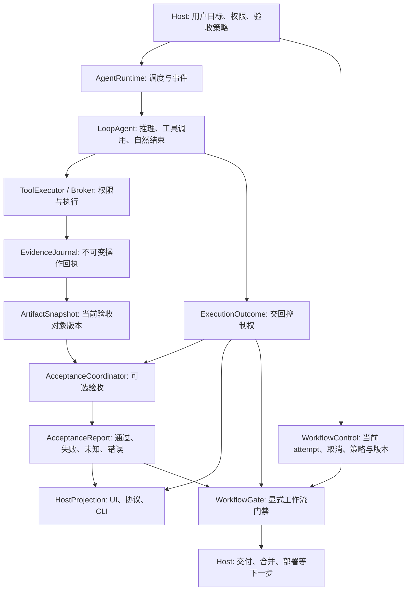
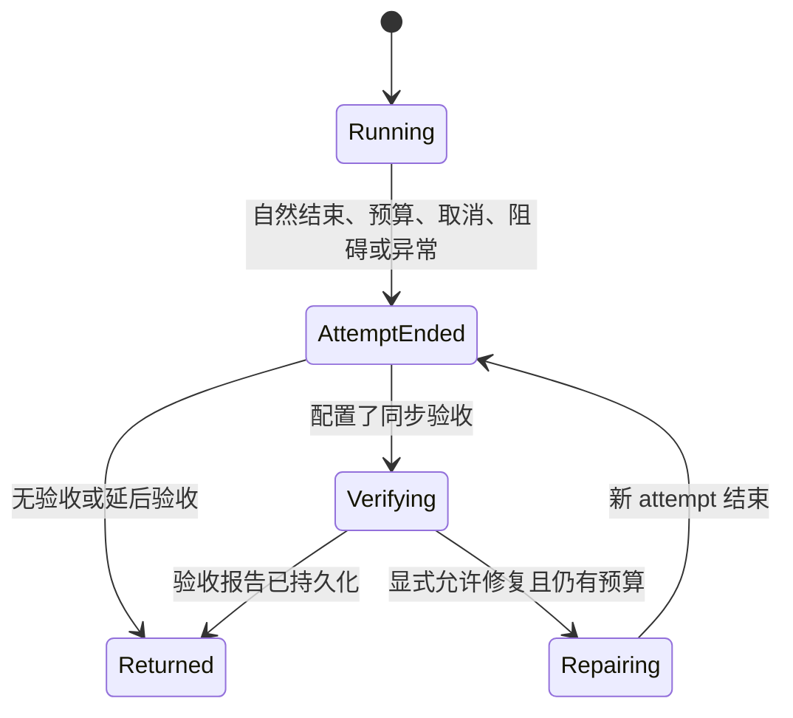

# 41. Agent 运行结果与任务验收架构重设计

状态：目标架构；M1 已实现并恢复五题官方判分链路，M2 宿主 inline 验收已在 SDK 实现，M3a 延后验收控制层已实现，M3b 动作执行与对账框架已实现；验收与宿主控制接线见第 46 篇，自动修复尚未实现。更新：2026-10-13。

首批可执行范围及具体接口、协议版本、退出码、存储与测试契约见 [42. Agent Outcome 首批实施契约](42-agent-outcome-implementation-contract.md)。本文保留最终架构目标；M1 仅恢复默认执行与外部判分，新式 required/deferred/repair 工作流按第 42 篇提前拒绝，不能将下文全部能力视为首批承诺。

M2 的实际入口和边界见 [43. 宿主 inline 验收实施契约](43-inline-acceptance-m2.md)：新增独立组合 API 与验收 ledger，不覆盖 M1 已封存 outcome；默认 CLI/TUI/ACP 仍为 observe。M3a 的异步回调、持久化取消、等待与动作领取见 [44. 延后验收与持久化工作流控制](44-deferred-workflow-control-m3.md)；动作执行、取消传播与崩溃对账见 [45. M3b 动作执行与崩溃对账](45-workflow-action-execution-m3.md)；验收、投递与宿主控制接线见 [46. 接线交付记录](46-outcome-workflow-delivery.md)；repair、累计预算和具体生产动作适配器仍待实现。

基于代码 `dc396839` 和当日 Terminal-Bench 2.0 的五题复测。本文的问题分析描述该基线。工作分支 `codex/agent-outcome-m1` 已实现第 42 篇的首批接口，验证进度见其实施记录；本文中的完整验收与工作流架构仍不能当作全部已落地能力。

## 1. 决策

Agent 的运行结束、任务验收和执行权限是独立维度。共享 Runtime 默认允许 Agent 正常交回控制权；未配置验收器时，文件修改任务的验收状态为 `unverified`，不据此制造运行错误。

只有宿主明确配置的工作流可以要求验收通过。权限、沙箱、checkpoint 和部署/合并授权始终在对应操作发生前执行，不因运行结束或验收成功而放宽。

核心约束：

1. 没有验收证据不能宣称任务已验证，但可以结束运行。
2. 工具成功、模型说完成、文件存在与任务正确是不同事实。
3. 验收的对象由宿主明确声明，不能从所有写过的文件推导。
4. 外部验收可以在 Agent 停止后执行，不依赖 Agent 先取得验收成功。
5. 新状态必须同时服务 SDK、CLI、TUI、ACP 和评测；不增加题名、模型或 benchmark 专用完成策略。

## 2. 当前问题与直接证据

此次复测沿用上轮五题、`deepseek-flash`、80 turns 和相同任务版本。五题均输出完整 result，但以 `completion contract missing: delivery-2` 退出；适配器抛出 `RuntimeError`，官方 verifier 全部未执行。这不是五题已经被 verifier 判错。

| 当前行为 | 本轮表现 | 架构问题 |
| --- | --- | --- |
| V2 默认要求 final response + delivery | GPT-2、调度器、HTML 题要求 host-authored acceptance evidence | 普通编辑任务默认要求宿主提供通用 CLI 并不存在的验收器 |
| `incomplete` 映射 exit 1，适配器对非零退出直接抛异常 | Harbor 无法进入 verifier | Agent 内部验收与外部验收形成顺序依赖 |
| 对写入历史逐路径检查最终存在状态 | 重分片题删除临时校验脚本后报 missing | 临时工作文件被当成必需交付对象 |
| 显式文件工具的指纹与最终文件比较 | 压缩器通过 shell 修改 `enc.c` 后报 changed | 已发生的新修改没有成为新版本，旧证据被当成最终正确性约束 |
| 当前 turn 的历史边界失败/审批记录可阻止完成 | 重分片题还报告 unresolved failure/approval | 历史尝试与当前仍需解决的操作没有充分区分 |

压缩器的工具回执显示：生成文件 2431 字节，解码与原文逐字节一致，连续三次检查一致。这只是 Agent 自检，不能替代官方 verifier；但说明当前退出错误与任务正确性之间没有直接对应关系。

相关实现入口：

- `zapsdk/harness/policy.ts`：默认 `delivery-response-v2`。
- `zapsdk/harness/completion.ts`：mutation 必须有 `verification.satisfied`。
- `zapsdk/runtime/completion-evidence.ts`：effects、写入指纹、审批与执行边界聚合。
- `zapsdk/runtime/agent-runtime.ts`：完成检查、继续执行请求、终态事件。
- `src/headless/runHeadless.ts`：completion 映射 stopReason、ok 与退出码。
- `evals/terminal_bench/zap_agent.py`：非零退出阻止外部判分。

第 40 篇记录迁移前及 legacy 实现；`harness-progress-evidence.md` 中“只有显式合约触发交付判断”的说法与当前 V2 默认策略冲突。后续以本文的决策为迁移目标。

## 3. 职责边界



| 组件 | 负责 | 不负责 |
| --- | --- | --- |
| `LoopAgent` | 执行已授权工作、工具调用、自检、预算、自然结束 | 决定外部 verifier 是否通过、隐式发明强制验收条件 |
| `ToolExecutor / Broker` | 操作准入、审批、沙箱、checkpoint、执行回执 | 根据命令 exit 0 判断整个任务正确 |
| `AgentRuntime` | attempt 生命周期、持久化、取消、调度可选验收 | 将缺少验收器变成模型/执行错误 |
| `EvidenceJournal` | 保留调用、版本、批准、失败和自检事实 | 把每个写入路径升级为交付要求 |
| `ArtifactSnapshot` | 对声明对象采集当前存在状态、版本与内容标识 | 从 shell 文本猜测完整写集合 |
| `AcceptanceCoordinator` | 按显式规范执行验收、处理 freshness 与基础设施错误 | 提升权限、把模型自报成功转成可信验收 |
| `WorkflowGate` | 综合执行结果、验收、取消与当前版本控制下一步操作 | 单凭 passed 放行、改写已结束 attempt 的执行结果 |
| `HostProjection` | 展示状态、协议映射、退出策略 | 混用“已结束”和“已验证” |

这些是逻辑边界。首轮实现保留统一 factory，不要求立即建立多个服务或大量新包。`zapvm/` 仍只提供执行协议和隔离能力，不提供 Agent prompt 或覆盖权限策略。

### 3.1 模型自检的交付范围

功能检查之外，模型还应按用户要求检查最终文件、目录内容及依赖。需要时将构建输出和诊断产物与交付内容分开；清理仅限本次创建且能可靠识别为可丢弃的输出，保留无关用户文件，并如实报告仍未满足的交付约束。standard 与 concise 共用同一提示来源，自定义系统提示也保留运行协议中的这份指导。

这属于通用模型指导，不推导隐藏验收规则，不将所有历史写入路径视为交付对象，也不注册自动删除、完成门禁或额外模型轮次。模型自检通过仍不能将 `acceptance.unverified` 升级为外部验收通过；真实模型是否因此改善交付行为需要独立对照验证。

### 3.2 文件工具的 checkpoint 范围事实

`CheckpointManager.createEditTracker()` 将跟踪回调与只读的 `describeCoverage()` 绑定在一起。描述直接读取同一个 manager 的当前启用状态、工作区根目录和文件大小上限，不包含快照存储目录、会话标识或其他控制路径。Executor 克隆保留这个回调；隔离子工作区使用自己 manager 创建的回调。SDK 自定义旧回调仍可使用；未声明描述、描述失败或无有效范围时，模型只得到未知范围，不从 executor cwd 猜测覆盖根。

Loop 在每次运行开始时，按实际工具注册表及 Host checkpoint 模式生成有界动态事实，standard、concise 与自定义系统提示都使用这条路径。它说明工作区外路径（含系统临时目录）不在该 manager 的覆盖范围，工作区内的具体路径也可能无法备份。模型应结合权限、现有文件和用户交付范围选择诊断位置，不能改用其他工具规避已拒绝的保护。

这些事实只描述文件工具的 checkpoint 范围，不声明 shell 或远程临时存储能力，不提供额外授权、不自动创建 scratch 目录，也不改变每次写入前的实际覆盖检查。运行中配置变化仍由实际回调执行；下一次运行重新获取事实。真实模型是否减少无效尝试，需要独立对照验证。

## 4. 状态模型

下面类型为拟议契约，尚未导出。三个结果分别保存，不使用一个 `success` 概括全部事实。

```ts
type ExecutionOutcome = {
  attemptId: string;
  status: "finished" | "limited" | "blocked" | "cancelled" | "failed";
  stopReason: string;
  finalResponse?: string;
  error?: { code: string; message: string };
  unresolvedActions: readonly ActionReference[];
};

type AcceptanceReport = {
  status: "not_requested" | "pending" | "unverified" | "passed" | "failed" | "error";
  specId?: string;
  attemptId: string;
  snapshotId?: string;
  checks: readonly AcceptanceCheckResult[];
  reason?: string;
};

type WorkflowDecision = {
  status: "not_requested" | "ready" | "awaiting_acceptance" | "blocked";
  attemptId: string;
  controlRevision: number;
  snapshotId?: string;
  reason?: string;
};
```

`ActionReference`、`AcceptanceCheckResult` 和下文的规范类型也属于拟议接口。实现时必须提供结构化 code、证据引用、时间和版本，不依赖拼接错误字符串判定状态。

### 4.1 执行状态

| 状态 | 含义 |
| --- | --- |
| `finished` | Agent 正常交回控制权；不表示目标已经正确实现 |
| `limited` | 达到 turns、tokens、时间等预算边界，可能已有可验收产物 |
| `blocked` | 当前下一项必要操作确实等待权限、输入或不可用能力；可解释并交回控制权 |
| `cancelled` | 用户或宿主取消，已等待工具停止或记录未停止的执行句柄 |
| `failed` | Runtime、provider、协议或必要持久化出现无法继续的执行故障 |

工具失败不自动决定 attempt 为 `failed`。Agent 可能改用其他方法完成工作。模型返回“做不到”也不自动等于 Runtime 异常，应保留回答、当前阻碍和验收结果。

### 4.2 验收状态

| 状态 | 含义 |
| --- | --- |
| `not_requested` | 本任务未要求验收，例如一般问答 |
| `pending` | 验收已安排或正在执行，包括外部异步判分 |
| `unverified` | 涉及交付，但缺少规范、证据或稳定快照，不能给出通过/失败判断 |
| `passed` | 当前明确要求均有可信、匹配当前版本的通过证据 |
| `failed` | 指定检查正常完成，至少一项验收条件明确不满足 |
| `error` | 验收器自身异常、超时或运行基础设施故障，未形成可靠结论 |

缺少必需产物在有明确规范时属于验收失败；哈希缺失、读取故障、工作区仍在变更属于无法判断或验收错误。命令非零是否表示验收失败由 verifier 契约规定；容器启动失败不能被归为任务不正确。

`passed` 只指声明的检查范围。通过一个单测不能被展示成所有目标均已满足。有限预算的 attempt 可以有 `acceptance: passed`；正常结束的 attempt 也可以有 `acceptance: failed`。

### 4.3 生命周期



attempt 的结束结果不可变。验收和 workflow 是后续版本化记录；异步验收不会将既有 `finished` 回写为执行故障。修复创建新 `attemptId`，归属于同一个 turn/workflow，使用明确的剩余预算和独立取消信号。

### 4.4 工作流放行规则

`WorkflowGate` 的输入必须包含执行结果、验收报告和宿主维护的 `WorkflowControl`。后者至少包含当前 `attemptId`、规范/交付版本、单调递增的 control revision、取消标记、当前必要阻碍，以及 `allowLimitedDelivery` 策略；模型不能直接修改这些控制字段。

先检查取消、执行状态和当前版本，再检查验收。以下规则按表中顺序匹配：

| 条件 | WorkflowDecision |
| --- | --- |
| 未配置受控的后续工作流动作 | not_requested；执行和验收仍正常返回 |
| workflow 已取消，或 execution 为 cancelled | blocked；迟到的 passed 不能解除取消 |
| execution 为 failed/blocked，或仍有必要阻碍 | blocked；验收结果保留，但不自动推进 |
| 报告属于旧 attempt/旧规范/旧交付版本，或缺少稳定版本证明 | 已安排新验收则 awaiting_acceptance，否则 blocked；不消费旧 passed |
| execution 为 limited 且未显式允许 `allowLimitedDelivery` | blocked；仍允许外部 runner 对产物独立判分 |
| 当前必需验收为 pending | awaiting_acceptance |
| 当前必需验收为 failed/error/unverified/not_requested | blocked，返回具体原因 |
| execution 为 finished，或显式允许交付的 limited；当前必需验收均 passed | ready |

`observe` 不创建强制验收门禁。用户后续明确要求的合并或部署，由宿主为该动作建立新的 workflow 规则，不能从普通 Agent 的验收摘要推断授权。

`ready` 是绑定 attempt、control revision 和交付版本的候选决定，不是不可撤销的执行许可。宿主调度下一步时须原子地复核这些字段、取消状态和原有授权，再固定被消费的交付版本；版本变化或取消会使旧决定失效。取消在动作开始前必须阻止启动；动作已开始后按执行层取消协议处理，不能承诺撤销已发生的副作用。Gate 的快照证明要求见第 6.2 节。

## 5. 策略与宿主配置

```ts
type AcceptancePolicy = {
  mode: "observe" | "required";
  timing: "inline" | "deferred";
  spec?: AcceptanceSpec;
  verifier?: HostVerifier;
  repair?: { maxAttempts: number; timeoutMs: number };
};
```

默认 `observe`，不配置 verifier，不自动执行任意仓库测试。Runtime 根据操作记录显示“有未验证变更”，正常返回；一般问答则报告 `not_requested`。

`required` 是宿主工作流的门禁，不是 SDK 全局默认：

- `required + inline`：必须在任何工具副作用前校验规范、verifier、资源与预算配置；缺失时返回配置错误，不能运行到结束才发现没有验收器。
- `required + deferred`：宿主必须提供外部验收所有者和结果关联方式。Agent 结束后 workflow 等待验收，不阻止结果输出或外部 verifier 启动。
- 没有验收通过的 workflow 不进入它所保护的交付/合并/部署步骤；用户授权与执行权限仍另行检查。
- verifier 必须由可信宿主注册，模型只能提出检查建议。普通工具自检以 `agent_check` 记录，不自动获得 host verifier 的身份。

规范至少声明验收对象、检查项、证据来源和 freshness 要求。原 `kind: delivery` 的笼统条件不再作为新默认，显式用户工作流应迁移为具体规范；不能只写“验证全部变更”。

示例：普通 CLI 编辑文件使用 `observe`；CI 工作流明确要求指定测试通过使用 `required + inline`；Terminal-Bench 使用外部验收，SDK 报告未验证或 pending，由 Harbor 决定 reward。

## 6. 文件证据与 freshness

### 6.1 操作日志与交付对象分离

`EvidenceJournal` 保留所有观察：文件工具写入、shell 执行、失败、删除、审批、自检。日志不可变，用于审计和诊断，不等于验收清单。

`AcceptanceSpec` 显式声明交付对象，可表达最终存在、最终不存在、内容/格式或运行行为要求。对象可标记为交付文件、检查输入或临时文件；模型建议的标记仅供宿主参考，不能自行撤销宿主要求。

- 临时脚本被删除，不触发全局完成失败。
- 用户要求删除的文件，最终不存在是正确目标。
- 新产生但未列入规范的文件可以展示和审计，不自动阻止运行结束。
- 通用 CLI 无规范时展示变更摘要，不推断所有文件必须存在。

### 6.2 使用当前版本验收

每项检查记录 `specRevision`、`snapshotId` 和输入依赖的版本。最终验收依据当前快照，而不是首次写入时的 hash。

文件工具能提供精确写入路径和版本；shell 的写集合可能未知。未知不表示失败，也不能假装无变更：

1. 为工作区维护 mutation generation；未知 shell 副作用保守推进 generation。
2. 准备验收时，对规范声明的依赖重新读取快照，刷新通过 shell 修改的文件。
3. 已知文件变更只使依赖它的检查失效；未知写集合使当前工作区相关检查保守失效。
4. 优先在可信的不可变快照上执行 verifier；另一种有效方式是由执行环境强制隔离全部相关写入者，并固定验收期间的输入版本。
5. mutation generation 和 Runtime writer lease 只覆盖受控写入，检查前后 hash 一致也不能排除检查期间修改后恢复。它们用于发现变化，不单独构成稳定版本证明。

输入变化使旧验证失效，不使正常文件编辑本身成为故障。大文件采用流式 hash、可信版本或 verifier 的隔离 snapshot，不因当前实现的 1 MiB hash 上限直接判失败。目录可以用确定性清单/版本表示，无法稳定采集时明确未知。

快照证据必须记录稳定性来源，例如可信文件系统快照、从受保护源采集的隔离副本，或覆盖编辑器、外部进程、受控及脱离管理子进程的强制写入隔离。只给目录取名 snapshot、从仍可变的源逐文件复制，或申请 Runtime 内部租约都不足以证明一致性。

普通可变工作区允许执行检查并保留 `checks[].observedOutcome`、时间和输入观察。检查可以报告观测到的通过/失败，但如果无法证明检查针对一个稳定版本，聚合验收为 `unverified`；不能发布可用于版本交付门禁的 `passed`。这不会阻止普通 Agent 结束或继续自主自检。

稳定快照上的 `passed` 只证明该快照。后续动作必须消费同一不可变版本，或在有全部写入者隔离的事务内证明当前目标与该版本一致；普通工作区的事后 hash 比较不能替代这个条件。第 4.4 节的版本复核因此必须同时检查版本身份和稳定性证明。

verifier 应只读访问交付对象，日志写入独立位置。必须修改文件的准备步骤要在 snapshot 前完成；确实改变交付对象后，应生成新快照并重新检查，不能沿用旧版本的通过结论。

## 7. 权限与失败的语义

操作准入仍是 fail-closed。验收通过不批准任何操作；`observe` 也不允许未授权命令执行。

区分两类记录：

- **历史尝试**：曾经拒绝、失败或取消的调用，永久保留审计事实。
- **当前阻碍**：仍有待批准的必要动作、未停止的工具、必须完成但未完成的 merge 等。

只有当前阻碍影响 workflow 或执行状态。Agent 换成合法方案后，不要求重放原先被拒绝的同一条命令来“洗掉失败”。

审批记录不删除、不自动转为 approved。明确放弃的动作标记为不再属于当前计划的活动项；其历史拒绝仍可见。撤销必要动作不能仅凭模型说“放弃”而自动满足宿主目标：目标是否实现由验收规范判断。

未停止的后台写入属于当前工作区不稳定，不能发布该版本的验收通过。merge 属于宿主交付动作时，不应反向阻止 Agent 交回结果；只有明确配置在验收前必需的动作才作为当前阻碍。

## 8. 验收、修复和预算

执行预算、验收预算和修复预算分别记录，并受同一 workflow 总截止时间约束。不得因进入验收或修复重新获得完整预算。

顺序为：停止 Agent 工具写入 → 保存 attempt result → 采集规范对象快照 → 调用验收器 → 发布报告 → 计算 workflow 决定。

自动修复默认关闭。显式启用时，仅对可操作的验收失败提供反馈；检查缺失能力、权限拒绝、验收器异常或未配置验收器不能生成“再试一次直到成功”的提示。

必须移除 `AgentRuntime` 当前因 artifact/command/successful_tool_call 验收条件未满足而注入的 acceptance-driven `turnEndGuard`。无论采用新协议还是兼容投影，都不能在自然结束前调用宿主 verifier，或把验收失败转换为合成 user 消息要求模型多跑一轮。显式 required 合约只决定后续 workflow 门禁；它本身不授权修复。

`LoopAgent.turnEndGuard` 作为显式宿主扩展可以保留，但 SDK factory 不再自动用它绑定验收。宿主显式配置的其他 guard 与验收修复分开记录；不能通过 guard 绕过 `repair` 默认关闭及预算限制。修复只能在 attempt 结束、验收结果已保存后，由 `AcceptanceCoordinator` 按显式 repair 策略发起新 attempt。

- 修复次数、累计时间和模型/工具预算都有上限。
- 每次修复是新 attempt；新修改使受影响的验收结果失效。
- 取消会停止后续验收和修复；如果外部检查无法立即取消，记录句柄并禁止发布过期结果。
- 隐藏测试内容、标准答案和 verifier 私有断言不注入模型。外部评测按其正式协议提供反馈；默认只运行一次 Agent，不进行按隐藏结果定向修复。
- 普通自检仍由 Agent 在已授权预算内执行，保留为独立检查事实。

## 9. 协议、持久化和恢复

新增结果 schema，包含 `execution`、`acceptance`、`workflow`，并带 `threadId / turnId / attemptId`。不要改变现有 result 字段含义后仍沿用同一 schema 版本。

最小结果版本、终态事件版本和兼容投影必须与默认行为恢复在阶段 A 原子上线，不能等到阶段 C 才补版本。具体版本已由第 42 篇固定：Headless 使用 zap.outcome schema 1，Runtime 事件与 state 升为 3，HostProtocol 新增 version 2；CLI 用 `--result-schema outcome-v1|legacy` 选择档位。消费者的目标行为如下：

| 消费者 | 协议选择与行为 |
| --- | --- |
| 新版 CLI 默认入口 | 显式标识新 outcome schema，按 execution 输出和退出，独立报告 acceptance/workflow |
| 已有 SDK 调用者、未协商新版本的 HostProtocol 客户端 | 保留 legacy 结果/事件投影，不在同一版本改变 completion.success/status 的含义；通过显式选项或能力协商采用新档位 |
| 明确选择 legacy 输出的 CLI | 同时保留旧字段语义和旧退出约定，可能仍返回 completion-incomplete；不恢复验收驱动的模型继续执行 |
| 新外部 runner | 识别 result schema，优先读 execution；兼容 legacy 语义性退出并保留原始结果 |

legacy 投影只表达旧的判定，不回写新 execution，不触发原收尾 guard。旧显式强制验收要求通过兼容层保留在验收/workflow 中。旧数据、字段、事件和退出码各自有固定映射及弃用规则，禁止一部分用新语义、一部分沿用旧语义。

拟议事件：`attempt_ended`、`acceptance_started`、`acceptance_updated`、`workflow_decided`。每条验收更新带检查 ID、规范版本、快照 ID 和单调递增 revision。重复结果提交必须幂等；旧 attempt 或旧 snapshot 的异步结果不能覆盖当前报告。

workflow 取消作为持久化的 control revision 更新，不通过修改旧 attempt 表达。处理验收回调和调度后续动作都必须读取该控制状态；迟到的结果可保留为历史证据，但不得清除取消、替换新 attempt 的报告或恢复旧 ready 决定。重新执行由宿主显式建立新的 workflow 控制版本，不能由验收回调隐式恢复已取消的工作流。

恢复时保留已结束的执行事实。中断的验收先恢复为未知/待协调，再由配置决定重跑；不能把进程恢复视为检查通过。只读、幂等检查可以重跑；有外部副作用的检查必须由宿主按 operation ID 协调，不能自动重放。

工作区 writer lease 在修改和快照阶段由 Runtime 管理；延后 verifier 不能无限持有 Agent writer lease。需要长期验证时使用可信隔离快照；可变工作区的短期内部锁只协调 Runtime，不能升级为全部写入者隔离。复用旧验收必须证明规范、检查版本和全部依赖版本匹配，不能凭历史 turn 曾经成功而复用。

## 10. 各宿主的结果投影

### 10.1 CLI / Headless

默认退出码表示执行请求是否正常处理，不表示所有用户目标都已被证明正确。增加明确的验收退出策略，只有宿主显式请求时才把 workflow 门禁投影为非零退出。

| 情形 | 默认退出 | 显式要求验收的退出策略 |
| --- | --- | --- |
| 正常结束，无验收或未验证 | 0 | 未满足明确门禁时返回独立 acceptance 状态码 |
| 正常结束，验收通过 | 0 | 0 |
| 正常结束，验收条件失败 | 0，JSON 保留 failed | 返回 acceptance 失败状态码 |
| 正常结束，验收器错误 | 0，JSON 保留 error | 返回验收基础设施错误状态码 |
| turns/tokens/时间限制，产物可用 | 保留现有软停止退出策略；JSON 为 limited | 对已有产物验收后决定门禁，不跳过验收 |
| 当前必需操作被权限阻止 | 保留权限状态码；JSON 为 blocked | 同样保留阻碍 |
| 用户取消、执行故障 | 保留取消/错误状态码 | 不被验收通过覆盖 |

第 42 篇固定验收失败/验收基础设施错误预留退出码为 5/6，M1 不产生这两个码，因为新式验收尚未开放；输入/能力阻碍使用 7。新 schema 的 `ok` 明确定义为 `execution.status === "finished"`，不表达验收通过，也不总是与退出码 0 等价（limited 保留软停止策略）。旧 schema 仅使用 legacy 映射及旧退出约定，不能把新定义套到旧字段。

`required + deferred` 的启动进程使用 execution 退出策略，输出关联 ID 和 pending，不因为当前尚未验收而返回 acceptance 失败码。需要等待门禁的调用者应使用独立 workflow wait API/命令，由该等待结果投影验收退出码；不能让启动端先等待它退出后才会启动的 verifier。

自然回答和工具失败解释可以正常返回。系统不能把“finished”渲染为“所有要求已通过”；有未验证修改时应显示“执行已结束，修改尚未验收”。

### 10.2 TUI / ACP

TUI 分开展示执行状态、未解决阻碍和验收状态。一般编辑会话不弹出必须由用户接管的“验收失败”，也不因没有 host verifier 强行继续模型循环。

ACP 的正常回合结束不因为 `unverified` 自动映射为 refusal。使用协议支持的元数据表达验收状态；如果协议不支持，明确降级为摘要说明。真实权限拒绝保留为拒绝/阻碍，不伪装成正常验收通过。

### 10.3 Terminal-Bench / Harbor

适配器只负责启动、隔离、收集执行结果和进入官方判分。存在有效最终 result 的软停止、未验证交付或旧 schema `incomplete` 不应被统一提升为 adapter exception。

```text
启动任务容器
  → 运行 Zap，保存最终 result 与进程退出码
  → 分类：可验收结束 / 运行基础设施故障
  → 可验收结束：调用 Harbor 官方 verifier
  → 分开记录 agent execution 与 verifier reward
  → verifier 完成后释放容器
```

兼容阶段：仅对已识别的语义性退出（例如有效 result 的 completion-incomplete）继续 verifier；不能吞掉未知非零退出、崩溃或损坏协议。对执行故障是否仍验收部分产物由外部 runner 显式决定，原执行故障必须保留。

官方 reward 是该 benchmark 的任务结论。adapter 不读取隐藏断言、不注入专用收敛提示、不把 Agent 自检改写为 reward。结果报告分别统计运行失败、verifier 基础设施错误、已判分任务和通过任务；未判分不能冒充官方 reward 0，也不能在总样本分母里悄悄删除。

外部 verifier 未返回时 SDK 不伪造 `passed`；由 runner 在外部结果记录中关联 attempt、任务版本和 verifier 输出。无需为了取得内联验收而把 Harbor 测试植入 Agent 进程。

## 11. 实施与迁移顺序

本节是全架构工作流分解；实际首批提交依赖与发布边界以第 42 篇的 M1-1 至 M1-6 为准。其余能力分期实现并在首批明确拒绝。

| 阶段 | 修改范围 | 完成条件 |
| --- | --- | --- |
| A：协议与默认语义原子迁移 | `harness/policy.ts`、Runtime completion、最小结果/事件版本、SDK 兼容层与 headless | 新入口正常结束并报告未验证；legacy 字段/退出语义不变；移除验收驱动 guard；显式契约和权限约束仍有效 |
| B：外部 runner 解耦 | Terminal-Bench adapter 与 Python 回归 | 有完整 result 的语义性结束进入 verifier；真正执行故障仍单独记录 |
| C：结果持久化与恢复完善 | `harness/completion.ts`、`runtime/types.ts`、事件与存储、SDK 导出 | 扩展阶段 A 已建立的独立结果契约，补齐历史数据转换、异步报告和恢复；不在此阶段才改变字段含义 |
| D：证据与快照 | completion evidence、executor、workspace snapshot | 临时删除不误报，shell 修改正确刷新版本，过期检查失效 |
| E：宿主投影 | CLI、TUI、ACP、coordinator | 状态一致，普通运行不误报 refusal，显式工作流门禁与权限独立 |
| F：验收工作流 | host verifier、修复预算、异步恢复 | required 配置提前校验，修复有界，异步结果不可覆盖新版本 |

阶段 A/B 是止损路径，不能作为最终架构的全部实现。A 保留审计回执和权限执行约束，同时完成最小协议隔离、默认行为恢复及收尾 guard 解耦；不能先悄悄重定义旧字段再补版本。B 同时支持阶段 A 的新协议和 legacy 分类，不能假设全部消费者已迁移。

旧 `CompletionContract` 的显式 requirements 通过兼容层映射为宿主规范；保留既有显式强制验收意图，不能在升级时静默变成 advisory。只有自动注入的默认 `delivery-response-v2` 移除隐式强制性。

旧 `completion.status/success`、`turn_incomplete` 与 `modelClaimedSuccess` 不直接解释为新 execution 状态。读取旧日志时保留 `legacyCompletion` 和实际 stopReason；没有足够证据时标记未知。`modelClaimedSuccess` 目前实际依赖自然非空回答，新接口用 `finalResponse`/实际模型声明描述，不能把任意非空回答当作成功承诺。

## 12. 验证矩阵与验收门槛

| 场景 | 必须得到的行为 |
| --- | --- |
| 普通问答，无工具 | finished + not_requested |
| CLI 创建文件，无 host verifier | finished + unverified，默认 exit 0 |
| 普通 shell 安装依赖、未知副作用 | 保留执行事实和未验证状态，不能仅因未知副作用报任务错误 |
| 工具失败后换合法方法完成 | 历史失败保留，当前无阻碍时正常结束 |
| 必需操作等待批准 | blocked；不执行该操作，允许交回解释 |
| 临时脚本创建后删除 | 不因临时文件不存在阻止运行结束 |
| 用户要求删除指定文件 | 最终不存在满足对应验收条件 |
| 写文件后经 shell 修改并验证 | 当前快照是新版本；旧测试不能证明新版本通过 |
| required 未配置验收器 | 在工具副作用前配置失败 |
| 显式验收条件不满足，repair 关闭 | 自然结束，不注入验收续跑消息，不增加模型调用；仅更新验收和 workflow |
| 显式允许修复，验收失败可操作 | 已结束 attempt 不变；在剩余预算内启动新 attempt |
| verifier 正常判错 / verifier 崩溃 | acceptance failed / error 分开；execution 不被重写 |
| 检查期间并发修改输入 | 不发布新 passed；重新检查或 unverified |
| 编辑器、外部进程或脱离管理子进程修改后恢复输入 | 不能凭 generation 或前后相同 hash 发布稳定 passed；保留观测，缺稳定性证明则 unverified |
| 不可变快照检查通过，原工作区随后变化 | passed 仍仅属于快照；后续动作不得消费变化后的工作区 |
| 修改无关文件 | 不使声明依赖明确且未变化的检查失效 |
| 大文件、目录、外部资源 | 支持对应版本证据；缺证据时未知，不伪造失败或通过 |
| 达到预算但已有正确产物 | limited，外部 verifier 仍有机会判分 |
| limited 验收通过，未允许 limited 交付 | 保留判分结果，workflow blocked；显式允许且满足其他条件才 ready |
| 外部 verifier 延后返回 / 崩溃恢复 | workflow 等待；关联版本、幂等提交，旧结果不覆盖新 attempt |
| 取消后收到 passed / ready 后在动作调度前取消 | 保留验收历史，workflow 不自动推进；调度复核取消与 control revision |
| required + deferred 启动与等待 | 启动按 execution 返回关联 ID；独立 wait 等待验收，不形成进程退出依赖 |
| 新版 CLI 与未迁移 SDK/协议客户端 | 新版带新 schema；legacy 的字段、事件、退出映射固定，不触发验收续跑 |
| 验收成功后请求部署 | 仍需原有部署授权、权限和执行准入 |
| TUI/CLI/ACP 同一任务 | 执行、验收、阻碍三个维度一致 |

实施时运行 root `bun test`，相关 TypeScript 检查和 Python adapter 回归；持久化测试使用隔离 `ZAPCODE_DATA_DIR`。没有改动 VM 不扩大到 VM 实现。

修复后首先重复同一组五题、同一模型与预算，用官方 verifier 证明 runner 已恢复判分；再扩大任务覆盖。报告保留本轮原始失败，不合并重跑以制造单轮更高分数。架构验收要求是正确区分状态并完成官方判分，不要求承诺某个通过率。

## 13. 不采用的方案

- 为 benchmark 关闭所有证据检查：普通 agent 的默认语义问题仍存在。
- 把 exit 1 全部吞掉：真正的 provider、进程、协议故障会丢失。
- 将任意 shell exit 0 当作任务通过：没有明确验收范围，也无法证明证据新鲜。
- 将所有写过的文件都列为必需交付物：不能支持临时文件、删除和正常迭代。
- 未配置验收器时让模型无限继续：模型无法创造可信宿主证据，只会增加费用和副作用。
- 把验收成功当作部署/合并批准：会越过原有授权边界。

本设计保留证据驱动验收的目标，将它放回显式宿主工作流，恢复通用 Agent 正常结束和交回结果的能力。
