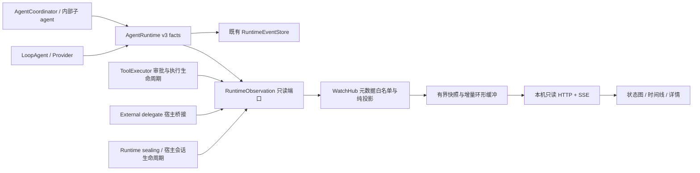
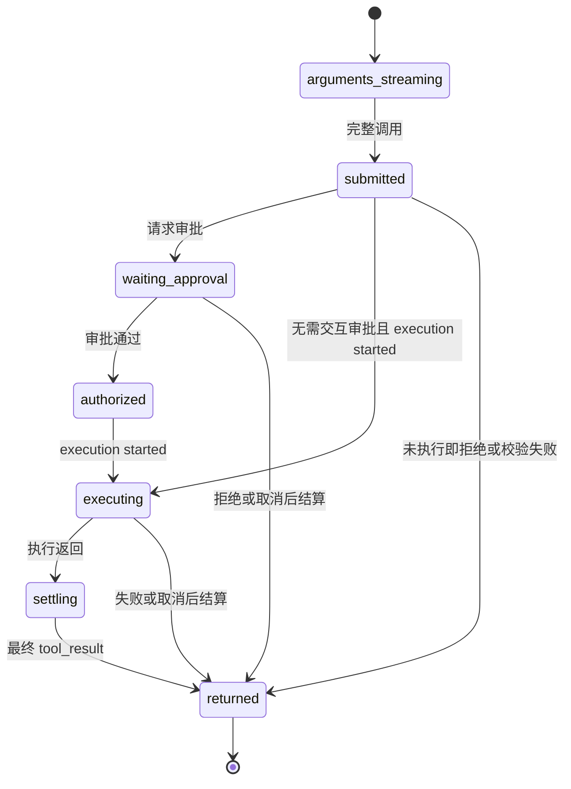

# 57. `zap --watch` 运行时观测与动态状态图

状态：运行时接线与首版实时网页已实施，位于 `codex/watch-runtime`。起始代码基线：
`2a72ed4646a1a13c49093682a46a25badd12c4f2`。本地验证范围见第 11 节；未声明跨平台、
npm 新环境安装及全部 M1 验收完成。Watch 是独立的只读观测路径。

## 1. 目标与首版边界

执行 `zap --watch`，保留正常终端交互，同时启动本地网页并打开浏览器。用户应能回答：

1. 主 agent 当前处于哪个阶段，在等待模型、审批、工具还是运行收尾？
2. 哪些工具正在生成参数、等待执行、实际执行、返回结果或失败，分别耗时多久？
3. 哪些子 agent 已排队、启动、运行、等待、验证、合并或结束，它们属于哪个父任务和工具调用？
4. 最近发生了什么，哪个请求正在重试，当前数据是否新鲜，哪里缺少观测？

首版 M1 必须同时覆盖 TUI、带明确 prompt 的 headless、内部嵌套子 agent、外部 CLI
委派的宿主生命周期。外部 CLI 内部工具只有它所报告的观察，必须标记来源和覆盖限制。
网页刷新、连接重建、TUI 新 turn、新会话以及取消后的收尾都属于 M1。

网页为只读观察者，不接收 prompt，不审批、不取消、不恢复 agent，不执行工具，不改变
提示词、权限、调度、重试、预算或终态。SDK 不引入 React、浏览器或 HTTP 依赖；`zapvm/`
仍是独立模块，只显示 agent 当前已经取得的执行后端事实，不进入 VM 内部采集。

M1 不包括跨进程聚合、任意历史会话浏览、远程访问、多人协作、原始网络抓包、完整对话/
思考内容、持久化的 watch 全量轨迹或从网页控制运行。关闭网页不停止 agent。

## 2. 实施前的基线事实与缺口

下表保留起始基线的诊断，所列缺口由下述实现补线；当前落点和剩余验收见第 11 节。

| 当前入口 | 已有能力 | 对 watch 的缺口 |
|---|---|---|
| [`src/index.tsx`](../../src/index.tsx)、[`src/cli-routing.ts`](../../src/cli-routing.ts) | TUI/headless/ACP/workflow 分流；`--dev [port]` | 没有 `--watch`；必须先剥离 watch 参数，避免端口被识别为 positional prompt |
| [`src/devtools-integration.ts`](../../src/devtools-integration.ts)、[`zapsdk/devtools/server.ts`](../../zapsdk/devtools/server.ts) | 本机 HTTP/WS、随机 token、AgentEvent 环形缓冲、会话/提示词/配置快照、脱敏；App 还包装全局 fetch | 缓冲仅 500 个 AgentEvent，无 watch 游标/一致性图快照；采集范围过宽；当前单个 emitter 订阅不能自动涵盖所有分支 |
| [`zapsdk/agent/events.ts`](../../zapsdk/agent/events.ts) | `status`、`provider_request`、`content_*`、`tool_call_pending`、`agent_run_state`、子 agent 事件和 `path` | `status` 是活动阶段，不是任务终态；工具调用内容不是工具执行开始事实 |
| [`zapsdk/runtime/agent-runtime.ts`](../../zapsdk/runtime/agent-runtime.ts)、[`types.ts`](../../zapsdk/runtime/types.ts) | RuntimeEvent v3：thread/turn/run/tool 身份、线程内 sequence；`subscribe(..., 3)`；`attempt_ended` | `subscribe` 默认投影为 v2，watch 必须显式选择 v3；发布给监听器时 append 已调用，但不保证已经持久化 |
| [`event-store.ts`](../../zapsdk/runtime/event-store.ts)、[`src/agent/runtimeEventStore.ts`](../../src/agent/runtimeEventStore.ts) | 项目级 JSONL、分页、SQLite 索引；事件与可变恢复状态分开 | 不能把磁盘轮询当实时来源；不能把落盘日志直接作为网页公开协议 |
| [`zapsdk/tools/executor.ts`](../../zapsdk/tools/executor.ts)、[`zapsdk/runtime/factory.ts`](../../zapsdk/runtime/factory.ts) | 独立的 Approval/ToolExecution lifecycle；factory 接到 RuntimeStateTracker | lifecycle 没有统一进入 RuntimeEvent 流；缺少完整 run scope 和每次执行尝试的唯一 span ID |
| [`zapsdk/agent/run-state.ts`](../../zapsdk/agent/run-state.ts)、[`zapsdk/coordinator/coordinator.ts`](../../zapsdk/coordinator/coordinator.ts) | 子 agent 的权威状态、parentRunId、toolCallId、每 run 单调 sequence | 图应使用这些身份；不能按任务文字、数组顺序或 tool 名称匹配 |
| [`src/hooks/useAgentRunner.ts`](../../src/hooks/useAgentRunner.ts)、[`src/headless/runHeadless.ts`](../../src/headless/runHeadless.ts) | TUI 每 turn 重建 Runtime；SessionHostRuntime 稳定存在；headless 有独立装配与清理 | 需要会话级 watch 生命周期和每 turn 绑定；headless 的 sealing 进度目前主要发给 formatter |
| [`zapsdk/builtin-tools/subagent.ts`](../../zapsdk/builtin-tools/subagent.ts)、[`delegate.ts`](../../zapsdk/builtin-tools/delegate.ts) | 内部子事件通过 factory 记录；外部 delegate 解析事件通过宿主回调进入 UI/formatter | 外部回调并非统一 Runtime 发布入口；需要带父工具身份的统一桥接，不能只接 `runtime.on("*")` |
| [`zapsdk/host-protocol`](../../zapsdk/host-protocol/index.ts) | 稳定 session、事件订阅、SSE、Bearer 认证，以及运行/取消等控制 RPC | 可借鉴订阅和认证模式；watch 不能直接暴露带控制权限的 AppServer/RPC |

现有 RuntimeEvent 继续承担既有运行事实与持久化职责；RuntimeStateStore 继续承担恢复控制。
Watch 的投影、缓冲丢失和页面断开均不写回这两者。已有 DevTools 保持兼容，watch 不调用
`patchFetchForDevtools`，不把 `--watch` 实现为 `--dev` 的别名。

## 3. CLI 与进程生命周期

已实现命令：

```sh
zap --watch
zap --watch --watch-port 4318
zap --watch --watch-no-open
zap --watch -p "检查当前项目" --output-format stream-json
zap --watch -p "检查当前项目" --watch-linger 30
```

| 参数 | M1 语义 |
|---|---|
| `--watch` | 为当前 CLI 进程启用观察；默认监听 `127.0.0.1:0`，让系统分配端口；默认打开浏览器 |
| `--watch-port <0..65535>` | 必须与 `--watch` 同用；显式端口占用时在模型/工具启动前报错，退出 2；不偷偷换端口 |
| `--watch-no-open` | 只打印地址，不启动浏览器；必须与 `--watch` 同用 |
| `--watch-linger <0..300>` | headless 结束后保留只读页面的秒数；默认 0；不延长 agent 的执行预算，也不继续执行 agent |

所有 watch 参数先完整解析和校验，再把剩余 argv 交给现有 routing/headless parser。
保留 `--cwd` 在 singletons 导入前生效的现有顺序。`--help`/`--version`/`--help-headless`
只打印说明，不启动 server。`--watch-linger` 用于 TUI 时按无效组合报错，不默默改变退出行为。

`acp`、`--acp-worker`、`workflow` 与 watch 组合在协议输出前退出 2；显式 `--watch --dev`
同样退出 2。`--watch` 抑制继承的 `ZAPCODE_DEVTOOLS_PORT`，输出一次解释；`--no-devtools`
可与 watch 同用。这样不会在用户只要求状态观察时意外启用原始 HTTP 调试采集。

启动次序：参数校验 → cwd 与正常配置准备 → watch server ready → 输出地址/尝试打开浏览器
→ 原有 TUI/headless 运行。所有 banner、浏览器失败和观测警告写 stderr，headless stdout
仍只包含原有格式。无 prompt 的非 TTY 调用继续遵守现有参数规则，不因 watch 自动创建任务。

TUI 的 server 只创建一次；切换会话和 turn 不重启端口、不清空仍在观察的活动状态。
Headless 默认保持正常退出时机；极短任务可能在浏览器加载前结束，需要查看时显式使用
`--watch-linger`。linger 开始前保存原退出码；到期后以该退出码退出，Ctrl+C 仅提前结束
linger，不重新取消已经结束的 run。浏览器已加载的最后快照保留在页面内，显示“观测已停止”；任务结果以 outcome 区域为准。

启动监听失败在运行前报错；浏览器打开失败只提示手动地址。运行中 server/投影故障只降级
观察能力，不取消 agent。退出时先接收原有 Runtime 收尾和最终 outcome，再发布
`process_stopping`，有界清理 SSE/socket、订阅、timer 和 server；watch 自身清理上限 500 ms。
已有 Runtime 的收尾逻辑及其原有预算不归 watch 管理。强杀时页面只能显示连接丢失和最后
已知状态，不能声称任务取消、工具停止或服务已经回收。

## 4. 架构与单向事件路径



分层：

- **SDK 事实端口**： `zapsdk/runtime/observation.ts`。只声明事件、身份、同步 observer
  接口与防异常包装。现有 Runtime 发布事实一次，审批/执行/收尾补充事实进入同一观察端口。
- **Host 适配**： `src/watch/integration.ts`，拥有进程实例、会话注册、factory observer
  参数与外部 delegate 桥接。TUI/headless 复用相同 WatchHub，不依赖 React effect 才能记录事实。
- **投影与传输**：`src/watch/projector.ts`、`hub.ts`、`server.ts`，分别负责纯状态归约、
  有界顺序/快照/重放，以及本机只读服务。浏览器只消费 Watch 协议，不消费 SDK 原始对象。
- **页面**：`src/watch/client.html`，原生 DOM/SVG 的增量图和列表，无需新增图形库或远程 CDN。
  使用 Bun text import 内嵌页面，补 TS 声明；npm 源码包与 `bun build --compile` 均须携带页面。
  不依赖运行时读取源码 checkout 的相对路径，具体嵌入方式必须经过编译产物验收。

factory 新增可选 `observer?: RuntimeObserver`。未启用 watch 时不创建 WatchHub、服务器、
图状态或内容统计 timer。SDK 调用 observer 必须同步、try/catch、只做有界分发；
不能 await 浏览器、网络、watch 写盘或页面消费。既有 durable lifecycle hook 的 await 顺序
保留，watch 不混入其错误传播链。自定义 observer 是可信 Host 扩展，无法隔离恶意无限循环；
内置 watch 回调必须满足下文的复杂度、队列和性能约束。

内部 observer 可以借用现有 RuntimeEvent 对象引用，但不得复制、序列化或扫描其中的正文。
内置回调只提取白名单元数据和 O(1) 字符长度；对浏览器的 read model 在此之后单独生成。

TUI 在稳定会话创建时注册 session，在 factory 创建每个 Runtime 时传入相同进程级 sink；
headless、public-checks repair 的每次 attempt 使用同一 sink。内部子 agent 经临时绑定继承 scope。
不同时订阅 session 转发和具体 Runtime 再投递一次相同事实，不再额外消费 formatter/UI 日志。
旧 turn 的闭包带活动身份检查，结束后 supplemental 回调失效；仍进入投影的迟到事实记诊断，不能串入下一 turn。

外部 `delegate_agent` 由宿主在启动子进程前建立 childRunId、父 run 和父工具绑定，桥接进
同一 sink；启动失败、超时、取消、退出由宿主进程管理者发事实。解析器不能用第三方 JSON
覆盖父身份、结束宿主 run 或宣称受 Zap sandbox 保护。

## 5. 运行时事件与身份契约

### 5.1 身份

| 身份 | 所有者与用途 |
|---|---|
| `instanceId` | 每个 watch CLI 进程随机生成；server 重启后更换，作为 cursor epoch |
| `threadId` | 现有会话身份；进程可包含多个 TUI 会话 |
| `turnId` / `rootRunId` | 现有 Runtime 建立的用户 turn 与根 attempt；多个 repair attempt 不能混为一个 |
| `runId` / `parentRunId` | Runtime/Coordinator 建立；内部子 agent 使用 AgentRunSnapshot 的真实身份 |
| `toolKey` | 编码元组 `[threadId, turnId, runId, step, toolCallId]`；同名、同 id 的不同分支不碰撞 |
| `executionSpanId` | 每次真实进入 executor 执行边界新建；现有 `execution:${toolCallId}` 不足以区分重试 |
| `requestId` / `attempt` | LoopAgent 每次逻辑 provider 调用建立 requestId；provider attempt 仅在该 request 内唯一 |
| `approvalKey` | 完整 toolKey 加审批 occurrence；不只使用 `approval:${toolCallId}` |

编码采用结构化元组的 JSON 序列化再取完整 SHA-256，控制节点/边 ID 的长度；不截断来源
身份或使用未转义拼接。`path` 只供既有 Runtime 确定真实 run，不能
覆盖 `agent_run_state.run.runId/parentRunId`。不得从 task 文本、最近一个活动工具或“当前
选中的会话”反推归属。根 sessionId 与子 sessionId 含义不同，不能直接当统一 runId。
投影入口限制单个来源身份字段最多 256 个 JS 字符；Watch 不复制来源路径数组。超限仅使该观察
不可关联并显示 coverage 诊断，不截断成可能碰撞的 ID，也不阻止原工具/agent 执行。

已使用 AsyncLocalStorage 承载 Host 建立的临时 observation scope，覆盖流式和非流式
executor、审批、ask_user_question 以及子 agent。coordinator 将该绑定保存在当前队列的
临时 bindings，执行时恢复；不持久化 observer/闭包，不放入模型参数。独立未观测 Runtime
会退出继承的上下文。缺少 scope 时不冒认根 run；无法关联的投影事实产生诊断。

### 5.2 SDK 观察端口

```ts
type ObservationScope = {
  threadId: string;
  turnId: string;
  runId: string;
  parentRunId?: string;
  rootRunId?: string;
};

type RuntimeObservation =
  | { kind: "tool_catalog"; names: string[] }
  | { kind: "runtime_event"; event: RuntimeEvent }
  | { kind: "tool_execution"; scope: ObservationScope;
      executionSpanId: string; event: ToolExecutionLifecycleEvent }
  | { kind: "approval"; scope: ObservationScope;
      approvalOccurrence: string; event: ApprovalLifecycleEvent }
  | { kind: "run_binding"; scope: ObservationScope;
      childRunId: string; toolCallId?: string; step?: number }
  | { kind: "input_wait"; scope: ObservationScope;
      toolCallId?: string; step?: number; phase: "requested" | "settled" }
  | { kind: "dependencies"; scope: ObservationScope;
      childRunId: string; dependencies: string[] }
  | { kind: "external_unknown"; scope: ObservationScope }
  | { kind: "external_event"; scope: ObservationScope; event: AgentEvent }
  | { kind: "lifecycle"; scope: ObservationScope;
      phase: "sealing" | "cleanup"; at: number }
  | { kind: "external_run"; scope: ObservationScope;
      toolCallId?: string; step?: number; childRunId: string;
      phase: "starting" | "running" | "failed" | "cancelled" | "exited";
      at: number; exitCode?: number };

interface RuntimeObserver {
  observe(event: RuntimeObservation): void;
}
```

这是 SDK 内部/Host 类型示意，引用既有 RuntimeEvent 和 lifecycle 类型，不是浏览器可接收的
raw JSON。完整类型以 `zapsdk/runtime/observation.ts` 为准。`provider_request` 仍走
RuntimeEvent，已补可选 requestId 字段；恢复调用、同 step
的 continuation 和新请求即使 attempt 都从 1 开始，也产生不同 requestId。

既有 RuntimeEvent v3 不因 watch 强制升版；新增 supplemental 观察不修改 v3 持久事件
payload。已有 event-store 与恢复语义保持原样。M1 supplemental 观察只保存在当前 WatchHub
内，不能声称重启后的历史执行/审批时间线完整。持久化、历史协议与迁移另列 M2。

### 5.3 来源到投影的映射

| 来源事实 | 网页更新 | 不能推断的事情 |
|---|---|---|
| `turn_started` | 建立 thread/turn/root run，绑定新 attempt | 任务已验收 |
| `status` | agent 的 `activity`：idle/thinking/writing/tool/compacting | idle 表示已结束；thinking 表示可以公开思考正文 |
| `provider_request` | request 节点：requesting/waiting_output/streaming/retrying/completed/failed，attempt、耗时、重试倒计时 | HTTP headers 已到表示模型已经输出；streaming 的字符数等于 token 数 |
| `tool_call_pending` | logical tool：`arguments_streaming`，只显示参数字符进度与工具名 | handler 已执行；部分 JSON 是可执行参数 |
| `content_final.tool_call` | logical tool：`submitted`，建立所属 run/step | 已授权或已经启动进程 |
| approval requested/approved/denied | waiting_approval/authorized/denied | approved 表示执行完成或已进入 handler |
| execution started | execution attempt：running；logical tool 进入执行阶段 | 本机进程已创建、远程 VM 已成功启动；这些需要更具体的 receipt |
| execution completed/failed/cancelled | execution attempt 终态；成功返回后 logical tool 仍可处于 `settling` | 已完成结果后处理、模型已经看见结果 |
| `content_final.tool_result` | logical tool 已返回最终结果；记录 success，明确 failed/cancelled | 工具成功等于 turn 成功或独立验收通过 |
| `agent_run_state` | 子 agent 权威 lifecycle、run sequence 与父工具关联 | `ready_to_merge` 或 `merging` 等于 completed |
| 子 `run_ended` | 子模型循环结束、usage 更新 | coordinator 的验证/合并已经结束 |
| `run_usage` | 按 run/step 累计已报告的用量和缺失标记 | 缺失 usage 为 0；父子用量可以直接再相加 |
| lifecycle sealing/cleanup | 根 run 进入收尾，保留仍未结算的子节点 | 文本 final/run_ended 表示 CLI 可以安全退出 |
| v3 `attempt_ended` | 固定 execution、acceptance、workflow 三个独立结果区 | execution finished 表示验收 passed 或服务已停止 |
| legacy turn terminal | 带 legacy 标记的根终态 | 自动补造 outcome-v1 验收结果 |
| 外部 delegate 宿主/解析事件 | 宿主 child 生命周期；报告的内部工具另标 `external_report` | 外部工具已被 Zap executor 直接观测、parser 的 success 是宿主最终成功 |

外部 parser 不认识的内容只累计“未解析事件数”；保留外部进程存活/退出事实，并显示
`coverage=opaque`，不把未知协议当成没有工具调用。其工具节点可展示 reported_start/result，
必须与内部的 executor_verified 来源标签区分。

现有 `tool_call_pending.bytesHint` 来自 `jsonBuffer.length`，实际是 JS 字符长度；Watch DTO
使用 `argumentChars`，不能沿字段名误显示为 UTF-8 bytes。工具名只从宿主注册表的公开名称
取得；外部报告使用已知协议的工具标签映射，未知/任意名称归为 `external_tool`。

### 5.4 状态归约规则

Run 分开保存 `lifecycle`、`activity`、`providerPhase`、`coverage`。内部子 run 的 lifecycle
复用 AgentRunStatus 全集；根 run 从 turn 起止和 sealing 事实投影。等待子任务必须有显式
协调器/委派事实，否则只显示正在执行的委派工具与活动子任务数量，不猜造 waiting_children。

Tool 分开保存逻辑调用、执行尝试、最终结果。参数生成、提交、审批、执行、后处理分别计时。
拒绝/校验失败可以直接返回结果而没有 execution started，此时 `wasExecuted=false`；
无 lifecycle 的旧来源显示“已返回，执行阶段缺失”，不补出假开始时间。重试沿同一 toolKey
增加 execution attempt，不重复创建一个看似独立的模型工具调用。发生异常但缺少最终
settlement 时保留最后事实并标缺口，不能靠 timer 补造成功/失败。



非流式调用直接从 submitted 建立节点；returned 另含 success/failure/cancelled 与
wasExecuted，图中的路径不是强迫每个调用都经过的运行流程。执行重试的 attempt 保留在
逻辑调用之下，不借助此图重试工具。

`status idle`、子 `run_ended` 和父节点结束不批量结束其他节点。父终态后仍无结算的节点
标为“最后已知状态/观测未闭合”。权威 cancelled 不被迟到 success 覆盖；迟到事实进入
诊断计数。已固定的 attempt outcome 不因网页重连、子工具 late result 或选中节点改变。

顺序使用 watchSeq；AgentRunSnapshot 额外检查其 per-run sequence，忽略重复/旧状态。
RuntimeEvent 以 thread 内 source sequence/eventId 去重；跨线程没有源事件全局 sequence。
原始来源引用只用于诊断，禁止拿不同 scope 的 sequence 比较大小。

## 6. 网页数据协议与断线恢复

### 6.1 浏览器只接收白名单 read model

每个节点包含稳定 id、实体类型、身份引用、枚举状态、创建/更新时间、可用的阶段时长、
计数和 coverage；缺失字段为 unknown，不填 0。边引用必须指向已存在节点。

节点类型为 `run`、`tool`、`request`；thread/turn 作为分组。执行 attempt/approval 默认放在
工具详情中，目前不展开为局部子图。边类型为 `owns`（run→tool/request）、`spawns`
（委派工具→子 run）、`depends_on`（只使用 coordinator 显式依赖）。不绘制每个 token 节点。

已实现的增量与快照概要：

```ts
type WatchFrame = {
  schema: "zap.watch";
  schemaVersion: 1;
  instanceId: string;
  seq: number;                  // WatchHub 全局、连续递增；不是 Runtime sequence
  observedAt: number;           // Host 接收时刻，仅用于显示
  changes: WatchMutation[];     // node/edge upsert/remove、session、outcome、diagnostic
};

type WatchSnapshot = {
  schema: "zap.watch";
  schemaVersion: 1;
  instanceId: string;
  throughSeq: number;
  processState: "running" | "stopping";
  sessions: WatchSession[];
  nodes: WatchNode[];
  edges: WatchEdge[];
  outcomes: WatchOutcome[];
  recentTimeline: WatchTimelineItem[];
  coverage: { historyFromSeq: number; truncated: boolean; reasons: string[] };
  diagnostics: Record<string, number>;
};
```

完整 read-model 类型定义于 `src/watch/protocol.ts`，投影只构造白名单 DTO，不透传 SDK 对象。
`WatchMutation` 的固定操作为 `node.upsert`、`node.remove`、`edge.upsert`、`edge.remove`、
`session.upsert`、`session.remove`、`outcome.set`、`outcome.remove`、`timeline.append`、
`diagnostic.set`、`process.set`。
upsert 携带完整实体并替换旧实体，不做任意 JSON merge；remove 以稳定 ID 定位；删除节点
时先提交关联边的删除，再删除节点。`outcome.set` 仅含三类结果的状态枚举和 attempt
引用，不含 AgentOutcomeV1 的 finalResponse、证据内容或路径。未知操作按不兼容版本处理。
`historyFromSeq` 表示当前可提供的连续增量起点，不能解释为磁盘轨迹的完整性保证；
历史淘汰、启动前的旧会话、缺少 scope 和容量降级都单独标识原因。

模型正文、arguments、tool output、错误原文、task 原文、system prompt、配置、环境变量、
HTTP body/header 均不进入 M1。默认标签为角色/工具名和短 ID；只公开白名单错误码、枚举
后端、计数、相对关系。未知来源的任意字符串也按内容处理并丢弃，而非只对字段名做脱敏。
不默认暴露绝对路径、外部 URL/query、原始对象哈希、秘密相关 argumentsHash 或 stack。

### 6.2 HTTP 与 SSE

| 请求 | 行为 |
|---|---|
| `GET /` | 静态页面；没有运行信息；浏览器从 fragment 取得 token |
| `GET /api/watch/v1/snapshot` | 认证后的全局有界快照，含 throughSeq 和 instanceId |
| `GET /api/watch/v1/events?instanceId=...&after=...` | 认证后的 SSE；每条 `event: watch`、`id: <seq>`、JSON WatchFrame |
| 其他路径/写方法 | 404/405，不转发 HostProtocol RPC，不提供文件读取或任意 export |

页面用 `fetch` 的流式 reader 读取 SSE，以 Authorization Bearer 传 token；不使用无法设置
该 header 的原生 EventSource，不把 token 放到 SSE 查询字符串。M1 传输当前进程所有
已注册会话，页面本地筛选；因此 seq 必须连续，不存在过滤线程产生的“合法缺号”。

握手与重连：

1. WatchHub 先对每个可见观察进行纯归约，再原子更新 seq、read model 和 ring。一次 frame
   内父节点、子节点和边一起提交，前端一次事务应用。
2. snapshot 深拷贝同一逻辑时点的状态，标注 S=throughSeq；页面随后请求 `after=S`。
3. SSE 接入在一个同步临界段完成 cursor 检查、注册 live queue、取得重放窗口及 watermark。
   先发重放，再发排队 live，之后持续发送；此段不 await。不会在读 snapshot 和订阅之间丢事实。
4. 只接受安全整数 cursor，范围 0..currentSeq。epoch 不符、cursor 超前或早于 ring 保留边界，
   在 SSE headers 前返回 `409 {code:"RESET_REQUIRED"}`。页面重新取 snapshot，标明历史窗口截断。
5. 浏览器按 `(instanceId, seq)` 去重；重复跳过，缺号或版本不兼容停止增量并重新握手。
   不能先清空图再赌后续事件能恢复；新 snapshot 原子替换旧图。
6. 无事件也每 2 秒发 SSE heartbeat，带 serverNow/currentSeq，不消耗 seq。10 秒无心跳显示
   “连接不新鲜”，20 秒标记连接丢失并重连；重连退避 0.5/1/2/5 秒，带 jitter。

`source sequence` 只描述既有事实；新 watchSeq 描述已接纳投影变化。快照/重放均为当前
进程内观察，不承诺所有数据已落盘或能跨进程恢复。HTTP 掉线期间 agent 照常运行；重连
只补观察，不调用 Runtime.initialize/recovery、模型、工具或 HostProtocol 控制方法。

### 6.3 资源与背压

默认限额属于实施合同，改变时要同步压测与文档：

- ring 最多 10,000 frames 或 8 MiB，先达到者触发淘汰；单 frame 最大 16 KiB。
- read model 最多 4,096 个节点、8,192 条边；先淘汰旧终态，M1 保留最多 3 个已结束 turn
  和 16 个会话。活动节点不为保留历史而淘汰。snapshot 最大 8 MiB。
- 超出活动容量时进入 `coverage=partial/overloaded`，以可见计数记录未纳入实体；不能
  静默丢失并继续显示“完整”。不因观测限额阻止 agent 创建子任务。
- 时间线最多 1,000 条；当前图显示最近 200 个节点并提示总数。子树折叠列入后续交互工作。
- 每客户端待发送队列最多 256 frames 或 1 MiB；超过后断开慢客户端，允许其重新取快照。
  最多 4 条 SSE、32 条 HTTP 连接；滞留连接回收；不 await socket drain 来推进 agent。
- thinking/text 只累计字符长度，最多每 100 ms 提交一次计数变化；参数流沿用 SDK 节流后的字符计数。
  未提交的计数在阶段终态前有界 flush。归并发生在分配 watchSeq 前，不制造不可恢复缺号。
- lifecycle、审批、执行起止、run 终态不做采样。超过容量时必须显式降级 coverage；ring
  淘汰只损失历史窗口，正常负载下不能损坏当前状态。

耗时由 Host 时钟域计算；使用 monotonic clock 计算持续时间、epoch 时间用于展示。没有
对应起点就显示未知，不能混用浏览器本地时钟与服务器时间算 duration。服务心跳与业务
进度分开：工具安静运行 60 秒仍可连接健康；无进度不等于 deadlock 或 deadline exceeded。

## 7. 动态状态图与交互

页面初始布局：

```text
┌ Zap Watch · 会话选择 · 连接正常 · 最后活动 1.2s · 运行 02:14 ┐
│ 主 Agent：running / 等待模型输出   活动子任务 2   工具执行 1 │
├────────────────────────────────────┬──────────────────────┤
│ 动态状态图                         │ 选中节点详情          │
│                                    │ 角色、来源与覆盖      │
│ root ─ request #4 [waiting_output]  │ 权威状态 / 活动阶段   │
│   ├─ agent tool ─ explore #1        │ 阶段耗时、step        │
│   │               └─ read_file ✓  │ 请求 attempt / retry  │
│   └─ agent tool ─ general #2       │ 执行 attempt / 审批   │
│                   └─ bash [running]│ 结束原因、未知字段    │
├────────────────────────────────────┴──────────────────────┤
│ 时间线：提交 → 审批 → 执行 → 返回；可按 run/工具/错误过滤    │
└───────────────────────────────────────────────────────────┘
```

布局为稳定的父子层级，根节点在左、内部子 agent 向右展开，工具/request 在所属 run 下。
当前 DOM 节点按实体 ID 复用；同一窗口中的既有节点顺序保持稳定，状态更新不抢焦点。
层级只由 `owns` / `spawns` 决定，`depends_on` 以独立虚线表示，不参与父节点选择。
最多显示 200 个节点，优先保留选中节点、活动节点及其父链；省略数量在概览中明确展示。
连线与节点共享 Motion 插值位置，布局仅在拓扑变化时启动动画；重连保留选择与页面滚动。
提供 40%–150% 缩放和适配按钮；默认自动缩放不低于 75%，保证窄面板中文字可读。
适配按钮同时考虑画布宽高；长图在固定高度画布内滚动。子树折叠尚未实现。

页面使用“运行概览 → 状态图 + 节点详情 → 实时事件”的布局。概览只计数实际观测的
Agent、工具、等待和节点数量，不汇总可能重复的父子 Token 或推断任务完成率。
Motion 负责节点入场、位置过渡、状态淡入和运行信号；等待/审批节点不播放持续动画，
断线、观测停止或页面隐藏时停止持续动效。失败、取消和有限结束保留明确文字。
提供键盘可达的等价状态列表、会话选择和关闭动画选项，尊重 `prefers-reduced-motion`。
窄屏自动使用列表。选择某个会话后停止自动跳到其他活动会话；目前没有冻结画面的暂停
跟随或细粒度事件过滤。这些交互仍是后续项，后台持续消费实时事件。

详情展示精确的生命周期、活动阶段、来源强度、父关系、request/执行尝试、节点已观测耗时和
缺失项；原文参数/思考/输出 M1 不提供。usage 以每 run 自身已报告数据为准；树总量只有
确认没有父子重复汇总时才显示，provider 未报告则标 `usageIncomplete`，不臆算费用。

根终态区域分为“执行”“验收”“后续工作流”，状态枚举使用 outcome 原值。`finished +
unverified` 显示“执行结束 / 未独立验收”，不能给整张图一个暗示交付已验证的绿色通过。

一个确定性的演示轨迹必须能动态呈现：根请求 → 两个并行子 agent（一个 waiting_capacity）
→ 子工具同名/同 call id 但不同归属 → 一个审批等待 → provider retry → 一个子任务失败、
另一个 ready_to_merge/merging → 根收尾 → 最终 outcome。页面能在任意时刻刷新并恢复当前图。

## 8. 本地访问约束

Server 固定绑定 `127.0.0.1`；M1 不提供 `--watch-host`。每进程生成至少 256-bit 随机 token，
地址示例 `http://127.0.0.1:<port>/#token=<token>`；除 stderr 打印的访问链接外，不写入运行事件、
持久配置或结果文件。
页面把 token 放入该 tab 的 sessionStorage 后清除 fragment，支持刷新，关闭 tab 后不保留。
每个数据请求验证 Bearer，Host 必须精确匹配实际 loopback 地址/端口；带 Origin 时必须同源。
不开放 CORS，不接受通过远程域名 DNS rebinding 访问。

仅本机绑定也仍需认证；watch token 只适用于只读路由，不能复用 HostProtocol 控制 token。
页面无第三方脚本、字体、CDN 和 telemetry。设 `Cache-Control: no-store`、`Referrer-Policy:
no-referrer`、`X-Content-Type-Options: nosniff` 和 CSP（default-src none、仅 nonce 的本地
inline script/style、connect-src self、frame-ancestors none、base-uri none）。节点标签使用
textContent，禁止将模型/工具字符串插入 HTML/SVG markup 或当作链接自动访问。

## 9. 实施顺序与文件落点

各步骤先有契约/夹具再接线，M1 必须全部完成才能称为 `--watch` 已交付。

| 阶段 | 主要改动 | 独立可验收的结果 |
|---|---|---|
| A 身份与观察端口 | 新增 `zapsdk/runtime/observation.ts`；修改 `factory.ts`、`agent-runtime.ts`、`agent/loop.ts`、`tools/types.ts`/`executor.ts`；覆盖 `streaming-tool-executor.ts`/`nonstreaming-tool-executor.ts`、子 agent scope 继承、provider requestId | 同一脚本场景下根/子/工具/重试关联准确；observer 缺失或抛错不改变 agent 行为 |
| B 投影与协议 | 新增 `src/watch/{protocol,projector,hub}.ts` | 纯 reducer 的 snapshot+replay 与顺序回放相同，所有界限显式；无原始内容泄漏 |
| C 服务与 CLI | 新增 `src/watch/{server,integration}.ts`；修改 `index.tsx`、`cli-routing.ts`、headless 参数与装配、`buildAgentRuntime.ts`、`useAgentRunner.ts`；接通 `delegate` 桥和 sealing | `zap --watch`、headless、会话更换、linger、stdout、启动失败与退出码契约通过 |
| D 网页 | 新增 `src/watch/client.html` 与 text import 声明 | 真事件驱动图/时间线/详情，刷新重连、折叠、键盘和低动画；不依赖 checkout |
| E 验证与交付 | `zapsdk/tests/runtime/observation.test.ts`、`tests/watch/*`、CLI/打包夹具；更新 README/help 与使用说明 | 源码和编译 CLI、npm tarball、本地浏览器验收证据与平台覆盖表齐备 |

A 的 scope 与 executionSpanId 是前置项，不能用现有 UI log 临时拼图跳过。B/C/D 可用明确
标记的 synthetic fixture 分开开发；fixture 图不等于真实 agent 接线通过。

M2 另行评审：持久化 supplemental 事件、历史回放、跨进程 attach、内容级查看或网页控制。
这些都不能通过扩大 M1 token 权限或直接代理现有控制 RPC 顺带加入。

## 10. 验证与完成标准

### 确定性 SDK/投影验证

- 脚本 provider + 真 ToolExecutor 跑根 run、并行/嵌套子 run、相同 call id、排队与所有终态；
  两条并发 branch 的审批、执行、usage 与请求不交叉。retry/continuation requestId 不冲突。
- 覆盖参数未完成、授权后未启动、策略拒绝、handler 失败、后处理失败、取消、执行多次尝试、
  late result、sealing 和 observer 异常。前后对照工具执行次数、provider 调用、权限决定、
  outcome、退出码相同；除观测耗时外不增加等待或隐式调用。
- 对每一个事件边界切断连接，插入 duplicate/out-of-order/旧 run sequence，验证通过新
  snapshot 或 replay 得到同一图。epoch 变化、ring 越界、慢客户端、活动容量溢出都可见。
- 将 canary secrets 放入 prompt、task、arguments、result、错误、URL、HTTP headers 与嵌套
  任意字符串，断言所有 HTTP/SSE/read model 均不含 canary；验证 Host/Origin/认证和写路由拒绝。

### 真实 CLI、浏览器与产物验收

在 `ZAPCODE_DATA_DIR`、HOME、工作目录均隔离的夹具中，以本地脚本 provider 驱动真实
CLI 和工具，连接真实 HTTP/SSE。无需真实付费模型即可验收观测链，不把 mock 截图当端到端。

| 场景 | 必须记录的证据 |
|---|---|
| `zap --watch` TUI | 浏览器打开、本机地址、agent/工具/子任务实时变化；新 turn 和 `/new` 后身份隔离 |
| headless JSON/stream-json | stdout 可按原协议解析；stderr 地址；默认退出码与时机；linger 到期/提前结束仍保留结果码 |
| 并发与外部委派 | 实际内部子工具挂在正确父节点；本地假 CLI 子进程模拟外部协议/未知协议，分别显示 reported/opaque，不伪造受控执行 |
| 刷新/断线/慢浏览器 | 图恢复、不重跑 agent、不重放工具；连接健康与业务静默分开；没有浏览器也正常结束 |
| 进程正常退出/强杀 | 正常终态与停止通知；强杀只标失联，遗留节点不冒认已取消/停止 |
| 打包 | 源码 Bun、standalone `dist/zap`、实际安装 npm tarball 均能离开 checkout 打开内嵌页面；不依赖 CDN |
| 平台 | macOS/Linux/Windows 分别记录监听、浏览器打开/手动降级、SSE、终端与子进程退出；未跑的平台标未验收 |

性能目标采用固定脚本化 provider/可信测试工具、watch on/off、同一机器与输入，先预热，
交替执行至少 10 对，保留全部记录：100 events/s、200 个展开节点、单浏览器下可见状态延迟
p95 ≤250 ms；watch on 的 run 耗时中位数增量 ≤5%；Host 增量 RSS 稳态 ≤64 MiB。
这些为验收目标，本次固定夹具的测量见第 11 节；超标须定位 observer/布局/缓冲开销，不能删掉失败事件
或降低正常模式能力凑指标。另做不接浏览器、4 个客户端、慢客户端和大量历史淘汰的压力验收。

**M1 完成条件**：A–E 的功能与失效契约都有可复现证据，相关类型检查、SDK/CLI 回归、
仓库要求的 Bun 测试通过；真实页面与产物通过；性能记录齐备。平台、包安装或 CI 受阻时
明确标未验收，不把新增文件、静态假数据演示或架构设计当作已交付能力。

## 11. 实施与验证记录（2026-10-17）

当前分支 `codex/watch-runtime` 已接入下列真实运行时来源：Runtime v3 发布点、ToolExecutor
执行与审批、用户输入等待、coordinator 状态与依赖、内部子 agent 的临时队列身份、外部
CLI 的宿主进程与已解析活动、sealing/cleanup。没有启用 watch 时不创建 Hub/server/timer。
投影/浏览器异常不会进入工具与 outcome 的控制链。`src/watch/*` 提供元数据投影、实时
SSE、带 epoch 的快照恢复、认证和内嵌网页；TUI/headless 共用一份进程级服务。

| 验证 | 本次结果 |
|---|---|
| 类型检查、编译 | `bun run typecheck`、`bun run build` 通过 |
| 全仓回归 | `bun test --timeout 60000`：3993 pass、9 skip、0 fail；4002 tests / 339 files |
| SDK 行为对照 | call/stream、watch off/正常 observer/同步异常/异步拒绝：相同 provider 与工具次数、输出和 execution outcome |
| 子任务归属 | 两个实际排队子任务使用相同子工具 call ID，观察 scope、父绑定和执行 span 互不串线；可信只读夹具预授权，产品权限策略不变 |
| 真实 CLI / SSE | 本地 OpenAI 兼容脚本 provider → 根 agent → explore → 实际 read_file → outcome；源码与 compiled CLI 均通过，stdout 保持 stream-json |
| 浏览器 | Chrome 实际消费上述 CLI 的 SSE；实时图、节点详情、刷新、运行中无刷新自动重连、不重复执行、关闭动效、列表均通过；1100/768/390/320 宽度无横向溢出、无脚本错误 |
| compiled TUI | 隔离 HOME/data 的 PTY：会话已注册，`/new` 切换身份，`/exit` 返回 0 |
| 外部委派 | 本地假 Codex CLI 子进程真实启动/退出；未知输出仅计数，宿主 exited，coverage opaque，不透传正文 |
| 失败与协议 | 审批不冒认执行、取消终态不被迟到成功覆盖、投影异常可见、ring 淘汰与 cursor reset、认证/Origin/写路由拒绝、有界关闭通过 |
| 内容隔离 | prompt/system/task/tool arguments/output/errors/HTTP 凭据 canary 不进入 snapshot、SSE 或 DOM |
| npm | 本次候选 tarball 已生成并确认包含网页及 SDK hook；离线安装缺少 `@agentclientprotocol/sdk` 缓存（ENOTCACHED）；一次 fresh npm 在线安装 60 秒超时，新 consumer 安装未验收 |
| 平台 | macOS ARM 源码、compiled CLI、Chrome 和 PTY 已验证；Linux/Windows、默认浏览器自动打开未验收 |

本地证据位于 `dist/watch-validation/`（忽略构建产物）：`watch-live.png`、
`browser-results.json`、`tui-results.json`、`performance-results.json`（保留 10 对完整数据）
及对应本地夹具，以及 `npm-delivery/` 中的独立 npm 候选包。
性能使用可信本地 `probe`、脚本 provider 和真实 Runtime/ToolExecutor，每次 110 次工具调用：

| 本地指标 | 结果与口径 |
|---|---|
| 开关对照 | 预热后交替 10 对；off 中位数 3265.88 ms，on 3264.32 ms，差值 -0.05%，属于测量噪声，未测出可辨识增量 |
| 内存 | 同进程采样峰值的中位数：off 183.89 MiB，on 183.56 MiB；没有测出稳定增量。单浏览器压力时 Host 峰值 196.78 MiB；这不代替长时泄漏测量 |
| 网页压力 | 1002 个真实 observation，约 128 events/s，222 个模型节点、最多 200 个渲染节点、888 帧；达到 200 个渲染节点后采 47 次 DOM 状态应用延迟，p95 35 ms，最大 43 ms |

这些只证明本机固定正常链路下的开销；未覆盖长期运行、四客户端或所有浏览器/平台。
正常链路测量后的服务故障修正只涉及故障分支的诊断、覆盖标记与“观测已停止”文案，已单独复验。

功能验收可复现命令：

```sh
bun run typecheck
bun test ./tests/watch/ ./zapsdk/tests/runtime/observation.test.ts
bun run build
ZAP_TEST_COMPILED_BINARY="$PWD/dist/zap" bun test ./tests/watch/cli.test.ts
bun test --timeout 60000
```

**尚未完成的验收/交互**：全部终态和并行嵌套审批组合的逐边界断线矩阵、强杀/慢客户端
压力矩阵、跨平台、全新 npm 安装，以及子树折叠/缩放/细粒度过滤。它们不被本次通过数
替代，也不把第 10 节的完整 M1 条件标为完成。Watch 已能实时观察当前正常运行链；
外部 CLI 内部事实、历史窗口和超容量图始终保留覆盖限制。

### Watch 页面资源与开发预览（2026-10-18）

- `src/watch/client.ts` 维护实时连接、增量 DOM 和 Motion 控制；`client.css` /
  `client.template.html` 维护布局。`view-model.ts` 提供可测试的状态呈现和父子布局。
- `bun run build:watch` 生成并提交内嵌的 `client.html`；`bun run build` 自动执行它。
  `bun run check:watch` 及测试比较源代码生成结果，避免 npm / standalone CLI 带入旧页面。
- Motion 固定为 14.3.0，仅用于浏览器资源构建。脚本、样式、依赖许可证随 HTML 打包，
  无 CDN、远程字体或外部资源；服务器的 nonce CSP、Bearer 认证和只读边界保持不变。
- `bun run preview:watch` 启动标有 `DEMO` 会话的本机合成事件预览，不执行 Agent、
  工具或审批。真实运行请使用 `zap --watch`，已有进程需重启后才使用新内嵌页面。
- 关闭动效的偏好存于本机浏览器；系统 `prefers-reduced-motion` 优先。关闭后完成位置
  过渡并停止循环，实时事件仍继续更新。手机宽度自动使用可访问列表。
- 快照替换后即使事件序号复用，事件行也重新绑定当前节点并刷新时间、事件类型；
  DOM 复用不会保留旧快照的点击目标。

本轮验证：类型检查和 standalone 编译通过；全量 Bun 测试 4,246 pass / 17 skip / 0 fail。
最终缩放调整后再次通过编译版 CLI SSE 与布局/资源一致性测试（5 pass）。浏览器检查覆盖
真实 CLI 的 9 个节点与最终 outcome、刷新保留同一轮结果、断线恢复、手动/系统减少动效、
320/390/768/1280 宽度及节点详情交互。320 宽度无页面横向溢出；关闭动效后运行中的
Web Animations 为 0，等待审批节点无持续动画。证据保存于忽略目录
`dist/watch-validation/watch-motion-{preview,runtime,mobile}.jpg`；preview 为明确标记的合成事件。

提交前复核（2026-10-18）：修正快照事件序号复用后仍点击旧节点、保留旧时间与类型的问题，
新增 DOM 回归并用真实 Chrome 的两轮快照复现失败、确认修复。1280/768/390/320 宽度
无页面横向溢出；关闭动效后持续动画为 0，浏览器无脚本异常。截图为忽略目录中的
`dist/watch-validation/review-{1280,390}.png`，均使用本机合成事件。
与图片淘汰改动联合全量验证 4,345 pass / 17 skip / 0 fail，类型检查、构建、npm 打包预检
通过；最新编译版 CLI 的主/子 Agent、工具执行、最终 outcome 的认证 SSE 验证通过。
本轮未调用外部模型；不将跳过项或 npm 打包预检视为跨平台验收、全新消费者安装或发布。
