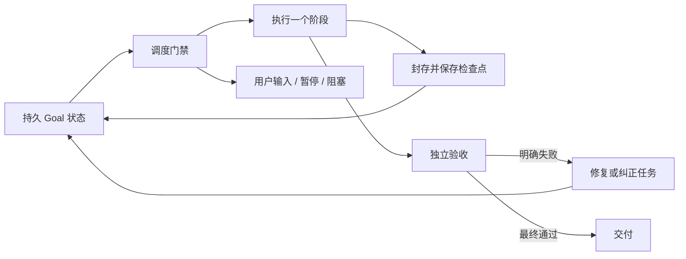

# Goal 持久目标与续跑调度

Goal 的完成条件是原目标通过独立验收并完成交付。单轮结束、产物冻结、子任务通过、暂停、受限和阻塞均不等于完成。

## 会话与前后台

默认在当前会话等待 Goal 完成，并复用普通任务的流式文本、工具和子 agent 展示。仅 `--background` 启动 detached runner；`/goal background` 在当前阶段完成并封存后移交后台。普通输入仍在安全阶段边界让出，控制命令走即时通道。Esc/Ctrl+C、退出和终止信号请求暂停并等待封存，不能提前把会话标为空闲。

前台执行轮调用普通 `runAgent`，沿用当前 conversation、工具、权限审批、网络、检查点和子 agent 隔离策略。默认不另起模型规划轮：原目标直接作为任务与验收条件，普通 turn 自行使用 planning/todo，避免额外规划发明更重的验收要求。显式 plan 权限才运行只读规划。目标自身不强制复制工作区，不限制普通任务已有的 shell、依赖安装或子 agent 能力。独立规划/验收轮通过 NDJSON 转发进度，使用只读工具，不把私有验收上下文写入主会话。后台使用普通 headless runtime，执行轮之间显式延续自己的会话。

Goal 与普通任务的区别在外层控制：持久保存目标、累计用量、独立验收、未完成时继续修复。工作区中已经发生的普通修改不会因验收失败自动回滚。

新 Goal 只在启动时建立运行记录，不全树扫描。验收证据仅采集实际访问路径，目录只记录直接子项，软链接只记录原始目标，不遍历链接。悬空/外部软链接不会因为存在于根目录而阻断无关任务；真正读取链接目标时仍受普通工具权限约束。

`--artifact` 显式选择旧隔离产物流程，旧 Goal 记录也继续使用原 Host。其内部绝对软链接重定位、私有 Git、封存和交付冲突规则不变。

## 分层

- `GoalStore`：SQLite 持久状态、所有权 epoch、用户控制、候选产物、最终验收及用量账本。TUI 创建时记录 sessionId，CLI Goal 不绑定聊天。
- `scheduler.ts`：纯函数选择下一项工作；阶段完成后通过事件循环调度下一步。每次重新读取状态，用户控制优先。
- `GoalController`：一次仅执行一项效果，先持久化 intent，完成后检查身份并提交 checkpoint。规划、执行、任务验收、集成、最终快照、最终验收、交付分别检查点化。
- `GoalTurnHost`：围绕普通执行轮收集有界工具观察和相关文件/目录证据，绑定独立验收回执；接纳结果不再进行整树合并。
- `LocalGoalHost`：兼容旧 Goal 和显式 `--artifact` 的隔离产物流程。

## 用户输入与权限

TUI 提交输入后，仅通知同一聊天的 Goal 在下一个封存边界让出执行权。当前阶段不因普通输入被直接杀死。使用 `/goal resume` 显式继续，避免后台把用户消息当作无关事件。

`/goal` 控制命令不触发此输入暂停；其他聊天和 CLI 启动的 Goal 不受影响。自动 runner 的领取在数据库事务中检查暂停状态，不能覆盖启动间隙到达的用户暂停。

计划权限只运行规划阶段，不自动进入执行；需要以获得执行授权的权限模式启动 Goal。取消及显式暂停继续使用已存在的终止、封存和恢复规则。共享目录中断执行后，进程消失不能证明操作没有副作用；未确认的执行/修复/交付不自动重放，须先核对当前状态。

## 结构化交接

规划和验收结果经严格 schema 校验；规划还验证依赖图。可以接受外围说明或代码围栏，但必须只有一个明确的 JSON 对象；多个对象、重复键、额外字段、无效状态或依赖图被拒绝。

只有格式错误允许最多两次纠正，均使用新的、被计量且只读的阶段。权限拒绝、进程异常和封存不明不能转成格式重试。错误不保留原始响应、提示词或密钥。

每次验收使用 Host 创建的 operationId 分配不可变记录目录。重试保留旧记录，并对同一冻结候选重新验收，不覆盖错误证据、不重跑开发。已有回执仍从原记录目录读取。

## 无进展与限制

不设置隐含总 Token、调用次数、修复次数或总时长限制。用户可显式设置 `--tokens`、`--model-calls`、`--provider-attempts`、`--tool-calls`、`--minutes`；总 Token 限额的一部分预留给验收与收尾。计量跨阶段及子 agent 共享。

失败检查身份和产物指纹连续不变时累计停滞次数；首次失败后的三次相同结果触发 `GOAL_NO_PROGRESS`。没有工具调用且没有文件变化的执行轮若验收失败，也阻止自动空转。普通只读最终验收不套用这一执行轮规则。纯文本产物可以通过独立验收正常交付。

自动生成的文本产物路径按内容归一化参与最终进展判断，随机任务名称不能伪装为新进展。检查通过会清除对应停滞计数；显式恢复可以重新尝试。

预算准入错误进入 `budget_limited`；验收无法确定进入 `awaiting_acceptance`；无法证明执行效果安全则保留 `inFlight` 并进入 `blocked`。`/goal status` 展示阶段、错误代码、操作身份、候选快照和进展，避免用泛化失败掩盖恢复位置。只有获得完整封存证据的失败阶段才允许清除进程标记。

## 有界证据与当前性

工具观察、最终文本以及最多 128 个实际访问路径保存在 Goal 自己的数据目录，内容哈希绑定候选。普通文件内容总计上限 128 KiB；大型/二进制文件、软链接父路径和被截断观察明确标注，独立验收需进一步核实，不能据此宣称已冻结整个工作区。目录证据只枚举直接子项，不读取所有项目文件。任务验收前后和最终交付再次核对记录的路径，发现漂移则要求刷新结果。

验收由独立的只读 agent 检查原始目标、验收条件和实际证据，可重新读取当前目录。用户指定 `--check` 时，必须实际执行对应测试命令并获得成功退出状态，模型口头声称测试通过不算验收。共享目录不是原子快照，其他进程的修改仍需协调。

独立验收返回 `unverified` 时，额外区分后续动作：`nextAction: repair` 表示普通执行器仍能补证/纠正，Host 将其作为未通过回执继续修复；`needs_input` 或无法分类的旧回执才等待用户。通过回执不能同时请求后续动作。执行器收到原候选文本和具体验收反馈，避免重启会话后丢失纯文本产物。

有界工具观察保留最近的结果并标记截断，避免早期目录枚举/文档浏览挤掉最后的测试和纠正证据。

验收反馈仅作为缺陷证据，不赋予新的任务范围。执行轮可以删去未证实的可选结论；不能因报告脱敏等附带问题自行扩展为跨仓库凭据/历史审计。临时只读脚本优先内联或放在运行时 TMPDIR。

独立规划/验收在沙箱可用时复用普通 explore 子 agent 的只读 Bash：允许目录计数、git status/worktree list/merge-base 等读取，拒绝写入、重定向、多命令、后台和网络 shell；无可用沙箱时不广告 shell。

最终冻结保留普通执行轮原始交付文本，不另起模型改写为摘要；最终验收仍独立执行，避免摘要丢失内容或引入新结论。
