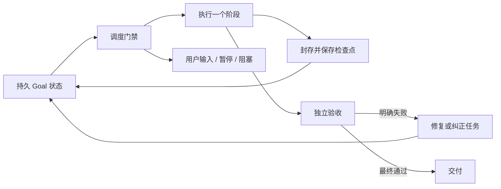

# Goal 持久目标与续跑调度

Goal 的完成条件是原目标通过独立验收并完成交付。单轮结束、产物冻结、子任务通过、暂停、受限和阻塞均不等于完成。

## 分层

- `GoalStore`：SQLite 持久状态、所有权 epoch、用户控制、候选产物、最终验收及用量账本。TUI 创建时记录 sessionId，CLI Goal 不绑定聊天。
- `scheduler.ts`：纯函数选择下一项工作；阶段完成后通过事件循环调度下一步。每次重新读取状态，用户控制优先。
- `GoalController`：一次仅执行一项效果，先持久化 intent，完成后检查身份并提交 checkpoint。规划、执行、任务验收、集成、最终快照、最终验收、交付分别检查点化。
- `LocalGoalHost`：隔离工作区、封存、只读独立验收和证据绑定。调度器不能替代验收或放宽运行权限。

## 用户输入与权限

TUI 提交输入后，仅通知同一聊天的 Goal 在下一个封存边界让出执行权。当前阶段不因普通输入被直接杀死。使用 `/goal resume` 显式继续，避免后台把用户消息当作无关事件。

`/goal` 控制命令不触发此输入暂停；其他聊天和 CLI 启动的 Goal 不受影响。自动 runner 的领取在数据库事务中检查暂停状态，不能覆盖启动间隙到达的用户暂停。

计划权限只运行规划阶段，不自动进入执行；需要以获得执行授权的权限模式启动 Goal。取消及显式暂停继续使用已存在的终止、封存和恢复规则。进程消失不能替代封存回执。

## 结构化交接

规划和验收结果经严格 schema 校验；规划还验证依赖图。可以接受外围说明或代码围栏，但必须只有一个明确的 JSON 对象；多个对象、重复键、额外字段、无效状态或依赖图被拒绝。

只有格式错误允许最多两次纠正，均使用新的、被计量且只读的阶段。权限拒绝、进程异常和封存不明不能转成格式重试。错误不保留原始响应、提示词或密钥。

每次验收使用 Host 创建的 operationId 分配不可变记录目录。重试保留旧记录，并对同一冻结候选重新验收，不覆盖错误证据、不重跑开发。已有回执仍从原记录目录读取。

## 无进展与限制

不设置隐含总 Token、调用次数、修复次数或总时长限制。用户可显式设置 `--tokens`、`--model-calls`、`--provider-attempts`、`--tool-calls`、`--minutes`；总 Token 限额的一部分预留给验收与收尾。计量跨阶段及子 agent 共享。

失败检查身份和产物指纹连续不变时累计停滞次数；首次失败后的三次相同结果触发 `GOAL_NO_PROGRESS`。没有工具调用且没有文件变化的执行轮若验收失败，也阻止自动空转。普通只读最终验收不套用这一执行轮规则。纯文本产物可以通过独立验收正常交付。

自动生成的文本产物路径按内容归一化参与最终进展判断，随机任务名称不能伪装为新进展。检查通过会清除对应停滞计数；显式恢复可以重新尝试。

预算准入错误进入 `budget_limited`；验收无法确定进入 `awaiting_acceptance`；无法证明执行效果安全则保留 `inFlight` 并进入 `blocked`。`/goal status` 展示阶段、错误代码、操作身份、候选快照和进展，避免用泛化失败掩盖恢复位置。只有获得完整封存证据的失败阶段才允许清除进程标记。
