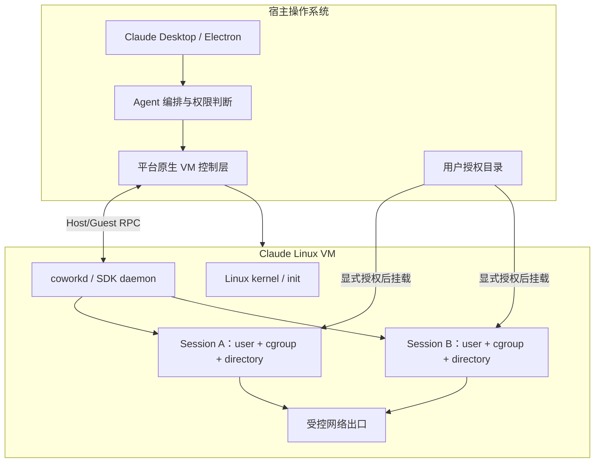

# Claude Agent VM 技术总结

> 更新日期：2026-08-05
> 范围：Claude Desktop 本地 Cowork/Agent 代码执行环境。当前 Claude Cowork 也存在远程执行模式；本文讨论的是本地 VM 实现。

## 1. 核心结论

Claude Desktop 使用一台专用 Linux 虚拟机运行 Shell 命令和 Agent 生成的代码，以隔离宿主操作系统：

- macOS 使用 Apple `Virtualization.framework`。
- Windows 使用 Hyper-V，并依赖 Windows Virtual Machine Platform、HCS/HNS 等系统组件。
- Claude 没有自行实现 Hypervisor，主要实现了 VM 控制服务、Linux 镜像、guest daemon、权限挂载、会话隔离、网络策略、镜像更新和故障恢复。
- 从安装包的生命周期和进程接口判断，本地模式更接近“一台长期运行的 VM，承载多个 Agent Session”，而不是“每个任务创建一台 VM”。
- Host 与所有 Agent 代码之间由平台 Hypervisor 强隔离；VM 内不同 Session 主要通过 Linux 用户、目录、cgroup 和挂载权限隔离。

## 2. 总体架构



主要职责分工：

| 层级 | 主要职责 |
|---|---|
| Claude Desktop | UI、任务编排、权限提示、会话状态 |
| 原生 VM 控制层 | 创建和停止 VM、磁盘、网络、Host/Guest 通信 |
| Linux guest | 执行 Shell、脚本和工具，管理 Session 进程 |
| 权限层 | 控制可挂载目录、允许访问的网络目标和敏感凭据 |
| 恢复层 | 心跳、卡死检测、镜像修复、磁盘清理和重启 |

## 3. macOS 实现

本机 Claude Desktop 的 VM bundle 位于：

```text
~/Library/Application Support/Claude/vm_bundles/claudevm.bundle
```

观察到的主要组成包括：

- `rootfs.img`：Linux 基础系统盘。
- `sessiondata.img`：Session、SDK 和缓存等持久数据。
- `efivars.fd`：EFI 变量数据。
- `smol-bin.<arch>.img`：Claude guest 工具盘。
- `coworkd`、SDK daemon、sandbox helper 等 guest 组件。

macOS 侧通过 Claude 自带的原生模块调用 `Virtualization.framework`，启动 Linux VM，并通过 guest 通信通道控制进程、传输日志和监测 VM 状态。

## 4. Windows 实现

Anthropic 官方确认 Windows 本地 Cowork 使用 Hyper-V Linux VM。Claude Desktop 需要：

- Windows Virtual Machine Platform。
- 硬件虚拟化：Intel VT-x 或 AMD-V。
- `vmcompute`：Hyper-V Host Compute Service。
- `HNS`：Host Network Service。
- `vfpext`：Hyper-V 虚拟交换机过滤组件。
- 机器级 Cowork virtualization service。

没有管理员权限时，Claude Desktop 的普通聊天部分仍可能安装成功，但本地 Cowork VM 服务可能无法注册。

### 4.1 Windows VM 文件

当前 Claude 跨平台代码为 Windows x64 和 ARM64 准备：

```text
claudevm.bundle/
├── rootfs.vhdx
├── vmlinuz
├── initrd
├── smol-bin.vhdx
└── sessiondata.vhdx
```

合理的职责划分是：

| 文件 | 作用 |
|---|---|
| `rootfs.vhdx` | 可替换、可重新下载的 Linux 基础系统 |
| `vmlinuz` | Claude VM 配套 Linux 内核 |
| `initrd` | 早期启动、驱动加载和磁盘挂载环境 |
| `smol-bin.vhdx` | `coworkd`、SDK daemon 等 guest 工具 |
| `sessiondata.vhdx` | `/sessions`、SDK、缓存和运行数据 |

代码在重新安装 VM 镜像时会尽量保留 session data，因此整体采用“基础镜像可替换、会话数据持久化”的设计。

### 4.2 Windows 启动链推演

```text
Claude Desktop
  → 下载并校验 rootfs.vhdx、vmlinuz、initrd
  → 准备 smol-bin.vhdx
  → 调用 Windows VM client.configure()
  → Cowork Windows Service 配置 HCS/HCN
  → Hyper-V 启动 Linux VM
  → initrd 挂载基础盘、工具盘和数据盘
  → guest 启动 coworkd
  → Host 与 coworkd 建立连接
  → 检查或安装 SDK
  → VM 进入 Ready 状态
```

Claude 官方报错会直接检查 `vmcompute`、`HNS` 和 `vfpext`。结合 VHDX、独立内核、Windows 服务和 Virtual Machine Platform，可以高置信判断：Windows 服务利用 HCS/HCN 管理 Hyper-V utility VM。

这并不是普通 WSL2 发行版：

| 项目 | Claude VM | WSL2 |
|---|---|---|
| 生命周期 | Claude Windows 服务 | `wsl.exe`/WSL 服务 |
| 镜像 | Claude 自带 `rootfs.vhdx` | 发行版 `ext4.vhdx` |
| 内核 | Claude 配套 `vmlinuz`、`initrd` | Microsoft WSL 内核 |
| guest 服务 | `coworkd`、SDK daemon | WSL init/systemd |
| 目录访问 | 显式授权目录 | 通用 Linux/Windows 文件访问 |
| 主要用途 | 不完全可信的 Agent 代码沙箱 | 通用 Linux 开发环境 |

两者会复用部分 Hyper-V、Virtual Machine Platform 和 HCS 基础设施，但上层运行时不同。

## 5. Agent Session 执行模型

从单一 `claudevm.bundle`、全局 VM 生命周期和按 Session 启动进程的接口判断，最可能的结构是：

```text
一台长期运行的 Claude Linux VM
├── 特权 coworkd
├── 受控网络层
├── Session A：Linux 用户 + cgroup + /sessions/A
├── Session B：Linux 用户 + cgroup + /sessions/B
└── Session C：Linux 用户 + cgroup + /sessions/C
```

当一个 Agent 需要执行命令时，Host 侧会准备类似以下信息：

- Session ID 和进程 ID。
- 命令、参数和工作目录。
- 经过过滤的环境变量。
- 用户已授权的附加挂载目录。
- 允许访问的网络域名。
- 新建还是恢复 Session。
- 是否为一次性执行。

guest 侧预计会：

1. 创建或恢复 Session 用户和目录。
2. 配置 cgroup、进程组和资源限制。
3. 挂载本次任务获得授权的 Host 目录。
4. 以低权限 Session 用户启动命令。
5. 将 stdout、stderr、退出码和异常状态流式返回 Host。
6. Session 结束后杀死后代进程并清理挂载。

## 6. Host 与 guest 通信

可以确认 Claude 使用一个原生 VM client 暴露以下类型的能力：

- 启动和停止 VM。
- 判断 VM 与 guest 是否在线。
- 在 guest 内创建和终止进程。
- 传输 stdin、stdout 和 stderr。
- 传递挂载目录和网络策略。
- 获取内存、磁盘和进程状态。
- 接收 guest 连接、网络和 VM 停止事件。

Windows 的具体传输协议尚未公开。从 HCS 的典型设计、guest 组件字符串和相关模块痕迹看：

- Host/guest RPC 很可能使用 Hyper-V Socket。
- 授权目录可能通过 9P/Plan9 或类似共享机制进入 guest。
- guest 内再用 bind mount 把目录限定给具体 Session。

以上三点属于高置信推断，不是 Anthropic 官方确认的具体实现。

## 7. 文件访问边界

Claude 不应把整个 Host 文件系统直接暴露给 VM。推测的数据路径是：

```text
用户选择目录
  → Claude Desktop 权限检查
  → VM 控制层建立受控共享
  → guest 中出现共享挂载点
  → bind mount 到指定 Session
  → Agent 进程访问
```

安全关键点包括：

- 路径规范化，防止 `..`、符号链接和挂载逃逸。
- 只共享用户明确授权的目录。
- 不同 Session 不应继承彼此的目录权限。
- Session 结束后及时卸载共享目录。
- 删除操作需要额外权限确认。

Host 文件挂载是整个架构中风险最高、实现最复杂的边界之一。

## 8. 网络沙箱

本机 Claude 代码在启动 VM 时将网络模式设置为 `gvisor`。这更可能表示使用 gVisor/gvproxy 一类用户态网络组件，而不能仅凭该名称断言所有进程都运行在完整 gVisor 内核沙箱中。

可能的流量链路：

```text
Agent Process
  → guest 网络层
  → 用户态网络或出口代理
  → 域名与地址策略
  → Host 网络
  → Internet
```

网络控制需要处理：

- 域名白名单。
- DNS 解析及 DNS 重绑定风险。
- 内网、link-local 和 cloud metadata 地址阻断。
- HTTP/HTTPS 代理。
- VPN、IPv6 和企业证书兼容。
- 敏感 OAuth token 与普通 Agent 进程隔离。

## 9. 健康检查与故障恢复

当前 Claude Desktop 代码显示了多层恢复机制：

- VM 启动后轮询 guest 连接。
- 启动连接超时约 60 秒。
- 轻量 keepalive 周期约 2 秒。
- heartbeat 周期约 30 秒。
- heartbeat 超时约 15 秒。
- 连续多次 heartbeat 失败后重启 VM。
- 分别处理 VM 停止、guest 断开和网络不可达。
- 镜像损坏时可以删除可重新下载文件并自动修复。
- 重装基础镜像时保留 Session 数据盘和部分缓存。
- 检查 Session 数据盘空间，并清理孤立 Session 和缓存。

这些机制说明 VM 被当作一个长期后台服务，而不是一次性命令执行器。

## 10. 使用到的虚拟化技术

Claude 组合了较完整的虚拟化技术栈，但主要复用操作系统能力：

```text
平台提供：
硬件虚拟化
  + Hypervisor
  + VM 生命周期 API
  + 虚拟磁盘
  + 虚拟网络
  + Host/Guest 通信

Claude 提供：
VM Service
  + Linux 镜像
  + coworkd
  + Agent 执行协议
  + 权限挂载
  + Session 隔离
  + 网络策略
  + 更新与故障恢复
```

真正的技术门槛不是模拟 CPU 或编写 Hypervisor，而是把这些组件组合成安全、可升级、可诊断并能兼容大量终端环境的产品。

## 11. 实现门槛评估

| 目标 | 难度 | 粗略投入 |
|---|---:|---:|
| 启动 VHDX Linux VM 并执行命令 | 中等 | 1–2 人，2–4 周 |
| 内部可用的 Agent 沙箱 | 较高 | 2–4 人，2–4 个月 |
| Claude 级跨平台桌面产品 | 很高 | 5–10+ 人，6–12 个月以上 |

产品化的主要难点：

- Windows 系统服务、UAC、MSIX 注册和升级。
- macOS 与 Windows 两套原生虚拟化实现。
- 镜像下载、校验、迁移和回滚。
- 安全目录挂载和路径逃逸防护。
- Session 资源隔离和进程完整清理。
- 网络出口控制和企业网络兼容。
- 睡眠唤醒、崩溃恢复、磁盘满和 VM 卡死处理。
- Windows 10/11、x64/ARM64、EDR、VPN、VMware 等环境兼容。

## 12. 与开源方案的关系

可参考的开源项目包括：

- Lima：适合 macOS/Linux Host 上运行 Linux VM，Windows Host 不是成熟主路径。
- QEMU：完整通用 VMM，可配合 WHPX、HVF、KVM。
- Firecracker：面向 Linux/KVM 的 microVM。
- Cloud Hypervisor：面向云工作负载的轻量 VMM。
- Microsandbox：更接近 Agent 代码沙箱的产品方向。
- libkrun：面向轻量、嵌入式 VM 场景。
- WSL2：Windows 上快速实现原型，但权限和产品生命周期不完全适合严格 Agent 沙箱。

如果在 Windows 上复刻 Claude 路线，最接近的技术路径是：

```text
HCS/HCN + Hyper-V utility VM
+ 自定义 Linux rootfs
+ Host/Guest RPC daemon
+ 受控目录共享
+ 用户态网络和出口策略
+ 每 Session 用户/cgroup 隔离
```

## 13. 事实与推断边界

### 官方确认

- 本地代码执行位于专用 Linux VM。
- macOS 使用 Apple `Virtualization.framework`。
- Windows 使用 Hyper-V。
- VM 包含网络出口、系统调用和每 Session 用户隔离。
- Windows 依赖 Virtual Machine Platform 和 Cowork virtualization service。
- Windows 故障诊断涉及 `vmcompute`、`HNS` 和 `vfpext`。

### 安装包代码确认

- Windows 包含 `rootfs.vhdx`、`vmlinuz` 和 `initrd`。
- Windows 启动前准备 `smol-bin.vhdx` 并调用 `configure()`。
- 启动网络模式参数为 `gvisor`。
- 代码识别并保留 `sessiondata.vhdx`。
- VM 具有全局生命周期、进程 RPC、心跳和自动恢复逻辑。

### 高置信推断

- Windows Service 通过 HCS/HCN 创建 Hyper-V utility VM。
- Host/guest RPC 使用 Hyper-V Socket。
- Host 授权目录使用 9P/Plan9 或类似共享协议。
- 一台长期 VM 承载多个通过用户/cgroup 隔离的 Session。

### 尚未确认

- Windows 原生 VM Service 的具体实现语言和完整 API 调用链。
- VHDX 的精确挂载模式和 rootfs 是否始终只读。
- Windows 文件共享最终使用 9P、虚拟 SMB 还是自定义协议。
- `gvisor` 参数对应的具体组件和版本。

## 14. 参考资料

- [Claude Cowork architecture overview](https://support.claude.com/en/articles/14479288-claude-cowork-architecture-overview)
- [Deploy Claude Desktop for Windows](https://support.claude.com/en/articles/12622703-deploy-claude-desktop-for-windows)
- [Microsoft Host Compute System overview](https://learn.microsoft.com/en-us/virtualization/api/hcs/overview)
- [Microsoft Hyper-V APIs](https://learn.microsoft.com/en-us/virtualization/api/)
- [Lima](https://github.com/lima-vm/lima)

## 15. 最终概括

Claude Agent VM 的核心并不是一项单独的新虚拟化技术，而是一套面向桌面 Agent 的完整运行时：

> 使用平台 Hypervisor 隔离 Host 与不完全可信代码，在 Linux guest 内用用户、cgroup、目录和网络策略隔离不同 Session，再通过专用 guest daemon 将 VM 能力安全地提供给 Claude Desktop。

其工程壁垒主要来自安全边界、跨平台集成、镜像与数据生命周期、网络和目录权限、故障恢复及企业终端兼容，而不是底层 CPU 虚拟化本身。
