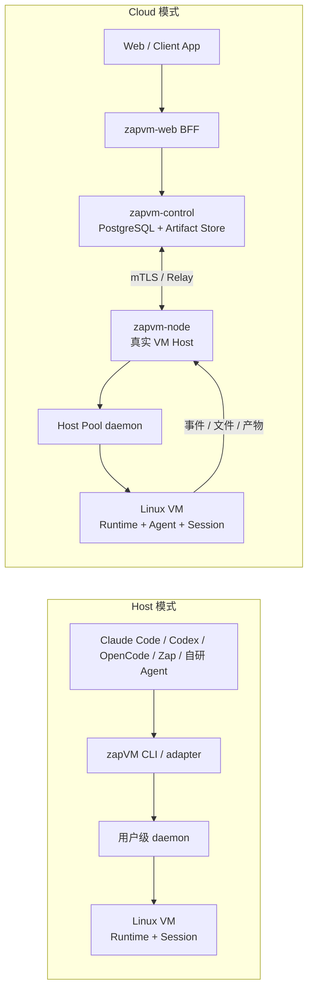

# zapVM

**面向 AI Agent 的本地与自托管 Agent Computer 运行时。**

zapVM 在 macOS、Linux 和 Windows 的原生硬件虚拟化后端上运行隔离的
Linux 工作环境，为 Claude Code、Codex、OpenCode、Zap 及自研 Agent 提供一致的
命令执行、持久工作区、依赖环境、任务恢复和产物交付能力。

它不是一个新的模型或聊天客户端，也不是 Docker 包装器。zapVM 负责的是 Agent
真正执行工作的 Computer：运行命令、安装项目依赖、修改文件、执行测试，并在本地
或远端任务结束后交付结果。

> **当前状态：Developer Preview。** macOS Apple Silicon 是当前最完整的公开交付；
> Linux KVM 与 Windows Hyper-V/HCS 已完成核心主链路验收，但全部平台的整机休眠、
> 72 小时长稳和精确发布候选验收仍在进行。以
> [支持矩阵](./docs/support-matrix.md)和 [验收记录](./docs/acceptance.md)为准。

## 产品形态

zapVM 同时支持两种产品形态，底层使用同一套签名镜像、Guest RPC 和权限模型。

| 模式 | 适合场景 | Agent 在哪里 | 使用入口 |
|---|---|---|---|
| **Host 模式** | 给 Claude Code、Codex、OpenCode、Zap 或自研 Agent 增加隔离执行环境 | Agent 可以继续运行在 Host；VM 只提供 Computer | `zapvm run`、`zapvm computer exec`、stdio 或 daemon IPC |
| **Cloud 模式** | Web Agent、远端任务、多用户项目空间、弹性 Host Pool | Resident Agent 运行在 VM 的独立签名 Agent Layer | Web → Control → Node → daemon → VM |

Host 模式不要求把 ZapCode 内置进 VM。外部 Agent 可以把 zapVM 当作可插拔的
Bash/Computer 后端。只有 Web/Cloud Resident Agent 场景才需要签名的 Agent Layer。

## 系统架构



Railway 等容器平台可以运行 Web、Control、PostgreSQL 和对象存储，但通常不提供
`/dev/kvm`、Hyper-V/HCS 或 Virtualization.framework。因此 Cloud 模式仍需要至少
一台真实 macOS、Linux 或 Windows Host 运行 `zapvm-node` 和 daemon。

## macOS 五分钟上手

### 1. 安装完整 Agent Computer

Homebrew 包同时安装经过 Developer ID 签名和 Apple 公证的 Host 工具、签名 VM
镜像、镜像公钥及离线文档。镜像会在安装阶段完成验签、真实启动 smoke 和激活，
不需要用户再手工下载或导入数 GB 的镜像。

```bash
brew tap JackCaow/zapvm
brew trust JackCaow/zapvm
brew install JackCaow/zapvm/zapvm

zapvm doctor
zapvm verify
```

`zapvm verify` 会启动真实 Virtualization.framework VM、验证 Guest RPC、只读系统层
和 Agent Computer 能力。成功时输出 `ZAPVM_AGENT_COMPUTER_OK`。

### 2. 执行第一个隔离任务

```bash
mkdir -p "$HOME/zapvm-workspace"
cd "$HOME/zapvm-workspace"

zapvm run \
  --workspace "$PWD" \
  --stop-after-exec -- \
  /bin/sh -lc 'python3 --version && node --version && uname -a'
```

工作区会挂载到 Guest 的 `/workspace`。命令通过结构化 argv 传递，不会由 zapVM
重新拼接为 Host shell 命令。

### 3. 创建可复用的 Agent Computer

先在一个终端启动当前用户的 VM 池：

```bash
zapvm daemon serve
```

在另一个终端创建并使用持久 Computer：

```bash
cd /absolute/path/to/project

zapvm computer create \
  --id my-project \
  --workspace "$PWD"

zapvm computer exec my-project -- python3 --version
zapvm computer exec my-project -- /bin/sh -lc 'python3 -m venv .venv'
zapvm computer inspect my-project
zapvm computer stop my-project
```

Computer 定义、Session HOME、项目工具和状态盘可以跨命令与 VM 重启保留。`stop`
只会正常 flush 并停止 VM，不会删除 Computer 或状态盘。

需要断开客户端后继续运行的任务时，使用异步 Task：

```bash
zapvm computer task submit --task-id build-001 my-project -- go test ./...
zapvm computer task attach build-001
zapvm computer task attach --after 10 build-001
```

每条事件都有单调 cursor；重新连接时可以从上次位置继续读取，而不会重跑任务。

## 接入现有 Agent

最简单的接入方式是把 Agent 原有的 Bash/command tool 映射到：

```bash
zapvm computer exec <computer-id> -- <command> [args...]
```

根据 Agent 的生命周期选择不同接口：

| 接入方式 | 建议接口 |
|---|---|
| 单次命令或 CI adapter | `zapvm run` |
| 同一 Agent 父进程长期持有一台 VM | `zapvm run --serve-stdio` |
| 多个本地 CLI/TUI 共享 VM 池 | `zapvm daemon` + `zapvm computer` |
| 外部 Agent 原生工具协议 | `zapvm-agent-adapter` + protocol codec |
| 断线恢复、取消、重试和事件 cursor | `zapvm computer task` |
| 单 Host 远程接入 | mTLS `gateway serve` / `gateway tunnel` |
| 多 Host 或 Web Agent | `zapvm-control` + `zapvm-node` + `zapvm-web` |

外部 Agent 不应在 VM 不可用时静默回退到 Host 执行。应把 zapVM 的稳定错误码、
stdout/stderr 和任务终态映射回 Agent 自己的工具协议。完整示例与 Claude Code、Codex、
OpenCode、Zap 的接入建议见[Agent 接入手册](./docs/agent-integration.md)。

## Cloud Agent 与 Host Pool

Cloud 模式把浏览器、控制面和执行 Host 分离：

1. `zapvm-web` 提供登录、Session、流式消息、任务恢复和产物下载。
2. `zapvm-control` 在 PostgreSQL 中持久化 Computer、Task、事件、placement 和审计。
3. `zapvm-node` 从真实 Host 主动连接 Control，不向公网暴露 daemon socket。
4. daemon 按 Computer、工作区、Agent、网络和凭据权限复用或启动 VM。
5. VM 内 Resident Agent 执行工具循环，事件和产物通过 Node 返回 Web。

动态 Host Pool 使用 **start-then-task**：Control 先为 Computer 创建唯一 placement，
Node 完成 `computer.start` 后 Task 才能 claim。空闲 VM clean stop 后，Node heartbeat
释放 placement；下一条任务重新按容量调度。Node generation、placement epoch 和 Task
lease 会阻止旧节点或旧 VM 上传结果。

部署入口：

- [多租户 Cloud Agent](./docs/cloud-agent.md)
- [Railway Control/Web 部署](./docs/railway.md)
- [Web BFF 与登录边界](./docs/web-bff.md)
- [macOS Remote Host](./docs/host-install-macos.md)
- [Linux Remote Host](./docs/host-install-linux.md)
- [Windows Remote Host](./docs/host-install-windows.md)

## 网络与依赖环境

zapVM 的产品默认网络模式是 `unrestricted`，适合 Agent 正常联网检索、安装项目依赖
和访问外部 API。对不可信任务可以显式收紧：

| 模式 | 行为 |
|---|---|
| `unrestricted` | 使用平台原生 VM 网络与 Host 可用公网出口；默认模式 |
| `restricted` | 只允许显式域名和端口，并拒绝私网、loopback、link-local 和 metadata 地址 |
| `off` | 不给 Guest 提供外部网络 |

```bash
zapvm computer create \
  --id restricted-project \
  --workspace "$PWD" \
  --network restricted \
  --allow-domain example.com \
  --allow-port 443
```

Guest 系统层保持签名且只读，不能用 `apk` 修改根文件系统。产品镜像预装 Python、
pip/virtualenv、Node/npm、Git、curl、jq、ripgrep、zip/unzip 等常用工具。项目依赖应
安装到工作区，例如 `.venv`、`node_modules`；需要跨 Session 和 VM 重启保留的工具
可通过 `zap-pkg` 安装到 Computer 的持久 `/nix` 层。

这意味着“系统不可变”不会等于“Agent 无法搭建工作环境”：操作系统和运行时层受
签名保护，项目环境和 Computer 工具层保持可写、可执行、可持久化。

## Runtime 与 Agent 分层

Schema 3 把更新频率和信任根不同的内容分开：

| Layer | 内容 | 生命周期 |
|---|---|---|
| Base | Alpine 用户空间 | 只读、签名、低频更新 |
| Runtime | kernel、initramfs、Guest RPC、能力契约 | 随 Host/Guest 协议更新 |
| Agent | Dim 或其他 ACP Resident Agent | 独立签名、可单独替换 |
| Session | Computer 状态、HOME、持久工具 | 每个 Computer 独立保留 |
| Workspace | 用户显式授权的 Host 目录 | 不进入镜像或更新包 |

`host-runtime` 只包含 Base、Runtime 和 Session，适合外部 Agent 与 Web/Cloud
Resident Agent；Agent Layer 始终作为独立签名 ACP 包安装，无需重建 Base 或
Runtime。详见
[分层镜像与 Agent 包](./docs/layered-image-delivery.md)。

## 安全边界

- VM 使用平台原生硬件虚拟化，不与 Host 共享 kernel。
- rootfs 和 Agent Layer 只读且签名；激活前验证 manifest、架构和全部文件 hash。
- 只挂载显式工作区；可将整个工作区或指定路径设为只读。
- Guest 内 `.git`、`.zapcode` 和控制路径通过 Host 文件服务策略保护。
- 凭据以请求级只读文件 lease 注入，不把 secret value 放进 argv 或 Task payload。
- Cloud Control、Node 和 Web BFF 使用固定 scope 与 mTLS 身份；Node 只建立出站连接。
- Task、Session、Artifact 和 Git 操作都有幂等 ID、租户边界和可审计终态。

`unrestricted` 网络允许正常公网访问，不应被当作网络隔离边界。需要限制外联时必须
显式使用 `restricted` 或 `off`。完整边界见[威胁模型](./docs/threat-model.md)。

## 平台支持

| Host | Backend | 当前状态 |
|---|---|---|
| macOS Apple Silicon | Virtualization.framework | 核心链路已验证；Homebrew 为主要公开交付 |
| Ubuntu 24.04 x86_64 | KVM + Cloud Hypervisor + systemd 254+ | 核心链路已验证；专用 Host 多 route 验收仍需保留证据 |
| Windows Server 2025 x86_64 | Hyper-V + HCS + HCN | 核心链路已验证 |
| Windows Server 2022 build 20348 | Hyper-V + HCS + HCN | Experimental |
| macOS Intel、Linux arm64、Windows arm64 | 各平台原生后端 | Build-only 或未完成真实 Host 验收 |

WSL 和普通 Docker 容器不是 zapVM 的产品后端。完整要求见
[支持矩阵](./docs/support-matrix.md)。

## 当前已交付与未完成项

已交付的主链路包括：

- macOS 签名、公证、Homebrew 安装和 VM 镜像自动导入。
- 本地 `run`、stdio、daemon、持久 Computer 与异步 Task。
- 默认正常联网，以及可选 restricted/off 策略。
- Host Runtime 与可插拔 Agent Layer。
- Web/BFF、PostgreSQL Control、Node、动态 placement、start-then-task 和 idle reclaim。
- 流式事件恢复、取消/重试、Artifact 上传下载和受控 Git PR 交付。

仍不能宣称 GA 的门禁包括：

- 三平台完整整机睡眠/唤醒与 72 小时长稳。
- Linux 专用 Host 的同机多 route 保留验收，以及 Windows 20348 最低版本验收。
- 生产 TUF/KMS/CA 轮换、备份恢复和多区域 Control 故障演练。
- Cold snapshot/restore 和长期 Host Pool 容量/成本数据。

## 开发与验证

```bash
go test ./...
go run ./cmd/zapvm doctor
make verify-cloud-dev
```

macOS 自源码构建的 `zapvm` 必须带 Virtualization entitlement；镜像构建、签名、
发布和跨平台门禁见[安装](./docs/installation.md)、[发布流程](./docs/release.md)和
[验收记录](./docs/acceptance.md)。测试通过、CI 通过与真实 Host 发布验收是三个独立
结论，不能互相替代。

## 文档导航

### 用户与 Agent 接入

- [安装与卸载](./docs/installation.md)
- [Agent 接入手册](./docs/agent-integration.md)
- [Host Agent Adapter Layer](./docs/agent-adapters.md)
- [诊断与脱敏证据](./docs/diagnostics.md)
- [稳定 CLI 错误契约](./docs/error-taxonomy.md)

### 架构与安全

- [架构决策](./docs/architecture.md)
- [完整远端 Agent 架构](./docs/remote-agent-system-architecture.md)
- [分层镜像与 Agent 包](./docs/layered-image-delivery.md)
- [威胁模型](./docs/threat-model.md)
- [兼容性策略](./docs/compatibility.md)

### Cloud 与运维

- [多租户 Cloud Agent](./docs/cloud-agent.md)
- [Workspace 管理与商业化控制面](./docs/platform-administration.md)
- [Railway 部署](./docs/railway.md)
- [Node 运维](./docs/node-operations.md)
- [Artifact 交付](./docs/artifact-delivery.md)
- [Git Provider](./docs/git-provider.md)
- [PostgreSQL 状态](./docs/postgresql-state.md)

### 项目状态

- [支持矩阵](./docs/support-matrix.md)
- [实施计划](./docs/plan.md)
- [验收证据](./docs/acceptance.md)
- [发布门禁](./docs/release.md)

## License

Apache License 2.0。第三方组件及对应源码信息见
[`THIRD_PARTY_NOTICES.md`](./THIRD_PARTY_NOTICES.md)和签名镜像中的 SPDX SBOM。
