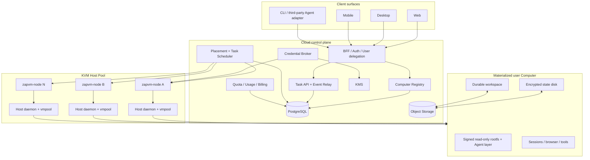
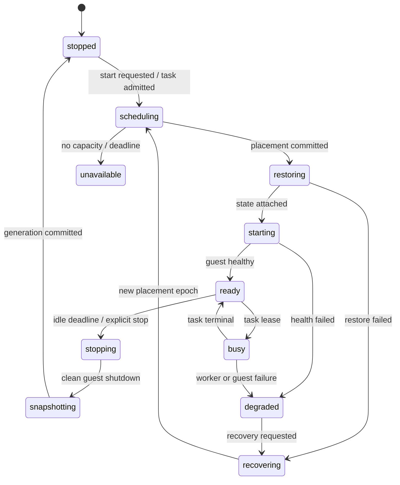

# zapVM 用户级 Agent Computer 与 KVM Host Pool 改造方案

- 状态：Proposed
- 日期：2026-08-14
- 范围：Cloud Agent Computer 交付架构、调度、状态持久化与商业化验收
- 核心决策：用户级逻辑 Computer + 共享 KVM Host Pool + 计算与持久状态分离

## 1. 摘要

zapVM 不应继续沿着“每个任务、每个 Agent 或每个用户长期占用一台独立云主机”的方向扩展。目标形态是：

1. 每个租户成员默认拥有一个持久的逻辑 Agent Computer；同一成员的多个 Agent 和 Session 共享它的工作区、浏览器状态、工具缓存和授权。
2. 多台真实 KVM Host 组成计算池。Computer 在有任务时被调度到某个 Host，空闲后正常关机并释放 CPU、内存和 VM slot。
3. Computer 的状态盘、工作区、产物和快照独立于 Host；Host 是可替换的计算资源，不是状态权威。
4. Task 是一次临时执行；Computer 才是持久状态、安全边界、配额和计费的主体。
5. P0/P1 先使用 PostgreSQL 事务调度和现有 daemon/vmpool，不引入 Kubernetes、Ceph 或在线迁移。

这套设计保留 zapVM 已有的只读签名 rootfs、rootless 工具层、状态盘、Session、credential broker、artifact、SSE、lease/fencing 等基础能力，把当前“静态 Computer→Node 映射”升级为可以按需启动、动态放置、休眠恢复和故障迁移的产品架构。

## 2. 背景与问题

### 2.1 当前成本矛盾

如果为每个用户长期保留一台云 VM，成本近似随注册用户线性增长，即使绝大多数 Computer 处于空闲状态，vCPU 和内存仍被占用。暂停 VMM 通常也不会释放 guest RAM，因此不能作为主要降本手段。

真正需要持久化的是：

- 用户工作区和产物；
- Session HOME、浏览器 profile、登录状态；
- SDK、包和构建缓存；
- Computer 配置、权限和审计；
- 可恢复的状态盘快照。

计算资源可以按需分配和回收。由此，成本模型应从“每用户一台常驻主机”改为：

```text
单活跃用户基础设施成本
= Host 月成本 / 平均并发活跃 Computer 数
+ 状态与工作区存储
+ 对象存储请求与流量
+ 模型和第三方服务成本
```

### 2.2 当前实现的约束

现有实现已经具备可复用基础，但 Cloud 调度仍然以静态 provision 为中心：

- [`NodeProvision.Computers`](../internal/cloudplane/types.go) 把 Computer 预配置到指定 Node；
- [`computer_nodes`](../internal/controlpostgres/migrations/0002_file_snapshot_import.sql) 保存静态 Computer/Node 映射；
- [`Task`](../internal/cloudplane/types.go) 在 Node claim 时直接进入执行租约；
- [`Pool`](../internal/vmpool/pool.go) 已能为 Computer 维护唯一状态盘、空闲回收和保留状态的停止；
- [`Agent Computer`](./agent-computer.md) 已定义只读 rootfs、持久 state、`/workspace`、`/nix`、Session 和异步 Task；
- Web 端已有任务流和断线续传，但当 Node 离线、Computer 未启动或容量不足时，主要表现仍是泛化的“正在分配运行环境”。

当前缺少的不是另一套 VM 后端，而是以下控制面能力：

- Computer 独立于 Node 的真实生命周期；
- 动态 placement 和资源向量调度；
- Computer start/restore 与 Task lease 的两阶段调度；
- Host 之外的状态权威和恢复代际；
- 成员级身份、安全边界、配额和计量；
- 明确、可终止的排队状态与用户可恢复错误。

## 3. 外部产品参考与适用边界

xAI 的公开 Grok Bot 文档提供了值得借鉴的产品模型：

- 每个成员拥有一个专属的托管 Linux Cloud Computer；
- 同一成员的多个 Bot 共享 Computer、文件、浏览器 Session 和登录状态；
- 多个 screen 是并行工作面，不是安全边界；
- 可以销毁并重建运行中的 VM，同时保留 durable storage；
- `/workspace` 和受支持的状态用于持久交付，临时目录、手动安装包和未提交应用状态应视为可替换。

参考资料：

- [Grok Bot overview](https://docs.x.ai/grok-bot/overview)
- [Use the computer and apps](https://docs.x.ai/grok-bot/computer-and-apps)
- [Grok Bot for teams and enterprises](https://docs.x.ai/grok-bot/teams-and-enterprises)

这些资料只证明产品边界，不公开其定价算法、VMM、调度器、快照格式或底层云供应商。因此本方案不推断 Grok Bot 使用 KVM、Firecracker 或任何具体实现；zapVM 的 KVM Host Pool 是基于自身现有技术栈作出的工程决策。

## 4. 目标与非目标

### 4.1 目标

- 用户无需理解 Host、Node、镜像导入或 daemon 配置即可使用 Agent Computer；
- Computer 可以在任意兼容 Host 上启动，Host 故障后可从最近持久状态恢复；
- 空闲 Computer 释放 vCPU、内存和 VM slot；
- 多 Agent/Session 可以共享用户 Computer，同时保留 Session 级 HOME、worktree 和进程隔离；
- 调度、恢复和容量等待都有明确状态、超时、错误码和恢复入口；
- 保留本地 Host 模式和 Cloud 模式，Agent Layer 继续可插拔；
- 在不破坏现有 v1 API 的前提下渐进迁移。

### 4.2 非目标

- 不为每个 Bot 或每个 Task 创建独立持久 VM；
- P0/P1 不引入 Kubernetes、Ceph、分布式块存储或在线迁移；
- 不在不同用户之间复用任何已被用户运行过的 warm VM；
- 不把特定 Agent、模型 Token 或长期 credential 固化进基础镜像；
- 不把 VMM pause 当作主要节省内存的方案；
- 不在缺少快照代际和 fencing 的情况下自动故障迁移。

## 5. 产品与安全层级

默认层级如下：

```text
Tenant
└── Member
    └── Computer
        ├── Agent A / Agent B / Agent N
        ├── Sessions
        ├── Workspace
        ├── Browser profile
        └── Durable tool and package cache
```

核心语义：

- 默认安全边界是 `tenant + member + computer`；
- Bot、Agent、Session 和 screen 是工作上下文，不是彼此隔离的安全边界；
- 企业可以为高敏项目显式创建额外 Computer 或专属 Host scope；
- 一个 Computer 默认只允许一个会修改工作区的 Task 并发执行；只读检索、模型调用和 connector 可以按策略并行；
- 同一 Computer 内的 Agent 共享已登录浏览器和 Computer 级 credential 权限，UI 必须明确展示这一点。

## 6. 目标系统架构



### 6.1 责任边界

| 组件 | 权威数据 | 不应承担的职责 |
| --- | --- | --- |
| Client/BFF | 用户会话、交互路由 | 直接控制 VMM、伪造 Node 身份 |
| Control | Computer 定义、desired state、placement、Task、配额 | 持有 guest root 或直接挂载用户磁盘 |
| Node/daemon | observed state、启动/停止、执行、快照上传 | 成为唯一持久状态权威 |
| Object Storage | 状态快照、workspace、artifact | 任务授权和调度决策 |
| KMS/Broker | DEK 和短期 capability | 长期 Token 写入 guest 镜像 |

## 7. Computer 生命周期

Computer 使用期望状态和观测状态分离，避免把 Node 心跳误当成 Computer 的真实状态。



建议字段：

```text
desired_state
observed_state
assigned_node_id
placement_epoch
state_generation
state_manifest_digest
image_digest
last_activity_at
idle_deadline
failure_code
failure_detail_redacted
```

约束：

- 只有 `ready` Computer 可以领取普通 Task；
- `placement_epoch` 是写入状态盘、提交快照和回报 ready 的 fencing token；
- 旧 epoch 的 Node 即使恢复连接，也不能继续写盘、续租或提交终态；
- Computer 的 `observed_state` 来自该 epoch 的 operation/daemon 回报，不能只由 Node 在线状态推导；
- 所有非终态 operation 都必须有 deadline，超时转换为明确 failure code。

## 8. 两阶段调度

### 8.1 调度流程

当前链路近似为 `Task pending → Node claim → daemon 启动 VM → execute`。目标链路拆成两个状态机：

```text
Task admitted
  ├─ Computer ready ────────────────→ Task lease → execute
  └─ Computer not ready
       → create/merge start operation
       → placement selects Host
       → restore state / boot / health
       → Computer ready
       → Task lease → execute
```

多个 Task 同时唤醒同一 Computer 时只能合并为一个 start operation。Task 等待 Computer 的期间不占 Node execution lease。

### 8.2 Placement 硬过滤

- CPU 架构和 VMM 后端兼容；
- image digest、state schema 和 Agent layer 兼容；
- 可分配 vCPU、内存、磁盘和 VM slot；
- Node 在线、非 drain、无启动失败熔断；
- tenant/region/network/compliance/专属 Host scope；
- 快照和 workspace backend 可达；
- 浏览器/display slot 可用（需要 computer-use 时）。

### 8.3 Placement 评分

建议按以下信号计算可解释分数：

1. 已缓存该 Computer 最新 state generation；
2. 已缓存目标 image digest；
3. 上一次 placement affinity；
4. 剩余内存和 CPU headroom；
5. 当前启动队列长度；
6. 最近启动失败率和 P95 ready 延迟；
7. region/egress 距离和成本。

首版使用 PostgreSQL 事务、`FOR UPDATE SKIP LOCKED`、唯一 active placement 约束和 epoch CAS 即可。除非单库调度指标证明已到瓶颈，否则不引入新的编排系统。

### 8.4 Node 容量模型

现有单个 `capacity` 应逐步升级为资源向量：

```text
total_vcpu / allocatable_vcpu / reserved_vcpu
total_memory_bytes / allocatable_memory_bytes / reserved_memory_bytes
local_state_cache_bytes
image_cache_bytes
vm_slots
browser_slots
starting_count / running_count
labels / region / architecture
cached_image_digests
```

调度需要为 Host OS、VMM、virtiofs 和磁盘缓存保留安全余量，不能把物理内存全部承诺给 guest。

## 9. 计算与持久状态分离

### 9.1 三层数据

| 层 | 内容 | 生命周期 |
| --- | --- | --- |
| Immutable image | kernel、initrd、rootfs、guest agent、可插拔 Agent layer | 签名版本化，Host 缓存 |
| Computer state | Session HOME、browser profile、`/nix`、SDK/cache、状态 schema | Computer 级持久、加密、可快照 |
| Workspace/artifacts | 源码、文档、构建结果、下载产物 | 独立持久，可直接交付 |

### 9.2 快照模型

建议为每个快照记录：

```text
computer_id
generation
parent_generation
manifest_digest
image_digest
state_schema
size_bytes
created_at
committed_at
clean
object_prefix
encryption_key_version
```

停止协议：

1. 关闭新 Task admission；
2. 等待 active mutating Task 到终态或显式取消；
3. guest flush state/workspace；
4. 正常关机并确认 state clean；
5. 生成 manifest，上传新块或完整稀疏镜像；
6. 用 `placement_epoch + previous_generation` 做 CAS；
7. 提交新 generation 后，Host 本地磁盘只作为缓存。

P0 可以上传压缩后的完整稀疏 state disk，先把恢复正确性做实；P2 再升级为 4–16 MiB content-addressed chunk、增量 manifest、并行上传和去重。不要在第一阶段同时引入复杂分布式块存储。

### 9.3 故障恢复

- 任意时刻只有最新 placement epoch 可以 writable attach；
- Node 丢失后，Control 先使旧 epoch 失效，再从最近 `clean=true` generation 调度到新 Host；
- 未完成快照不能成为 state authority；
- UI 显示最近恢复点和可能的数据 RPO，不用“已恢复”掩盖未持久化窗口；
- workspace/artifact 应比 state disk 更频繁同步，减少最终交付物受 VM 故障影响。

## 10. 空闲与缓存策略

建议默认分层：

| 阶段 | 建议区间 | 运行形态 |
| --- | --- | --- |
| Hot | 0–10 分钟 | VM 运行，立即响应 |
| Warm | 10–30 分钟 | VM 已停止，Host 保留本地 state/image cache |
| Cold | 超过 30 分钟 | 仅对象存储快照，任意 Host 恢复 |
| Archived | 30–90 天未使用 | 压缩状态、清理可重建缓存 |
| Deleted | 用户/管理员显式删除 | 恢复窗口后加密销毁 |

区间需要根据真实 workload 调整，不是固定承诺。优先优化顺序：

1. image cache；
2. state cache；
3. restore 和启动并行化；
4. guest Ready 路径；
5. 最后才评估 pristine warm VM pool。

Warm VM 只能是从未接触租户数据的预启动空白实例。任何用户运行过的 VM 都不得跨用户回池；即使重置文件，也无法证明内存、swap、浏览器、日志和设备状态已安全清除。

Host Pool 至少需要一个在线 Host，并保留故障/突发容量，因此 Host 层不能字面 scale-to-zero；可以 scale-to-zero 的是用户 Computer 的运行计算。

## 11. 数据模型与迁移

最新主线已经使用 `0009_computer_agent.sql`，因此建议新增 additive migration：`internal/controlpostgres/migrations/0010_computer_runtime.sql`。

### 11.1 新表

```text
computer_runtime
  tenant_id, project_id, member_id, computer_id
  desired_state, observed_state
  assigned_node_id, placement_epoch
  state_generation, state_manifest_digest, image_digest
  last_activity_at, idle_deadline, failure_code

computer_placements
  placement_id, computer_id, node_id, epoch
  state, reason, created_at, ready_at, released_at

computer_operations
  operation_id, computer_id, type, state
  deadline_at, attempt, failure_code, idempotency_key

computer_snapshots
  computer_id, generation, parent_generation
  manifest_digest, image_digest, state_schema
  size_bytes, clean, object_prefix, committed_at

node_resources
  node_id, report_generation
  total/allocatable/reserved resource vectors
  cached images, region, labels, updated_at

computer_usage_samples
  computer_id, node_id, interval
  cpu_seconds, memory_byte_seconds, disk_bytes, egress_bytes
```

### 11.2 兼容策略

- 保留 `computers` 作为 durable definition；
- `computer_nodes` 在迁移期降级为 allowed Node scope/静态 fallback，不再代表唯一当前 placement；
- 保留现有 v1 Task API 和状态枚举，先添加 `queue_reason`、`queue_deadline` 和 Computer runtime view；
- 使用双读比对但单写 authority，禁止两个 scheduler 同时写 placement；
- migration 仅新增表、列、索引和约束，确认切流稳定后再删除旧语义。

## 12. API 契约

### 12.1 用户/Agent Computer API

```http
POST   /v1/agent/computers
GET    /v1/agent/computers
GET    /v1/agent/computers/:id
POST   /v1/agent/computers/:id/start
POST   /v1/agent/computers/:id/stop
POST   /v1/agent/computers/:id/recover
POST   /v1/agent/computers/:id/reset
DELETE /v1/agent/computers/:id
GET    /v1/agent/computers/:id/events
GET    /v1/agent/computers/:id/snapshots
```

Task 创建默认绑定当前成员的默认 Computer；高级用户或企业策略可以显式指定 Computer。

### 12.2 Node reconciliation API

```http
POST /v1/node/computers/claim
POST /v1/node/computers/:id/ack
POST /v1/node/computers/:id/ready
POST /v1/node/computers/:id/snapshot
POST /v1/node/computers/:id/stopped
```

所有 Node 写操作必须绑定 Node mTLS 身份、operation ID、placement epoch 和幂等键。

### 12.3 排队状态

为避免破坏现有客户端，Task 可暂时保持 `pending`，但必须带明确 `queue_reason`：

```text
computer_starting
capacity_wait
node_offline
snapshot_restore
quota
maintenance
```

超过 `queue_deadline` 后进入终态失败，例如 `capacity_timeout`、`computer_unavailable` 或 `node_offline`，前端不得无限 loading。

## 13. 用户身份与授权

当前 BFF/Control 的 project mTLS 适合服务间认证，但不足以直接建立“每成员一个 Computer”。需要增加可信用户委托：

1. BFF 使用 OIDC、企业 SSO 或邀请身份认证用户；
2. BFF 到 Control 继续使用 mTLS；
3. BFF 为每次 member-scoped 请求签发短 TTL internal delegation assertion；
4. assertion 至少绑定 `tenant_id`、`project_id`、`member_id`、`audience`、`nonce`、`issued_at`、`expires_at`；
5. Control 验签并把 `member_id` 放入数据库事务上下文和 RLS；
6. 浏览器传入的普通 header 不能直接成为 member authority。

Computer 的默认 owner 是成员，而不是一次浏览器 Session。删除成员、退出组织、冻结账号和企业 legal hold 都必须有明确的数据保留策略。

## 14. 网络与凭证

- 个人 Cloud Computer 可提供接近普通主机的互联网访问，但仍默认阻断 Host metadata、link-local、环回逃逸和未授权私网；
- 企业模式支持 restricted/static egress、域名/IP allowlist 和专属 Host；
- hosted MCP/connector token 尽量留在 backend，由短期 capability 代表用户调用；
- 需要进入 guest 的 credential 使用现有 one-time broker，不写入镜像、状态盘、Task journal 或日志；
- browser login state 属于 Computer state，产品必须提供查看共享范围、退出登录、重置 browser 和 reset Computer；
- 每个 Computer snapshot 使用独立 DEK，DEK 由 KMS 包装；
- 跨用户复用存储介质前需要 cryptographic erase；
- 高风险或破坏性操作写入 approval ledger，保留 actor、Computer、Task、命令摘要和结果，不记录 Secret。

## 15. Web 与产品交互

前端应围绕 Computer 和 Task 两条状态流展示，不再把所有等待统一为“正在分配运行环境”。

建议用户可见状态：

- Computer 正在休眠；
- 正在寻找可用 Host；
- 正在恢复工作区；
- 正在启动 Agent Computer；
- Computer 已就绪；
- Agent 正在执行；
- 正在保存恢复点；
- 当前容量不足，正在排队；
- 运行环境离线；
- 已从某个时间点恢复。

UI 必须提供：

- 预计冷启动时间和排队 deadline；
- 明确 queue reason 和可行动错误；
- Retry、Recover、Stop、Reset 的不同语义；
- 最近快照时间和潜在数据丢失窗口；
- 哪些 Agent/Session 共享这个 Computer；
- 浏览器关闭后任务继续执行的提示；
- 产物在消息内和 Outcome 面板可直接下载；
- Node 离线时立即预检，不能创建永不终止的 loading 卡片。

## 16. 分阶段实施

以下为工程量级估算，不是交付日期承诺；每阶段均应独立可发布、可回滚。

### Phase 0：决策与基线（2–3 工程日）

- 确认默认 owner 是 `tenant + member`；
- 采集启动、restore、idle、内存、state size 和并发基线；
- 定义 Computer/placement/operation 状态与 failure code；
- 建立 feature flag 和迁移回滚方案。

### P0：Computer 成为一等运行时（5–7 工程日）

- 新增 `computer_runtime`、`computer_operations`；
- 拆分 desired/observed state；
- Task 增加 `queue_reason` 和 deadline；
- Node 离线预检和显式容量超时；
- Web 展示真实 Computer 状态。

完成标准：Node 离线、无容量、启动失败都能在 deadline 内转成明确错误，不再无限 loading。

### P1：动态 Placement（7–10 工程日）

- 新增 placement、resource vector 和 epoch fencing；
- PostgreSQL 事务调度；
- `computer_nodes` 从静态归属降级为兼容 scope；
- Node drain、重调度、竞态测试。

完成标准：同一 Computer 只能有一个 active writable placement，两 Node 抢占不能双挂盘。

当前实现状态：控制面 P1 slice 已落地 `static|dynamic` 开关、`computer_placements` 唯一 active 约束、Node resource vector 基表、Task placement epoch、指定 Node/generation Claim 和 generation/drain 后重调度。真实 PostgreSQL 并发测试覆盖两 Node 竞争与 stale epoch。这里的 `ready placement` 仍只表示调度 authority，不表示 Guest 已启动或状态盘已挂载；“writable”最终门禁必须由 P2 start operation 与 P3 snapshot/state CAS 共同完成，因此不能把该 slice 单独宣称为完整 P1 产品交付。

### P2：按需启动与空闲停止（5–7 工程日）

- 两阶段 start-then-task 调度；
- 合并并发 start；
- Hot/Warm/Cold idle policy；
- image/state cache 和启动指标。

完成标准：空闲 VM 100% 回收计算资源，冷启动 P95 达到目标。

当前实现状态：P2 的 start-then-task 与 Hot→Warm 回收 slice 已落地。migration `0012_computer_start_operations.sql` 提供每个 placement epoch 的启动操作、租约、deadline、失败终态和 generation fencing；Node 优先 Claim 启动操作，通过 daemon `computer.start` 预热并保留 idle VM，Control 只在操作成功后放行 Task Claim。并发首批 Task 会合并为一次启动，placement slot 在事务中预留，失败、超时、generation 切换和 drain 都会释放或重建 placement。

空闲计时只由 daemon VM pool 的 `idle_timeout` 持有：有 active Task 的 VM 是 Hot，Task 结束后在超时窗口内保持运行；超时后 daemon clean stop 并在 Node heartbeat 中回报显式 `stopped`。Control 只回收属于该 Node generation、已经成功启动且没有 active Task lease 的 placement，同时清零运行资源计数。下一条 pending Task 会获得更高 placement epoch，并重新经过 start operation，不能因旧的成功记录绕过启动门禁。Heartbeat runtime inventory 有 1024 条硬上限，只含 Computer ID 和状态，不暴露 workspace 或策略。

真实 PostgreSQL 16 和 race 测试已覆盖两 Node 竞争、启动门禁、资源计数、超时、stale generation，以及 active Task 防误回收和 idle stop 后重新启动。当前实现的 Warm 是“VM 已停、Host 仍保留本地 state/image”；Cold 所需的对象存储 snapshot/restore、cache hit/miss 指标与 72 小时长期回收验收仍未完成，因此仍不能宣称整个 P2 已交付。

### P3：远端快照与故障恢复（10–15 工程日）

- 对象存储 snapshot authority；
- generation/manifest/CAS；
- 本地 cache、restore、Node failure recovery；
- snapshot 加密和损坏检测。

完成标准：清洁快照可以在另一台 Host 恢复，旧 epoch 无法写入或提交状态。

### P4：容量、成本与配额（7–10 工程日）

- usage sample 和 per-member quota；
- 并发、存储、带宽和冷启动预算；
- 扩缩容水位、Host drain、容量告警；
- 管理员 Computer 和 snapshot 视图。

### P5：商业化验收

- OIDC/企业 SSO 和成员生命周期；
- KMS、审计、retention、删除和 legal hold；
- 真实 KVM Host 故障演练；
- 72 小时 soak、负载和成本验证；
- 支持手册、SLO、Runbook 和故障沟通模板。

## 17. 代码落点

| 范围 | 建议改动 |
| --- | --- |
| [`internal/cloudplane/types.go`](../internal/cloudplane/types.go) | Computer runtime、placement、operation、queue reason 类型 |
| [`internal/cloudplane/contracts.go`](../internal/cloudplane/contracts.go) | 用户可见 Computer/Task 状态契约 |
| `internal/cloudplane/api.go` | Computer lifecycle 和 Node reconciliation 路由 |
| `internal/controlpostgres/migrations/0010_computer_runtime.sql` | additive schema |
| `internal/controlpostgres/computers.go` | runtime/operation/placement transaction |
| [`internal/controlpostgres/queue.go`](../internal/controlpostgres/queue.go) | Task claim 只允许 ready placement |
| [`internal/cloudnode/worker.go`](../internal/cloudnode/worker.go) | Computer operation claim/reconcile |
| [`internal/daemonrpc/messages.go`](../internal/daemonrpc/messages.go) | materialize/restore/snapshot/status RPC |
| [`internal/vmpool/pool.go`](../internal/vmpool/pool.go) | 复用 idle/stop primitives，增加状态回报与 epoch 校验 |
| `cmd/zapvm/daemon.go` | snapshot/restore backend adapter |
| [`web/client/react/src/`](../web/client/react/src/) | queue reason、Computer state、timeout/recovery UX |

实现顺序应先契约和数据库，再 scheduler/Node，最后切换 Web；不要先用前端文案模拟尚不存在的后端状态。

## 18. 测试与故障注入

### 18.1 一致性测试

- 两个 Node 竞争同一 Computer placement；
- stale epoch 尝试 ack、ready、attach、snapshot、Task terminal；
- Node 在 restore、boot、busy、snapshot 阶段掉线；
- 快照部分上传、manifest 损坏、对象缺失；
- dirty state 和 state schema 不兼容；
- Task 在 Computer start 期间取消；
- rolling drain 时 Computer 和 Task 迁移；
- scheduler 进程在事务提交前后崩溃。

### 18.2 安全测试

- tenant/member/Computer 交叉访问；
- 浏览器伪造 member header；
- snapshot DEK 和 credential 泄漏；
- unrestricted 网络下 metadata、私网和 Host 入口 SSRF；
- 被回收磁盘和 warm VM 的跨用户残留；
- stale Node 使用旧 credential 或旧 placement token。

### 18.3 真机与长期测试

- 至少两台真实 Linux KVM Host；
- Host 硬重启、网络隔离、磁盘耗尽和对象存储抖动；
- 72 小时持续 Task、idle stop/wake、snapshot/restore；
- macOS 客户端浏览器断线、刷新、跨设备续传；
- 真实大仓库、PPT/PDF、浏览器自动化和 artifact 下载。

## 19. 验收指标

首轮目标值用于压测和容量规划，不是未经验证的公开 SLA：

| 指标 | 首轮目标 |
| --- | --- |
| Hot Computer 首事件 P95 | < 2 秒 |
| Cold Computer ready P95 | < 30 秒 |
| 跨 Host snapshot restore P95 | < 60 秒 |
| 超过 idle deadline 的 VM 计算回收率 | 100% |
| 同一 Computer 双 writable attach | 0 |
| 无 deadline 的非终态 Task | 0 |
| Node 故障后可从 clean snapshot 恢复 | > 99% |
| artifact 下载成功率 | > 99.9% |
| 64 GiB Host 初始活跃 Computer 密度 | 12–16，须实测 |
| Host 有效内存/CPU 利用率 | > 50% |

密度必须按 workload profile 分层测量。浏览器、编译、大模型本地推理等 workload 不能使用同一个 overcommit 参数。

## 20. 发布、回滚与运维

- feature flags：`placement_mode=static|dynamic`、`state_backend=local|snapshot`；
- 先为内部 scope 开启，再小比例租户灰度；
- 双读比较 placement/runtime 结果，但只有一个 writer；
- 动态 scheduler 异常时可退回静态 mapping，已提交 snapshot 仍可读取；
- snapshot GA 前禁止自动跨 Host 恢复，只允许显式人工 recovery；
- 每次 schema/image/state 升级都验证 previous image 回滚和 state forward compatibility；
- Node drain 必须停止新 placement，等待 Task/快照到安全点后下线；
- 维护容量至少包含一台 Host 故障余量，容量不足应拒绝 admission，而不是无限排队。

## 21. 最终交付形态

### 本地 Host 模式

- Homebrew/DMG 安装 Host、daemon、镜像和可选 Agent layer；
- 第三方 Agent 通过 adapter 使用 zapVM，不要求把 ZapCode 固化进镜像；
- Computer、状态盘和任务在用户自己的 Mac/Linux Host 上运行。

### Cloud Agent Computer 模式

- Web/Desktop/Mobile 只连接控制面；
- Computer 按需运行在 KVM Host Pool；
- Agent layer 由 Computer/image policy 选择，可独立升级；
- 用户只看到 Computer、Session、Task、文件、产物和权限，不接触 Node/daemon；
- Host 故障或升级时，从持久状态在兼容 Host 恢复。

两种模式复用同一 Guest contract、Computer/Session/Task 语义和 Agent adapter。区别只是控制面、调度和状态存储 authority，不应维护两套互不兼容的 Agent 产品。

## 22. 决策检查表

进入实现前必须明确：

- [ ] 默认 Computer owner 是否确定为 `tenant + member`；
- [ ] 同成员多个项目是共享 Computer，还是按项目创建额外 Computer；
- [ ] 默认 idle timeout、恢复 RPO 和删除恢复窗口；
- [ ] 个人 unrestricted 与企业 restricted 网络边界；
- [ ] snapshot storage、KMS 和 workspace backend；
- [ ] 首批 Host 规格、地域、故障余量和容量预算；
- [ ] 冷启动与恢复的产品 SLO；
- [ ] migration owner、灰度 scope 和回滚开关；
- [ ] 商业版身份、配额、计费和审计责任人。

当以上决策完成后，P0 应从 `0010_computer_runtime.sql`、公开状态契约和 Node 离线/容量 deadline 开始，而不是先继续扩展 UI loading 状态或增加新的静态 Host。
