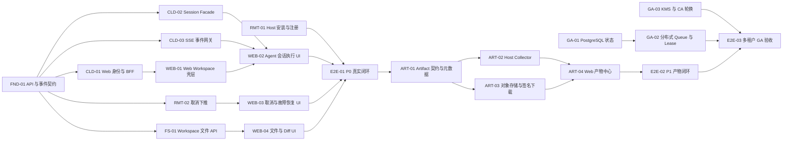

# Remote Agent 产品交付任务拆分

状态：实施中，2026-08-08。

本文把 [Web 到远端 Agent 的完整系统架构](./remote-agent-system-architecture.md) 拆成可以独立开发、独立评审和独立验收的任务。任务基于当前代码能力划分，不重复实现已经存在的 VM、Computer、Task journal、Node lease、Resident Agent 和 Guest 工具执行链。

## 1. 交付目标

第一阶段交付以下用户闭环：

```text
用户登录 Web
  → 选择 Computer 和 Session
  → 提交 Agent 目标
  → Remote Host 的 VM 内执行
  → 实时查看事件并可断线恢复
  → 取消或继续任务
  → 查看 Diff、文件和可下载产物
```

完成定义不是“页面能请求接口”，而是浏览器、云端控制面、Remote Host、Guest VM 和结果返回整条链路通过真实验收。

### 1.1 当前实施快照

- P0 的 API/事件契约、Web BFF、Session/Task、SSE 恢复、取消下推、Workspace 文件 API、Web UI 和可观测性基线已经落地。
- macOS Apple Silicon 已用当前源码重建并签名 Guest 镜像，真实跑通 Chrome → BFF → Control → Node → daemon → VZ Guest → 内置 Zap Agent → Web 的完整闭环。
- 同一场景已覆盖断网后 cursor 恢复、刷新重放、Session 继续、文件列表/读取/Git diff/下载、Guest 进程树取消、跨租户 404 和五层 correlation。
- 缺失 `.zapcode` 不再阻止 Resident Agent 启动：Guest 为缺失的受保护叶子建立请求期只读占位，任务结束后严格校验并清理；已有 `.git` 继续保持只读。
- P1 Artifact 软件链已落地：Host capability stream、Node mTLS content upload、private S3-compatible multipart、五分钟签名下载、Web Artifact Center、字节配额和 retention GC 已通过组件级测试；真实 VM/S3 黑盒验收仍归 E2E-02。
- Linux `/dev/kvm` 与 Windows Hyper-V/HCS 复用同一产品协议，但对应物理 Host 的本轮 Web E2E 仍是发布门禁，不能由 macOS 结果替代。

当前可签收范围是“单 active Control + 多 Remote Host”的 macOS Beta 软件闭环；P1 产物中心和 P2 多副本 GA 基建仍按下文继续实施。

## 2. 工作流与依赖



可以并行启动的首批任务：`FND-01`、`RMT-01`、`OPS-01`。完成 `FND-01` 后，Cloud、Web、Remote 和 Workspace 四条开发线可以并行。

## 3. 任务规格约定

每个任务必须满足：

- 只解决一个可描述的产品能力，不把无关重构混入同一 PR。
- API 或状态变化先更新契约和兼容性测试。
- 默认拒绝越权、路径逃逸、密钥泄漏和未授权网络。
- 测试至少覆盖成功、拒绝、重试/断连和清理路径。
- PR 描述包含真实验证证据；仅编译通过不能替代真实 Host/VM 验收。

规模用于控制 PR 大小，不是交付时间承诺：

- `S`：单一模块和聚焦测试。
- `M`：跨两个模块或包含一个新接口。
- `L`：完整纵向切片，应拆成多个顺序 PR。

## 4. P0：用户可用闭环

### FND-01：冻结 Web Agent API 与事件契约

- **规模**：M
- **依赖**：无
- **代码范围**：`internal/cloudplane`、API 文档、契约测试
- **产物**：Agent Session、Task、Event、Error 的版本化 JSON Schema 或 OpenAPI；cursor、幂等键、终态、错误码和 redaction 规则。
- **验收**：现有 `POST/GET/DELETE /v1/agent/sessions` 和 events 接口全部进入契约测试；未知字段、超限输入和敏感字段回显被拒绝或脱敏；兼容性策略写入文档。

### FND-02：建立端到端开发测试环境

- **规模**：M
- **依赖**：FND-01
- **代码范围**：开发编排、测试 fixture、smoke 脚本
- **产物**：一条命令启动 Control、模拟或本地 Node、daemon、测试 Client；固定测试身份和可重放 fixture。
- **验收**：CI 无硬件模式验证 API/事件协议；真实 Mac 模式验证 VM Resident Agent；测试结束无遗留 Task、进程、socket 和临时凭据。

### CLD-01：Web 身份认证与 BFF 边界

- **规模**：M
- **依赖**：FND-01
- **代码范围**：Web Server/BFF、Control Plane client
- **产物**：浏览器登录态到 `tenant/project/user` 的服务端映射；BFF 到 Control 的受控 mTLS 身份；CSRF、CORS、限流和审计入口。
- **验收**：浏览器不能自行指定 tenant/project；跨租户 ID 返回统一不可枚举错误；Control mTLS 私钥不进入浏览器或前端日志。

### CLD-02：Computer、Session 和 Task Facade

- **规模**：L，建议拆成列表/创建和详情/继续两个 PR
- **依赖**：FND-01、CLD-01
- **代码范围**：Web Server/BFF、Control Plane 查询接口
- **产物**：Computer 列表与状态、Session 列表与详情、创建 turn、继续 Session、查询 Task 的 Web API。
- **验收**：同一幂等键重复提交只产生一个 Task；`continue=true` 只能绑定同一 Computer/Session；所有列表按 tenant/project 过滤并分页。

### CLD-03：SSE/WebSocket 事件网关

- **规模**：M
- **依赖**：FND-01、CLD-01
- **代码范围**：Web Server/BFF、Event Journal adapter
- **产物**：优先 SSE 的事件流接口、cursor replay、心跳、背压、连接数限制和终态关闭策略。
- **验收**：断线后以最后 cursor 无丢失、无重复展示恢复；慢 Client 不拖住 Control；关闭页面不取消 Task；终态后仍可查询完整事件。

### CLD-04：Web 错误模型与重试策略

- **规模**：S
- **依赖**：FND-01、CLD-02、CLD-03
- **代码范围**：BFF adapter、共享 Client types
- **产物**：可重试、需用户操作、权限拒绝、资源不足和基础设施故障的稳定错误分类。
- **验收**：UI 不依赖服务端原始错误字符串；同一 Task 不因 Client 自动重试被重复执行；日志保留 correlation ID 但不泄漏内部路径。

### RMT-01：Remote Host 安装、注册与升级

- **规模**：L，按 macOS/Linux/Windows 分平台 PR
- **依赖**：无
- **代码范围**：`packaging`、`scripts`、`zapvm-node`、daemon service
- **产物**：安装包、首次注册、owner-only 配置、服务自启、doctor、升级和卸载流程。
- **验收**：干净 Host 安装后能自动出站连接 Control；daemon IPC 不监听公网；失败升级可回滚；平台差异分别在真实 Host 验收。

### RMT-02：云端取消下推到 Guest 进程树

- **规模**：M
- **依赖**：FND-01
- **代码范围**：`internal/cloudplane`、`internal/cloudnode`、daemon Task、Guest Agent
- **产物**：Control cancel intent、Node 获取/确认取消、daemon cancel、Guest 进程树终止和最终事件。
- **验收**：运行中 Task 取消后完整 Guest 进程树终止；Node 断连后重连仍收到取消；清理失败则 VM degraded 且不回池；重复取消幂等。

### RMT-03：Node drain、容量和可运营状态

- **规模**：M
- **依赖**：RMT-01
- **代码范围**：Node registry、admin API、运行手册
- **产物**：drain/undrain、capacity、last heartbeat、版本、镜像摘要和故障原因状态。
- **验收**：draining Node 不接新 Task，已有 Task 可完成或按策略终止；过期 generation 被 fence；管理接口只允许管理员身份。

### FS-01：Workspace 安全文件 API

- **规模**：L，建议拆成只读浏览和变更/下载两个 PR
- **依赖**：FND-01、CLD-01
- **代码范围**：Remote Host 文件服务、BFF adapter
- **产物**：目录列表、文本读取、元数据、Git diff、受控单文件下载；统一路径和大小限制。
- **验收**：所有路径以 Computer workspace 实路径为根；拒绝绝对路径、`..`、symlink 逃逸、设备文件和超限内容；`.git`、`.zapcode` 内容不通过通用文件 API 暴露。

### WEB-01：Web Agent Workspace 壳层

- **规模**：M
- **依赖**：CLD-01、CLD-02
- **代码范围**：Web Client
- **产物**：登录态、Project/Computer 选择器、Session 列表、路由、空态和连接状态。
- **验收**：刷新页面恢复当前 Project/Computer/Session；无权限和无在线 Node 有明确状态；前端不持久化模型密钥。

### WEB-02：Agent 会话执行与实时事件 UI

- **规模**：L，建议拆成提交/流式消息和工具事件/终态两个 PR
- **依赖**：WEB-01、CLD-02、CLD-03、CLD-04
- **代码范围**：Web Client
- **产物**：prompt 提交、thinking/tool/stdout/stderr 渲染、Task 状态、cursor 保存、终态答复和继续会话。
- **验收**：刷新或网络切换后事件顺序一致；大输出虚拟化且不冻结页面；重复事件按 cursor 去重；Session 继续使用原 Computer。

### WEB-03：取消、重试和基础设施故障恢复 UI

- **规模**：M
- **依赖**：WEB-02、RMT-02、CLD-04
- **代码范围**：Web Client、BFF
- **产物**：取消确认、取消中状态、基于 `retry_of` 的显式重试、Node/VM degraded 诊断和恢复入口。
- **验收**：重试创建新 Task 且保留原执行记录；用户能区分代码失败与基础设施失败；按钮重复点击不会产生多次副作用。

### WEB-04：Workspace 文件、Diff 和下载 UI

- **规模**：M
- **依赖**：WEB-01、FS-01
- **代码范围**：Web Client
- **产物**：文件树、文本预览、Git diff、变更摘要和受控下载。
- **验收**：二进制和超大文件不直接渲染；路径、tenant 和 Computer 切换不会展示旧响应；下载使用短期授权且记录审计事件。

### OPS-01：P0 可观测性基线

- **规模**：M
- **依赖**：无
- **代码范围**：Control、Node、daemon、BFF、Dashboard
- **产物**：统一 correlation ID；Task latency、queue、Node heartbeat、VM boot、event lag、cancel latency 指标；关键告警和排障手册。
- **验收**：一次 Web Task 能跨五层关联查询；日志不含 prompt、credential value 或 Host 敏感路径；Node offline 和 Task 卡死能告警。

### E2E-01：P0 真实用户闭环验收

- **规模**：L
- **依赖**：FND-02、WEB-02、WEB-03、WEB-04、RMT-01、RMT-02、OPS-01
- **代码范围**：黑盒测试、验收记录
- **产物**：浏览器到真实 Mac VM 的自动化场景；Linux/Windows 对应 Host 复用同一测试规范。
- **验收**：创建、流式输出、刷新恢复、继续、取消、文件查看、Diff 和下载全部通过；网络/Node/daemon/Guest 故障有确定终态；跨租户访问测试失败关闭。

P0 完成后，产品已经可以作为“单 active Control + 多 Remote Host”的 Beta 交付。

## 5. P1：完整产物与运营闭环

### ART-01：Artifact 领域契约和元数据

- **状态**：已完成（2026-08-08；组件级，P1 真机闭环归 E2E-02）
- **规模**：M
- **依赖**：E2E-01
- **产物**：Artifact ID、tenant/project/computer/session/task 归属、路径、MIME、大小、SHA-256、状态、retention 和审计 API。
- **验收**：metadata 不接受 Client 伪造归属；同一 Task 的重复登记幂等；未完成上传不会显示为可交付。
- **实现证据**：state schema 7 持久化 Artifact；Node 仅凭当前 Task lease 登记，归属由 Control 推导；公开 API 仅支持租户内 list/inspect；`pending` 不具备下载能力；跨租户、冲突、重启恢复、retention 过期和审计均有自动化测试。

### ART-02：Host Artifact Collector

- **状态**：已完成（2026-08-08；组件级，P1 真机闭环归 E2E-02）
- **规模**：M
- **依赖**：ART-01
- **产物**：声明式 output 目录、Host 侧路径复核、类型/大小/hash 校验、短期上传 capability 和清理。
- **验收**：拒绝 workspace 外路径、symlink、设备文件和超限产物；Guest 不获得对象存储长期密钥；失败上传不改变 Task 成功语义或被明确标记 partial。
- **实现证据**：Resident wrapper 注入每 Task 固定输出目录；daemon 仅对匹配的本地 succeeded Task 采集；平台 pinned-open 快照拒绝 symlink/reparse、FIFO/设备、受保护路径、超限和读取中变化；Host spool 使用 256-bit 短期 capability 和自动 GC；Node 只登记 metadata，capability 不发送到 Control；采集失败追加 `artifact.collect_failed` 而不篡改执行成功语义。

### ART-03：对象存储与签名下载

- **状态**：已完成（2026-08-08；组件级，真实 provider/VM 闭环归 E2E-02）
- **规模**：M
- **依赖**：ART-01
- **产物**：S3 兼容存储 adapter、multipart upload、短期 signed URL、tenant ACL、retention 和删除。
- **验收**：URL 过期后不可用；跨租户对象 ID 不可枚举；hash 与 metadata 一致；删除和保留策略产生审计记录。
- **实现证据**：Node 从 owner-only daemon IPC 逐块兑换 capability，并用 Task lease/generation 经 mTLS 上传内容；Control 以 metadata 的 size/MIME/SHA-256 校验请求，使用 private S3-compatible multipart adapter 持久化后才转换为 `available`；下载 API 只为 authorized available Artifact 返回五分钟 HTTPS signed URL；deterministic internal object key 让 lease 竞态产生的潜在 orphan 仍进入 retention GC；过期立即禁用下载，删除完成写入 hash-chained `artifact_delete` audit。S3-compatible TLS fixture、跨租户、重试、hash、过期和删除均有自动化测试。

### ART-04：Web 产物中心

- **状态**：已完成（2026-08-08；组件级，浏览器真实下载归 E2E-02）
- **规模**：M
- **依赖**：ART-02、ART-03
- **产物**：Task 产物列表、类型预览、校验值、下载状态、过期提示和重新生成入口。
- **验收**：只展示 authorized metadata；下载失败可重试但不重复生成；过期/删除对象不会残留可点击死链接。
- **实现证据**：Web Workspace 按当前 turn 读取 tenant-scoped Artifact 列表，展示名称、MIME、大小、SHA-256 前缀、状态和过期时间；只有 `available` 启用下载，前端即时申请 signed URL 且不持久化；`pending`、`failed`、`expired` 保持不可点击，下载失败只重试授权请求，不重建 Task 或 Artifact。

### GIT-01：Git Provider Integration

- **状态**：已完成（2026-08-08；组件级，真实 GitHub App/VM 黑盒归 E2E-02）
- **规模**：L，按授权、branch/commit、PR 三个 PR 拆分
- **依赖**：E2E-01
- **产物**：GitHub App 或等价短期授权；受控 branch、commit、push、PR 和状态回传。
- **验收**：默认不直接写保护分支；每次外部写操作需要明确授权和审计；token 不进入 Guest 通用 Bash 环境；重试不重复创建 PR。
- **实现证据**：Control 可从 owner-only RSA PEM 为固定 GitHub App installation 签发 JWT，并申请单仓库、最小 write 权限的短期 installation token；redirect 被拒绝，响应和 token 有界且不假定固定长度。mTLS Client 只能查看本 tenant/project 的非秘密仓库描述，并为同 scope/Computer 的 succeeded Agent Task 创建显式 Git operation。Control 生成 `zapvm/<operation_id>`；Node 仅凭当前 lease 转交短期 capability 到 owner-only daemon。Host writer 拒绝危险 Git config/metadata、预暂存内容、非远端 base HEAD 和保护路径，固定禁用 hooks/helper/redirect/protocol，提交 operation trailer 后只 push 非保护分支；同 branch/commit 重试幂等，冲突不 force push。Host push 后由 Control 使用新短期 token 创建或严格复用匹配 head/base/commit 的 GitHub PR，422 竞态会重新查询，retryable provider 故障保留 lease，永久冲突形成稳定失败码。Node 无权提交 PR 元数据；Web 以确定性 operation ID 提交，并只展示 Control 校验后的 PR 链接。全链路 token 不持久化、不回 Browser/Guest，操作写入 Task-bound hash-chain audit。

### OPS-02：Retention、配额和成本保护

- **状态**：Beta 软件门槛已完成（2026-08-08；模型/第三方 API 计量归 GA-04）
- **规模**：M
- **依赖**：ART-01、OPS-01
- **产物**：Task/event/artifact 保留策略、Computer 磁盘配额、并发和时长上限、异常成本熔断。
- **验收**：GC 只处理终态对象；活跃 Task 和可恢复 Session 不被误删；达到配额时返回稳定错误且不产生孤儿资源。
- **当前证据**：daemon 已有 terminal-only Task journal retention、Node/VM 已有并发与运行时上限；本阶段新增单文件 5 GiB、默认单 Task 20 GiB、单 scope 100 GiB 的 Artifact 限额、稳定 `quota_exceeded`、1 小时至 30 天 retention 和只处理 `expired` object key 的 GC。Control 新增 0/1 小时至 365 天可配置 Task retention，按完整 Session/retry 组回收 Task/Event，Artifact 引用和任一活跃/尚未到期 turn 都会阻止 GC；Event journal 具备单 Task 与 Control 总量 admission 熔断。模型 token/第三方 API 成本计量仍归 GA-04，因此 OPS-02 的 Beta 软件门槛已完成，GA 计费门槛保持未完成。

### E2E-02：P1 产物闭环验收

- **规模**：M
- **依赖**：ART-04、GIT-01、OPS-02
- **产物**：源码变更、构建包、测试报告、Git PR 四类场景的自动化验收。
- **验收**：所有产物可追溯到 Task 和 hash；下载、删除、过期、跨租户拒绝和 Git 幂等均通过。

## 6. P2：多租户 GA 基建

### GA-01：PostgreSQL 一致性状态

- **状态**：已完成（2026-08-08；单 active PostgreSQL primary，细粒度多副本调度归 GA-02）
- **规模**：L，按 schema、双写迁移、切换三个 PR 拆分
- **依赖**：E2E-01
- **产物**：Node、Task、Lease、Event、Session、Artifact、Audit 外部状态；迁移和回滚工具。
- **验收**：迁移期间无 Task 丢失；事务和唯一约束维持幂等/fencing；备份恢复演练通过后才移除单文件主存储。
- **GA-01a 证据**：PostgreSQL 16 初始 schema 覆盖 Node/Scope/Computer/Session/Task/Event/Workspace/Artifact/Audit；数据库 CHECK/unique/FK/强制 RLS 固化 lease、idempotency、cursor 和 tenant 边界。内嵌 migration 带 checksum、advisory lock 与 Serializable transaction；Railway image 包含只从 Secret 环境变量读取 DSN 的显式 migration CLI。真实 PostgreSQL 16 容器已通过重复 migration、约束负测、RLS 隔离和 checksum 验收。
- **GA-01b-1 证据**：migration v2 以 `computer_nodes` 表达 Computer 多 Node 调度；离线 CLI 在 Control 独占锁下从当前 `state.json + Node provisions` 生成私密规范快照，单事务导入完整投影。源摘要、全数据库摘要与逐表行数持久化；真实 PostgreSQL 16 已通过首次/幂等导入、verify、手工篡改拒绝、显式 repair、未跟踪数据保护和 Store 锁冲突门禁。
- **GA-01b-2 证据**：在线 Control 先原子持久化 `state.json`，再异步合并并镜像最新规范快照；启动同步 reconcile，实际写失败使 readiness fail closed，30 秒 lag/失败进入管理员告警，恢复后自动追平，关闭时仍持 Store lock 强制 flush。DSN 只从 owner-only 文件读取，Control 不隐式迁移。真实 PostgreSQL 16 已验证启动 reconcile、多次在线状态变更、关闭 flush 和最终全表摘要一致；组件测试覆盖写失败、重试恢复、最新 generation 合并、超时退出、DSN 权限和错误脱敏。
- **GA-01c 证据**：migration v3 在同一 Serializable transaction 持久化规范化投影、摘要和完整可恢复 primary snapshot；Control 启动优先校验/读取 PostgreSQL，配置 provision 漂移先同步归一化，状态变更先提交数据库再更新单文件回滚缓存。真实 PostgreSQL 16 已验证首次 cutover、同步多次提交、数据库摘要一致、本地文件损坏恢复和移除 primary 后单文件回滚；组件测试覆盖主提交失败不污染缓存、Store degraded、DSN owner-only/脱敏和 mirror/primary 互斥。单 active 约束仍保留。

### GA-02：分布式 Queue、Lease 和多副本 Control

- **状态**：实施中；GA-02a SQL Queue/Lease/Fencing 原语已完成，Control 多副本运行时接线与故障注入仍未完成
- **规模**：L
- **依赖**：GA-01
- **产物**：多 active Control、可靠队列、lease fencing、outbox/inbox 和 leader-free 调度路径。
- **验收**：任意 Control 实例终止不丢 Task；同一 lease 不产生两个有效 completion；滚动升级不中断事件恢复。
- **GA-02a 证据**：migration v4 增加原始 Task payload、transition receipt 与可抢占 outbox；SQL claim 使用 `FOR UPDATE SKIP LOCKED`，按 Node scope/Computer/capacity 调度，并只持久化随机 lease token 的 SHA-256。ack、Event、completion、取消、续租和过期重领均以 attempt、Node generation、lease hash 与 expiry fencing；真实 PostgreSQL 16 已通过 8 路并发单次 claim、重复 ack/Event/completion/cancel、失败 completion、原子续租、过期重领、旧 token 拒绝和 outbox 单消费者验收。该阶段只交付数据库原语，尚未允许 Railway 扩为多 active Control。
- **GA-02b 拆分**：b1 已把 HTTP API 从具体单文件 Store 解耦为完整 Backend 契约；b2 已实现 PostgreSQL Node/Task/Session/Event/Audit 核心权威，包括 generation fence、并发 Session admission 和全局 audit hash chain；b3 仍需迁移 Artifact/Workspace/Git 状态并接通跨副本 Event 通知；b4 仍需切换 Control 启动配置并移除单 active 文件锁依赖。任一子项未完成都不能扩容。

### GA-03：KMS Credential Broker 与 CA 自动轮换

- **状态**：实施中；GA-03a1 provider-neutral envelope cryptography、GA-03a2 PostgreSQL ledger 与 GA-03b 一次性运行时 broker 已完成，生产 KMS 与 Node CA 轮换仍待完成
- **规模**：L
- **依赖**：GA-01
- **产物**：短期 credential capability、KMS envelope、Node 证书签发/轮换/吊销、密钥访问审计。
- **验收**：Control 数据库不存 credential value 明文；被吊销 Node 不能 claim；轮换不中断运行中 Task；Bash、日志和 Artifact 全链路泄漏测试通过。
- **GA-03a 证据**：每个 Credential version 使用独立随机 256-bit DEK 与 96-bit nonce，通过 AES-256-GCM 和 tenant/project/Credential/version AAD 绑定；KMS wrapper 只处理 DEK，provider 错误稳定脱敏。migration v7 只持久化 envelope 与 capability secret SHA-256，TTL 上限 15 分钟并绑定 Task、Node generation 和具体 Credential version；四张表强制 RLS，访问审计独立 hash chain。真实 PostgreSQL 16 已通过重复 migration、唯一 active version、TTL/state 负测和 plaintext absence 验收。
- **GA-03b 证据**：distributed claim 在同一事务内把 capability 绑定到当前 Task lease、Node generation 和固定 Credential versions；Node ack 后通过 mTLS 一次兑换，再只经 owner-only daemon IPC 传递精确 ID/value bundle。daemon worker 以内存请求把值交给 Guest Agent 的 request-only `0400` 文件，完成后覆盖并删除；Capability secret、Credential value 不进入 Task/Event/Artifact/Audit 普通链路。真实 PostgreSQL 16 已通过轮换不中断已签发 Task、并发双兑仅一次成功、重放、过期、错 Task/lease/generation、终态吊销、generation fence、audit 链与持久列明文缺失验收；开发 static wrapper 明确不等于生产 KMS。

### GA-04：租户配额、计量和计费事件

- **规模**：M
- **依赖**：GA-01、OPS-02
- **产物**：CPU、内存、执行时长、模型 token、存储和下载计量；预算、限流和账单事件。
- **验收**：计量可按 tenant/project/task 对账；重复事件幂等；预算耗尽停止新 admission 但不破坏运行中 Task 的清理。

### GA-05：多区域、备份与灾难恢复

- **规模**：L
- **依赖**：GA-02、GA-03
- **产物**：区域路由、Node region affinity、数据库/对象存储备份、恢复工具、RPO/RTO 和演练手册。
- **验收**：区域故障不会产生跨区域双执行；按声明的 RPO/RTO 恢复 Task/Event/Artifact；恢复后 tenant ACL 和审计链仍有效。

### E2E-03：GA 安全、负载和长稳验收

- **规模**：L
- **依赖**：GA-02、GA-03、GA-04、GA-05、E2E-02
- **产物**：多租户攻击测试、并发压测、故障注入、72 小时长稳、恢复演练和发布报告。
- **验收**：没有跨租户读取、重复有效执行、密钥泄漏、失控进程、挂载泄漏或不可恢复状态；SLO 和容量边界形成可运营基线。

## 7. 建议 PR 顺序

第一批可以立即并行：

1. `FND-01`：API 与事件契约。
2. `RMT-01a`：macOS Host 安装/注册。
3. `OPS-01a`：correlation ID 与核心指标。

第二批在 FND-01 合入后并行：

1. `CLD-01`、`CLD-02a`、`CLD-03`。
2. `RMT-02`。
3. `FS-01a`。

第三批形成纵向切片：

1. `WEB-01`。
2. `WEB-02a`：创建 Task 并显示文本事件。
3. `WEB-02b`：工具事件、终态和 cursor 恢复。
4. `WEB-03`、`WEB-04`。
5. `E2E-01`。

P1 和 P2 不应阻塞 P0 Beta，但 P0 的 API、身份、Task 和 Artifact 边界必须为后续扩展保留版本和迁移路径。

## 8. 交付看板字段

建议每个 GitHub Issue 使用以下字段：

| 字段 | 值 |
|---|---|
| Milestone | P0 Beta / P1 Artifacts / P2 GA |
| Workstream | Foundation / Cloud / Web / Remote / Workspace / Artifact / Security / Ops / E2E |
| Priority | P0 / P1 / P2 |
| Size | S / M / L |
| Platform | All / macOS / Linux / Windows / Web |
| Blocked by | 上述 Task ID |
| Evidence | Test、CI run、真实 Host、截图、日志或验收报告链接 |

Issue 关闭前必须把实现 PR、验证命令和真实环境证据回填到 `Evidence`，避免把“代码合入”和“产品交付”视为同一件事。
