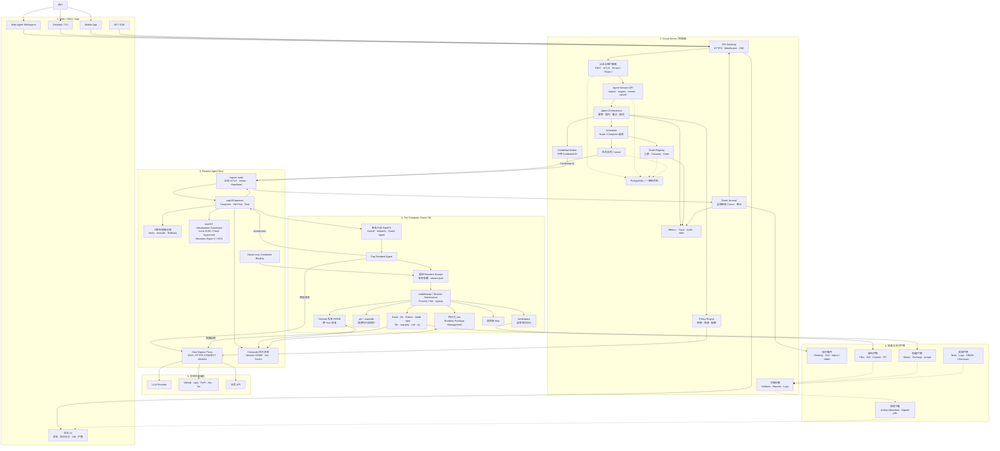
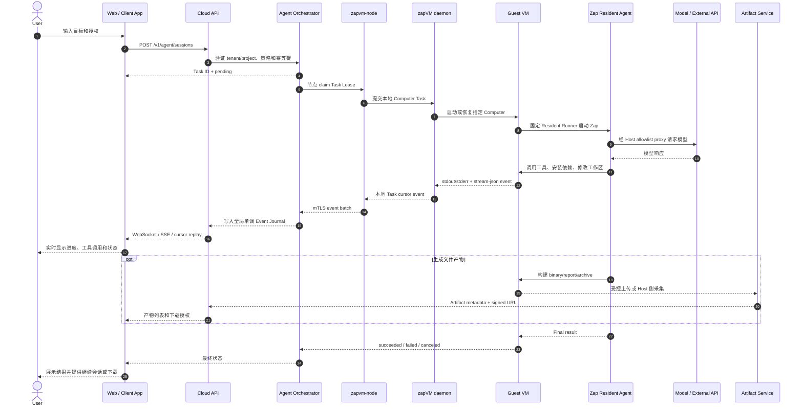
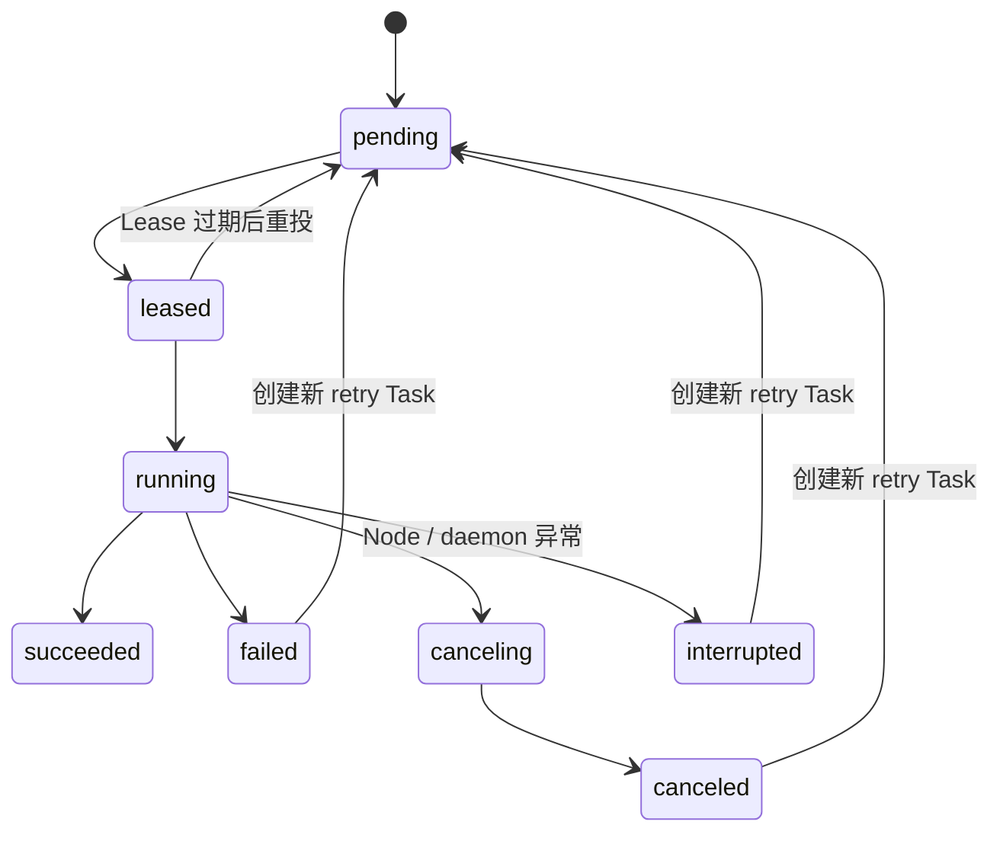
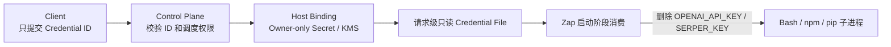
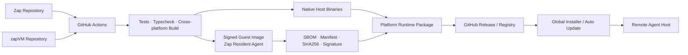

# Web 到远端 Agent 的完整系统架构

状态：Target Architecture，2026-08-07。

本文定义从 Web、Desktop、TUI、Mobile 或 API Client 发起 Agent 任务，经云端控制面调度到远端真实 Host，在隔离 VM 内运行 Zap Resident Agent，再把实时事件和最终产物返回客户端的完整产品架构。

本文同时区分：

- **当前 Beta 已交付**：zapVM、`zapvm-control`、`zapvm-node`、Agent Computer、Resident Agent、签名镜像、mTLS、持久 Task journal、受限网络、Credential ID、Session 恢复和跨平台运行包。
- **产品化目标**：Web Agent Workspace、外部一致性数据库、任务队列、对象存储、产物签名下载、KMS、配额计费、多区域容灾和完整运营可观测性。

## 1. 产品目标

目标调用链为：

```text
Web / Client / App
  → Cloud Server
  → Remote Agent Host
  → Zap Resident Agent in VM
  → Tools / Model / Package Registry
  → Cloud Server
  → Web / Client / App
  → 可下载、可审计、可继续执行的最终产物
```

这一形态不是“Web 远程执行几个 Shell 命令”，而是向用户提供一台长期存在、权限受控、能自行安装工具、能持续完成工作的 Agent Computer。

设计原则：

1. Agent 和不可信工具执行发生在 Guest VM 内，不发生在 Web Server 或 Host 控制进程内。
2. Remote Host 只负责 VM 生命周期、权限、凭据和网络出口，不解释用户 prompt。
3. 云端控制面不持有 Host 文件系统权限，不直接暴露 daemon socket 或 Guest RPC。
4. Client 断开不影响任务；输出以单调 cursor journal 恢复。
5. 同一 Computer 可以跨 turn、VM 重启和 Host 重启保留 Session、工具链与缓存。
6. 模型密钥和搜索密钥不能进入 prompt、argv、Task 查询响应或 Agent 创建的 Bash 子进程。
7. 最终产物与实时输出分离：事件适合流式展示，文件产物适合对象存储和签名下载。

## 2. 总体架构

图中实线表示当前 Beta 主链路；虚线表示达到完整产品交付还需补齐的服务。



## 3. 端到端任务时序



## 4. 组件职责

| 组件 | 运行位置 | 核心职责 | 不允许承担的职责 |
|---|---|---|---|
| Web / Client App | 用户设备或浏览器 | 会话 UI、事件恢复、授权、产物展示 | 直接连接 daemon 或 Guest RPC |
| API Gateway | 云端 | HTTPS、WebSocket/SSE、限流、认证入口 | 执行 Agent 工具 |
| Agent Orchestrator | 云端 | 幂等 Task、调度、超时、取消、策略组合 | 持有 Host 路径或直接运行 prompt |
| `zapvm-control` | 云端单 active Beta | Node registry、lease、跨节点事件、审计 | 访问本地 daemon socket |
| `zapvm-node` | 远端真实 Host | 出站 mTLS、claim、ack、事件上传 | 自行扩大 tenant/project scope |
| zapVM daemon | Remote Host 用户域 | Computer、VM Pool、Task journal、Credential binding | 对公网暴露 IPC |

Node heartbeat 同时携带 Node/daemon 版本、签名镜像摘要和经过枚举约束的 daemon 健康码。该 telemetry 只进入管理员目录；`paused`、`degraded`、`unreachable` 节点不参与新 Task admission，租户目录将其 Computer 聚合为 `offline`。Control 仍以 generation 和 lease token fence 旧进程，不能用健康上报替代执行权限校验。
| Host egress proxy | Remote Host | 域名、端口、DNS 和目标 IP 策略 | 允许 Guest 绕过代理直连网络 |
| Guest Agent | VM root 控制域 | 认证 RPC、Session、namespace、进程树清理 | 把控制 socket 暴露给 workload |
| Zap Resident Agent | VM workload 域 | 规划、模型调用、工具调用、结果输出 | 获得 VMM 或 Host 泛化权限 |
| Artifact Service | 云端目标组件 | 产物元数据、对象存储、签名下载、保留策略 | 把长期对象凭据交给 Guest |

当前 P0 的浏览器入口由 `zapvm-web` 实现：登录 access token 只用于换取 HttpOnly 签名会话，Project 与 mTLS Client 证书由 owner-only provision 固定绑定。BFF 只开放 `/api/agent/*` 到 Control `/v1/agent/*` 的窄代理，并剥离 Cookie、Authorization、CSRF、tenant/project 和代理身份 header。详细配置见 [Web BFF 身份与安全边界](./web-bff.md)。

## 5. 身份与隔离模型

### 5.1 身份层级

```text
Tenant
└── Project
    └── Computer
        └── Session
            └── Turn / Task
                └── Command / Tool Call
```

- `Tenant / Project`：由经过 CA 验证的 SPIFFE client URI 得出，不能取自请求正文。
- `Computer`：持久项目执行环境，固定 workspace、网络策略、资源和状态盘。
- `Session`：私有 HOME 和 Zap 会话边界；同一 Session 可以跨 turn 恢复。
- `Task`：幂等、可附加、可取消的一次执行；Task ID 与请求 digest 联合防止冲突。
- `Command`：Guest 内具体工具进程，必须属于一个 Task 和 Session。

### 5.2 VM 隔离

- 默认一个工作区或信任域对应一个可复用 VM。
- 不同 Host 授权集合、Credential scope、网络策略或镜像摘要不得共享 worker。
- rootfs 为签名只读镜像；状态盘、工作区和请求临时目录分离。
- `/workspace` 默认 `rw,exec,nosuid,nodev`，允许编译、venv 和项目脚本执行。
- `.git`、`.zapcode` 在请求私有 mount namespace 内再次只读绑定。
- `/nix` 为 Computer 级持久、rootless、可执行包存储。
- Session HOME 可持久；TMP 和 credential lease 必须请求结束即清理。

## 6. Agent Session API

Web 后端使用稳定的 Computer ID 和 Session ID 提交一次 turn：

```json
{
  "id": "turn-01",
  "computer_id": "computer-a",
  "session_id": "web-session-a",
  "prompt": "inspect the project and run its tests",
  "provider_base_url": "https://api.example.com/v1",
  "model": "model-name",
  "model_credential_id": "model-api-key",
  "search_credential_id": "search-api-key",
  "continue": false,
  "max_turns": 80,
  "timeout_ms": 7200000
}
```

当前接口：

- `POST /v1/agent/sessions`：创建幂等 turn Task。
- `GET /v1/agent/sessions/<id>`：查询 redacted 状态，不回显 prompt 或内部 argv。
- `GET /v1/agent/sessions/<id>/events?after=<cursor>&limit=<n>`：恢复事件。
- `GET /v1/agent/sessions/<id>/stream`：SSE 实时事件流；支持 `Last-Event-ID`/`after` 恢复，单连接有 25 秒和 1000 事件上限。
- `DELETE /v1/agent/sessions/<id>`：请求取消并终止 Guest 进程树。
- `POST /v1/agent/sessions/<id>/retry`：显式创建有 lineage 的新 Task，不要求 Browser 保存或重传原 prompt。
- `POST /v1/agent/computers/<computer_id>/workspace/operations`：创建持久、幂等、只读的 list/read/diff 操作。
- `GET /v1/agent/computers/<computer_id>/workspace/operations/<operation_id>`：读取脱敏状态和有界结果。

文件链路固定为 Browser → BFF → Control durable operation → Node 出站领取 → Host daemon → 该 Computer 的固定 workspace。云端不接收绝对 Host 路径；daemon 对每个路径组件执行 no-follow/reparse 检查，隐藏 `.git/.zapcode`，且仅返回 regular file、目录元数据或有界 Git diff。

后续 turn 复用相同 `computer_id` 和 `session_id`，并设置 `continue=true`。控制面只允许固定 Resident runner、固定工作目录、`stream-json` 和有界超时/轮次，调用方不能借该接口提交任意 Guest argv。

## 7. 事件和状态

### 7.1 公开状态



重试创建新的 Task 和 `retry_of` 关系，不覆盖原 Task。当前跨节点语义是带 fencing 的 at-least-once；执行外部副作用时，应使用 Task ID 作为幂等键。

### 7.2 Event Journal

- 每个事件包含 Task ID、类型、时间和全局单调 cursor。
- Client 使用 `after=<cursor>` 断线恢复，不依赖保持一条永久连接。
- 关闭浏览器或 attach 客户端不会取消 Task。
- 输出、工具参数和结果可能包含敏感业务数据，必须受 tenant/project ACL 和保留策略保护。
- Task 查询响应保持 redacted；内部 payload、Host 路径和 credential value 不返回客户端。

## 8. 凭据安全



- 控制面 Task 只包含 credential ID，不包含 value。
- Host 只从 owner-only binding 或未来 KMS broker 获取实际值。
- Guest runner 只接受受控 credential file，不接受 token value 参数。
- Zap 初始化 provider 后删除敏感环境变量，再允许创建 Bash 子进程。
- credential lease 请求结束前必须覆写或删除；失败时 Agent health 失败并销毁 VM。
- distributed Control 已使用 Task/lease/Node-generation/version 绑定的一次性短期 capability，把 envelope Credential 经 Node mTLS 和 owner-only daemon IPC 送到 Guest 请求级文件；生产 GA 仍需在 GA-03d 把开发 static wrapper 换成托管 KMS/HSM，并完成 CA 轮换与泄露演练。
- KMS envelope、capability、轮换和分阶段交付契约见 [KMS Credential Broker](./kms-credential-broker.md)。

## 9. 网络模型

网络模式为：

| 模式 | 用途 | 行为 |
|---|---|---|
| `off` | 完全离线任务 | Guest 无外网 |
| `restricted` | 默认产品模式 | 只能经 Host proxy 访问 Computer allowlist |
| `unrestricted` | 显式危险授权 | 需要单独审批和审计 |

`restricted` 模式要求：

1. Guest 不具备可绕过代理的三层默认出口。
2. Host 同时校验域名、端口、解析后的全部 IP。
3. 拒绝 loopback、私网、link-local、metadata 和公私混合 DNS。
4. 包管理只获得用户明确配置的 registry 域名。
5. 模型 provider URL 必须是 HTTPS，且域名已进入 Computer allowlist。

## 10. 最终产物模型

Agent 的“最终结果”分成三类：

### 10.1 实时事件

适合 WebSocket/SSE 展示：

- Thinking 和 assistant delta。
- Tool call、stdout、stderr、exit status。
- Task 状态和取消/恢复事件。
- 最终文本答复。

### 10.2 工作区产物

直接保留在 Computer workspace：

- 新增或修改的源码。
- Git diff、测试文件、配置和文档。
- 项目本地依赖环境。

当前 Beta 已通过受控 workspace API、Git Provider 和 Artifact Service 展示产物，浏览器不能直接访问 Host 路径。Git Provider 只允许对同 scope/Computer 的 succeeded Agent Task 创建显式 operation，由 Control 生成 `zapvm/<operation_id>`，在 Host 侧 commit/push，再由 Control 创建或严格复用 PR；短期 installation token 不进入 Browser 或 Guest。

### 10.3 可下载产物

完整产品需要增加 Artifact Service：

- binary、安装包、镜像、压缩包。
- 测试报告、日志归档、SBOM、checksum。
- 大模型生成的文档、图片或数据文件。

推荐上传流程：

1. Guest 生成文件并写入声明的 workspace output 目录。
2. Host collector 在 Task 完成后验证路径、类型、大小和 hash。
3. Collector 使用短期上传 capability 写对象存储。
4. Artifact Service 保存 tenant/project/task 归属和 retention。
5. Client 获取短期 signed URL，不获得对象存储长期凭据。

## 11. 软件供应链与交付单元



最终产品不是一个单独的 VM 文件，而是五个交付单元：

1. **Web / Client Agent Workspace**：用户交互、实时事件、产物展示。
2. **Cloud Control Server**：API、租户、Task、Node 和审计。
3. **Remote Agent Host Runtime**：`zapvm-node`、daemon 和平台 VMM 后端。
4. **Signed Resident Guest Image**：Zap、Guest Agent、工具链和能力契约。
5. **Supply Chain / Operations**：Release、安装、更新、对象存储、监控和灾备。

当前 Zap `v1.12.0` runtime package 已把 Zap Host binary、zapVM Host binary、受信公钥和签名 Guest 镜像组合为同一平台安装包。

## 12. 部署拓扑

### 12.1 当前 Beta

```text
Railway
└── zapvm-control × 1
    └── /data persistent volume

Remote Host A
├── zapvm-node
├── zapVM daemon
├── owner-only credential bindings
└── Computer VM pool

Remote Host B ... N
└── 同上
```

Railway 只承载控制面，不承载 Guest VM。Remote Host 必须具备：

- macOS：Virtualization.framework 与 entitlement。
- Linux：`/dev/kvm`、systemd 254+、cgroup v2。
- Windows：build 20348+、管理员、Hyper-V/HCS/HCN。

### 12.2 多区域 GA 目标

```text
Global DNS / API Gateway
├── Region A Control API
├── Region B Control API
└── Region C Control API
        │
        ├── PostgreSQL / Consistent State
        ├── Queue / Lease Service
        ├── KMS / Credential Broker
        ├── Object Storage
        └── Audit / Metrics / Trace

Remote Hosts 按 Region、Tenant、Capacity 注册
```

多副本控制面上线前，必须把当前单文件原子 state 迁移到外部一致性数据库；同一 `/data` 卷不能同时挂到两个 active 控制面实例。

## 13. 当前能力与产品缺口

| 能力 | 当前状态 | 达到完整产品还需补齐 |
|---|---|---|
| VM 内 Resident Agent | 已交付 | 模型/provider 管理 UI |
| Session 跨 turn 恢复 | 已交付 | Web 会话管理和历史检索 |
| Task cursor 断线恢复 | SSE 已交付 | 多实例 fan-out 和长稳压测 |
| Guest 进程树取消 | 已交付 | 多节点取消延迟 SLO 和压测 |
| Rootless 持久包管理 | 已交付 | 包缓存配额和清理策略 |
| mTLS tenant/project/node | 已交付 | 自动 CA 轮换与吊销 |
| Credential ID 隔离 | 已交付 | KMS、短期 token、轮换 |
| Restricted egress | 已交付 | Tenant 自助 allowlist UI |
| 签名镜像和 runtime package | 已交付 | TUF channel 正式运营和自动更新策略 |
| Web Agent Workspace | UI、BFF、文件和 Diff API 已交付 | 真实多租户浏览器验收 |
| Artifact Service | private S3、签名下载和 Web 产物中心已交付 | 真实 S3 黑盒与故障注入验收 |
| Git Provider | GitHub App、Host branch/commit/push、PR create/reconcile 和 Web UI 已交付 | 真实 GitHub App/VM 黑盒与故障注入验收 |
| 多副本控制面 | PostgreSQL primary 与 Queue/Lease/Fencing 原语已实现 | Control 多副本运行时接线、fan-out、故障注入与滚动升级验收 |
| 配额与计费 | 未实现 | CPU/内存/时长/token/存储计量 |
| 多区域灾备 | 未实现 | 备份、恢复、演练、RPO/RTO |

## 14. 交付验收标准

### 14.1 功能闭环

- Web/Client 能创建 Agent Session，并立即得到 Task ID。
- 关闭并重新打开 Client 后，能从最后 cursor 恢复事件。
- Remote Host 不开放 daemon socket 到公网。
- VM 内 Agent 能安装缺失工具、修改 workspace、运行测试和构建。
- 后续 turn 能恢复同一 Session 的对话上下文。
- 最终文本和文件产物能返回正确 tenant/project 用户。

### 14.2 安全闭环

- 未签名或 hash 不匹配的镜像不能启动。
- `.git`、`.zapcode` 在 Guest 工具进程中不可写。
- 模型密钥不出现在 Task 查询、argv、Bash 环境、日志和产物中。
- `restricted` 网络不能访问私网、metadata 或未授权域名。
- 取消 Task 后 Guest 完整进程树终止；清理失败时 VM 不回池。
- 不同 Tenant、Project、Computer 和 Session 不能读取彼此状态。

### 14.3 可靠性闭环

- Node 重连后旧 generation 被 fence。
- Lease 过期可以安全重投，外部副作用以 Task ID 幂等。
- 控制面、Node 或 Client 重启不产生没有终态的静默 Task。
- Artifact upload 失败不会把 Task 错报为完整交付。
- 数据库、对象存储和 KMS 有经过演练的备份与恢复流程。

## 15. 推荐实施顺序

### P0：形成用户可用闭环

1. Web/BFF 接入 Agent Session API 和 cursor event stream。
2. 增加 Computer、Session、Task 页面和取消/继续入口。
3. 增加 workspace 文件列表、Diff 和受控下载 API。
4. 把 Remote Host 安装、注册和升级流程产品化。

### P1：形成可交付产物闭环

1. Artifact collector、对象存储和 metadata API。
2. signed URL、tenant ACL、大小限制、hash 和 retention。
3. Git provider integration：branch、commit、PR 和状态回传。
4. 统一日志、指标、Trace 和运营告警。

### P2：形成多租户 GA

1. PostgreSQL、Queue、KMS 和多副本控制面。
2. 配额、计费、限流和异常成本保护。
3. 自动 CA/Secret 轮换、节点吊销和供应链更新策略。
4. 多区域容灾、备份恢复演练和长稳验收。

## 16. 相关文档

- [Remote Agent 产品交付任务拆分](./remote-agent-delivery-backlog.md)
- [多租户云端 Agent](./cloud-agent.md)
- [Railway 控制面部署](./railway.md)
- [zapVM 架构决策](./architecture.md)
- [Agent Computer](./agent-computer.md)
- [单 Host 远程网关](./remote-gateway.md)
- [实施与验收计划](./plan.md)
- [当前验收记录](./acceptance.md)
